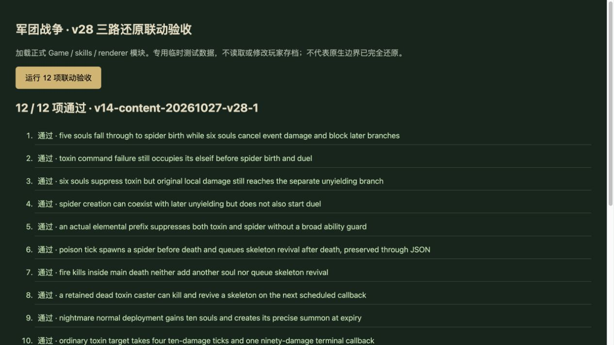

# v28 三路整合验收记录

日期：2026-10-27。内容版本：`v14-content-20261027-v28-1`。三个任务的可证明脚本行为已整合并验收，仍有原生边界，**整体完美还原目标尚未完成**。

## 交付与归档

| 任务 | 独立提交 | 结果 | 聊天状态 |
| --- | --- | --- | --- |
| A 骷髅王复活 | `9772c81daee73e6e84148d51725cfeac4ef52dc2` | [A-result.md](A-result.md) | 已完成并归档 |
| B 噩梦分身/黑暗之魂 | `337de418921dbe25d9110c4d3caad61716799976` | [B-result.md](B-result.md) | 已完成并归档 |
| C 噬魂毒素 | `1f2f3a9e85e6c4dddccd24c31653e47b44b9a3ef` | [C-result.md](C-result.md) | 已完成并归档 |
| 主聊天 孕母蛛群与共享事件链 | `91f3dc3` 起，最终 main 整合 | [蛛群证据](../../reference/broodmother-evidence.json) | 主还原目标继续 |

A/B/C 对应 `codex/skeleton-king-revival`、`codex/nightmare-souls`、`codex/soul-toxin`；独立提交保留在 GitHub 开发分支，主分支包含整合结果。B/C 分别整合为 `930c4c8`、`e1cd31b`。A 先按已验收工作树补丁整合，随后与最终 `9772c81` 比对；规则仅增加毒素事件时间接线，专项仅改为检查合并后的动态覆盖数据，证据和交接文档与独立提交一致。

用户新增规则已落实：单个需求完成并验收后归档对应开发聊天，源码、提交、证据和交接记录保留。下一批不复用这些已归档上下文。

## 共享接线

- 真实元素前缀命中后不执行黑暗之魂、毒素、蛛群或决斗；未命中则继续。A0XM 要求当前至少6魂且实际达到致命条件，取消事件金额但不修改供独立不屈使用的局部 P8。
- A0I5 命令失败仍选中其分支；删除两路整合前的临时 A0XM/A0I5 过宽阻挡。DemonStatueBounce 尚待核定，保留有名的具体前置边界。
- A0I1 在伤害前生成，后续免伤/回血不撤销新体；与 A0IA 的死亡后1秒复活分开。主死亡链增长灵魂先于伊瑟拉及火噬/骷髅王；嵌套死亡不能重入同一主回调。
- 三路定时任务以实际到期时间创建单位、事件和后续任务，退出时恢复外层时钟。LI 记录转换历史，避免较晚的帧末状态影响较早到期的复活。
- 合并旧档技能刷新条件、保留 C 的死亡句柄记录和 A 的尸体任务；e008 动态能力合并为完整一条，重新生成覆盖文件。统一更新内容版本及所有入口资源哈希。

## 验收

- Node v24.19.0，`npm test`：**1054 项通过**，含963项 Node测试和91项既有自定义检查。
- 四家专项分别为骷髅王33、黑暗之魂31、噬魂毒素34、孕母蛛群21；另有8项主聊天跨技能联动测试，均纳入全量。
- `npm run test:smoke`：35波各12秒，2784次出生，峰值124实体/16任务，`finiteState=true`、`saveContinuation=true`。这不是35波自然完整通关。
- `npm run build` 及 `node scripts/stamp-assets.mjs --check`：43个模块及样式内容版本一致。
- 本地浏览器临时夹具加载正式 Game/skills/renderer 及完整 import map，点击执行 **12/12** 联动验收；控制台无警告或错误。包括致命免伤互斥、命令失败仍阻挡、独立不屈、毒素击杀/蛛群/复活/JSON、主死亡禁用、死者来源、10魂召唤、130总毒伤及LI时间线。
- 临时夹具已移除；未读取或写入玩家存档。本地验证与生产部署结果分别记录，不将部署成功冒充线上浏览器验收。

## 当前覆盖和边界

玩家640种能力：410 implemented、82 partial、34 marker、114 unresolved。全战斗725种：460 implemented、84 partial、47 marker、134 unresolved。新增动态能力改变总数；与拆分基线相比全战斗待核定137→134，不能把数量下降解释成所有机制已闭合。

未闭合项包括 A0IB 原生命令许可/默认字段、A0XN 光环字段、缺失魔法上限、最大生命原生副作用、A0I5 冷却及主目标 buff 与施法事件先后、移除句柄、碰撞和枚举/命令时序。原始模型、贴图、音效、通行格和其他系统待办继续见[总待办](../RESTORATION_TODO.md)。
