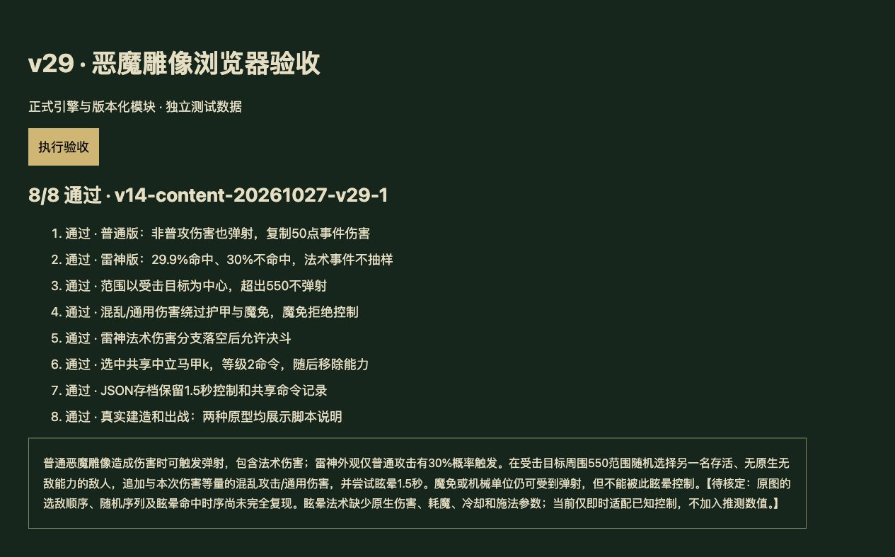

# v29 恶魔雕像验收记录

日期：2026-10-27。内容版本：`v14-content-20261027-v29-1`。该批可证明脚本行为已接入，原生边界仍为 partial；整体完美还原尚未完成。

## 交付

- `dist/demon-statue-rules.js`：n050/n06R 精确分支、受击者550范围随机单目标、局部事件金额的混乱/通用非普攻伤害、同来源忙碌保护、共享中立马甲 k 的等级2命令。
- `dist/skills.js`：前置元素→黑暗之魂→毒素→恶魔雕像→蛛群→决斗顺序；不屈仍为独立判断。移除蛛群和决斗中对两种雕像的一概阻挡。A0RF 不伪造注入战斗体，界面通过 rawcode 脚本绑定展示。
- [原始证据](../../reference/demon-statue-evidence.json)保存 JASS SHA、逐行证据、技能表来源和缺失字段；[Blizzard.j](https://jass.sourceforge.net/doc/api/Blizzard_j-source.shtml)的 GroupPickRandomUnit 使用逐候选 reservoir 抽样。Web 保持抽样调用结构，未声称原生随机流或枚举顺序一致。
- [专项测试](../../tests/v14-demon-statue.test.mjs)纳入 npm test，覆盖概率边界、普攻/法术、忙碌/无候选、范围中心、目标类型、事件金额、原生控制限制、死亡复活、前后分支、JSON与真实建造出战。

## 验收

- Node v24.19.0，`npm test`：1075 项通过（984 Node测试＋91项既有自定义检查），其中本批21项。
- `npm run test:smoke`：35波各12秒、2784次出生、峰值124实体/16任务，finiteState 与 saveContinuation 均 true；不是35波自然完整通关。
- `npm run build` / `node scripts/stamp-assets.mjs --check`：44个模块及样式内容版本一致。
- 本地浏览器加载正式模块与 import map，点击执行8/8通过，控制台无警告或错误。正式首页加载正常。最终文案精简后再次验证专项与浏览器说明，临时夹具移除，不发布测试页。
- 本地验收不冒充线上实测；GitHub与Sites发布结果另存最终发布回执。

## 覆盖与仍缺内容

玩家642种：410实现、84部分、34标记、114待核定。全战斗727种：460实现、86部分、47标记、134待核定。新增2项是此前未计入的建筑说明 A0RF 与动态命令 A0OZ；额外的2条原型脚本绑定单独记录，不算作新增能力。

数据包仅明确 A0OZ 等级2的1.5秒控制、目标条件、范围及buff。缺失伤害、耗魔、冷却、施法等字段，W3A只覆盖等级5持续时间，并未证明从AHtb继承缺失值。没有增加文案中的225伤害。当前即时控制是宿主适配；原生共享中立马甲的连续命令、立即移除能力、弹道、阵营映射与随机/枚举顺序仍需原生运行证据。

本批在主还原聊天内完成，没有新增开发聊天。先前三个独立需求已归档；主聊天继续保存尚未完成的整体目标。后续任务以[总待办](../RESTORATION_TODO.md)为准。
