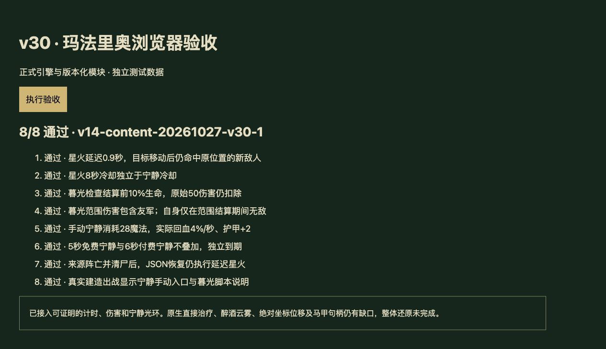

# v30 玛法里奥验收记录

日期：2026-10-27。内容版本：`v14-content-20261027-v30-1`。本批补入来源可证明行为，七项能力均按真实边界标为 partial，未宣称整个英雄或整体目标完全还原。

## 实现与差异

- [规则模块](../../dist/malfurion-rules.js)、[28项专项](../../tests/v14-malfurion.test.mjs)、[逐行来源](../../reference/malfurion-evidence.json)。JASS SHA和行号均由原始字节核对。
- 宁静：手动有效友军目标，28魔法/14秒冷却/600距离。效果发生在自身位置，stop命令停止当前攻击；500范围4%最大生命/秒和2护甲持续6秒，不追加缺失的原生瞬时治疗。
- 星火：条件实际读取A0JA，非A0JB。每8秒由造成敌对正伤害触发一次，0.9秒后在当时保存的位置创建马甲请求stomp。已发计时器不因来源死亡或目标移动取消。300伤害采用原生法术适配，英雄1秒/普通2.5秒控制，不按文案改成神圣伤害。
- 暮光：实际读取A0JA，非A0JE，也不预测致命伤害。在伤害结算前生命≤10%、未使用且前置同链分支未命中时，回血200，再在临时无敌下对400范围枚举单位造成225法术攻击/普通伤害，包含友军；原始事件仍扣血。随后留下5秒免费宁静。
- 同名光环按buff去重，免费/付费独立到期；复用既有回血/护甲计算，修正浮点范围边界。虚拟光环源限制同一宿主战区。
- 主伤害链接在不屈/狂战之后；前一条元素/恶魔雕像链不错误拦截。艾萨拉清理使用实际前置命中结果，移除宽泛A0JA阻挡。默认伤害调用保持原语义，暮光明确传入weapon=true。

## 验收

- Node24.19.0，`npm test`：1103项（1012 Node＋91自定义）全部通过。
- 本批28项包含范围/概率无关条件、分支互斥、双冷却、目标移动、保留死亡句柄、迟到回调、免疫、友军伤害、JSON、暂停、连续波、真实建造与手动入口。
- 本地浏览器独立夹具加载正式模块与完整import map，按钮执行8/8通过，控制台无警告/错误；截图如下。未将临时夹具发布到网站。
- 35波各12秒烟测：2784次出生、峰值124实体/16任务；finiteState与saveContinuation均true。这不是完整自然通关。
- 构建与45个模块/样式哈希一致。生产发布结果另存回执；本地验收不等同在线实测。

## 尚未闭合

- A0JA原生直接治疗数值、Ahea原生命令命中/自动施法AI、AOws耗魔/施法默认值及仲裁仍未验证。
- A0JD保留同一马甲向每个枚举目标的drunkenhaze请求、70耗魔/12秒冷却/3秒等对象字段；未假设连续命令全部成功，也未将DataA=8当作移动减速。沉默/致盲需要进一步统一原生施法实现。
- 原图位移是两次绝对坐标判断，原始y在1890—3742内均复用原位置；Web地形明确不是提取的原版坐标。保留精确程序和未执行请求，不猜测映射。
- E008以有时限虚拟对象承载光环/命令，原生句柄、碰撞、JH/JW计数和移除副作用仍未完全模拟。光环原生驻留及缺失默认字段仍有边界。

覆盖现为玩家647种：410实现、91部分、34标记、112待核定；全战斗732种：460实现、93部分、47标记、132待核定。2项待核定转部分，另补5项漏计的建筑说明/动态能力。总数变动不能冒充完整度百分比。

本批由主上下文完成，未再创建独立聊天；先前三个已完成开发聊天仍归档。当前主聊天保留未完成的整体目标与[后续队列](../RESTORATION_TODO.md)。
