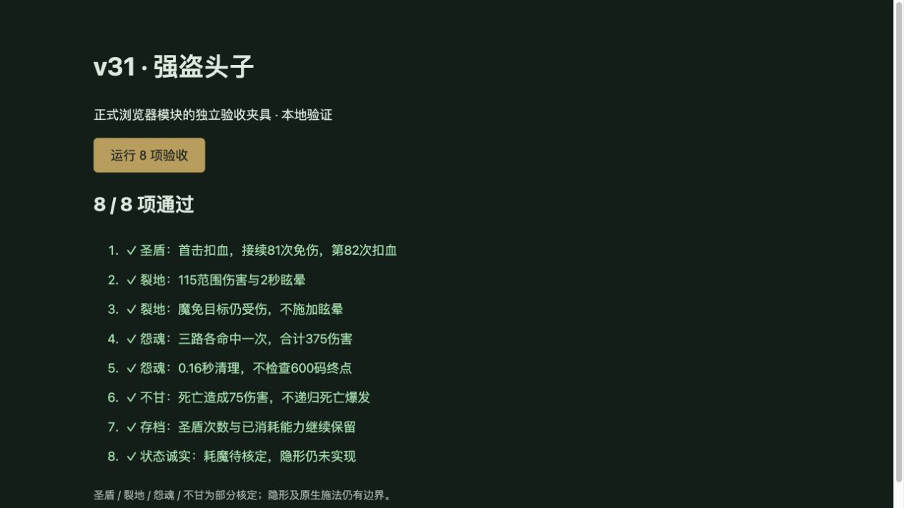

# v31 强盗头子交付与上下文归档

日期：2026-10-27。内容版本：`v14-content-20261027-v31-1`。本批交付来源可证明的四项脚本能力，不宣称强盗整族或整体还原目标已完成。

## 来源与实现

- [规则模块](../../dist/bandit-lord-rules.js)、[31项专项](../../tests/v14-bandit-lord.test.mjs)、[逐行证据](../../reference/bandit-lord-evidence.json)。JASS按原始字节Latin-1解码、仅按LF分行；SHA固定为`e66c55b3b25b185c991be5613e21fbf5b2d598f3cc40f2f8cd01c23bcb828250`。
- 圣盾A18D：主伤害链的独立if移除能力并注册监听，2秒或死亡结束。旧计数0—80共81次事件清零，第82次清理且保留伤害。Web沿用事件开始监听快照，创建监听的首击仍扣血；不添加Avul、不阻止控制或被选中。
- 裂地A18E：自身300范围存活敌人受到115混乱攻击/通用伤害，随后请求A0I7等级2眩晕。普通2秒/英雄1秒，机械与魔免受伤但不眩晕；15秒冷却。
- 怨魂A18G：目标点生成三个弹体，朝向及左右45度各一路，每路独立目标去重组。零计时器与0.04秒循环每次移动120；120/240/360/480四个位置检查200范围，每目标每弹体125伤害，至0.16秒时在600终点前清理。20秒冷却、500选点范围；没有添加来源未执行的持续毒伤/减速。
- 不甘A18H：在噩梦击杀联动之后、后续死亡分支之前，对死者600范围存活敌人造成75伤害。主死亡链执行期间的嵌套死亡不重入，独立死亡清理仍执行。
- [公开Blizzard.j源码](https://jass.sourceforge.net/doc/api/Blizzard_j-source.shtml)的UnitDamageTargetBJ转发attack=true，三类伤害据此进入独立攻击伤害监听。每项自动请求分别优先攻击者，失败不回退受击者；顺序为裂地、怨魂。
- 实际第16波购买与出战测试确认h0SF可达，h0SG仍是预览记录，不为测试擅自开放库存。两原型保留sapper/mechanical差异。

## 原生边界

- A18D/E/G/H均为partial。原生同事件新增监听、同刻计时器顺序、范围枚举及共享事件链其他未实现分支仍待验证。
- 两个ANcl缺少Cost1，h0SF/h0SG具有0.3秒施法前摇。当前采用即时施法适配，保留已知冷却，不扣未核定耗魔；接口及手动按钮显示“耗魔待核定”，不宣称原生零耗魔。
- 即时适配下，受击者裂地反击可触发新的攻击事件；怨魂在主SPELL_EFFECT监听禁用期间进入冷却，脚本被抑制，外层再请求因冷却失败。专项保留这一实际宿主行为，不能据此声称已验证原生连续命令成功率/打断仲裁。
- e008弹体使用有界虚拟任务。原生SetUnitPosition碰撞、可受攻击句柄、区域事件与跨任务计时顺序未完全模拟；明确移除源句柄后停止并记录边界，普通死亡继续执行既有弹体。
- A18F保持unresolved：已找到Apiv字段及初始化注册的HD/HE/HN/HO四矩形入区移除，但原生隐形/探测/攻击显形和原图坐标映射未实现。没有用隐藏实体替代隐形。

## 验收与交付

- Node24.19.0；31项专项覆盖事件81/82边界、2秒到期、攻击者优先失败不回退、嵌套触发抑制、范围/阵营/免疫、死亡和移除差异、JSON、暂停、迟到回调及真实购买出战。
- `npm test`全量1134项（1043 Node＋91自定义）全部通过；46个浏览器模块及样式的构建、资源哈希检查通过。35波各12秒烟测结果随发布回执归档。烟测为2784次出生、峰值124实体/16任务，finiteState与saveContinuation均true；不冒充完整自然通关。
- 本地浏览器夹具加载正式模块与完整import map，8/8通过且无控制台警告/错误；正式首页加载成功。临时夹具和服务在发布前清理。下图是本地检查，未宣称生产界面已实测。

覆盖：玩家647种仍为410实现、91部分、34标记、112待核定；全战斗732种为460实现、97部分、47标记、128待核定。四项待核定转部分，无新增能力数量，不等于整体完成率。

本批由主上下文完成，没有新增独立聊天。已完成的三路开发聊天继续保持归档；本需求的证据、实现、验证和剩余缺口在此独立归档。主聊天保留未完成的整体目标，[后续队列](../RESTORATION_TODO.md)继续有效。
