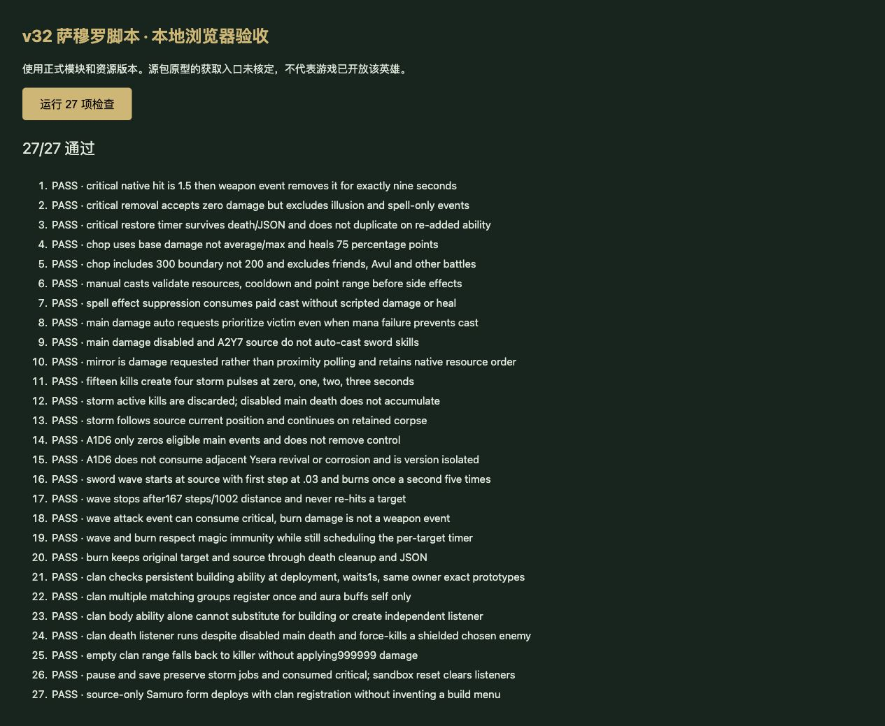

# v32 萨穆罗脚本与入口缺口归档

日期：2026-10-29。内容版本：`v14-content-20261029-v32-1`。本批接入源包可证明的萨穆罗脚本，并确认其获取入口仍缺证据；不宣称已经开放此英雄或完成剑圣整族。

## 来源与实现

- [规则模块](../../dist/blademaster-rules.js)、[29项专项](../../tests/v14-blademaster.test.mjs)、[逐行证据](../../reference/blademaster-evidence.json)。原始JASS按Latin-1和LF分行，SHA-256为`e66c55b3b25b185c991be5613e21fbf5b2d598f3cc40f2f8cd01c23bcb828250`。
- 镜像A1QC：敌对正伤害事件优先请求受击者，否则请求攻击者，失败不回退。消耗10魔法、20秒冷却，2个18秒镜像，75%输出、1倍承伤。移除原来仅靠接近敌人触发的通用适配。
- 无极剑刃A1QD：主死亡链每15次击杀触发，在零计时器及随后1/2/3秒各造成一次200范围137法术攻击/魔法伤害。旋转期间击杀不累计，持续期间授予A1D6，第四次后移除。
- 暴击A1QE：保留物编100%概率、1.5倍原生暴击。独立攻击伤害事件移除非镜像本体能力，9秒后恢复；零伤害的武器事件同样有效，普通法术事件不会消耗。
- 拔剑斩A1QF：22魔法、13秒冷却，自身300范围敌人受到当前主武器基础攻击×5的混乱攻击/通用伤害，随后增加75个百分点生命比例。[JapiNative声明](https://github.com/yefq/JapiNative/blob/master/JapiNative.j)确认ConvertUnitState(18)对应基础攻击；不使用平均或最大攻击替代。
- 火刃剑气A1QG：15魔法、9秒冷却、500选点距离，从施法者向目标方向每0.03秒前进6码，167步至1002码。每步检查200范围，每次施法对每个目标只造成一次225法术攻击/魔法伤害；随后每秒72伤害共5次。初击为武器事件，灼烧不是武器事件。
- 氏族荣耀A1QH：出战建筑携带该能力时，1秒后分别检查同玩家e00H/e00M/n06H，无距离限制。找到目标则双方获得A1QI并各注册一次独立死亡监听。只有能力图标不会自行产生监听。
- 氏族强化A1QI：物编仅对自身增加30%攻击。注册单位死亡后随机选择400范围敌人造成999999混乱/通用伤害，存活则直接KillUnit；范围内无人时直接杀死击杀者。依据[Blizzard.j](https://jass.sourceforge.net/doc/api/Blizzard_j-source.shtml)保留每个候选都取样的随机选择方式。
- A1D6：只将符合主监听条件的敌对正伤害归零，同时阻止邻接伊瑟拉复苏/腐蚀分支。不提供通用控制免疫；自身/友军、A2Y7来源、主触发器禁用时不进入该分支，旧版本不套用。

## 获取入口与原生边界

war3map.j:17436—17437仅确认n07U建筑与h0VQ战斗体映射，3638为限造1。检索包内JASS rawcode及CSV对象、训练、配方、升级边，未找到可证明的创建或获取链。当前UNITS没有这两个原型，也没有补造建造或合成菜单。普通剑圣的三阶段是另一组原型，不用其名称替换萨穆罗入口。

覆盖报告新增`sourceOnlyCombatForms`，单独记录此原型的8项partial能力和`entry-unresolved`状态。玩家仍为647项（410实现、91部分、34标记、112待核定），全战斗仍为732项（460实现、97部分、47标记、128待核定）；不能把源包原型测试计作玩家可达覆盖。

镜像原生被动继承、精确驱散、隐藏阶段和位置重排仍未核定；当前克隆不凭空添加暴击。拔剑斩的动态基础攻击改写、建筑与战斗体共享句柄、建筑死亡、原生施法前摇/连续命令、枚举、碰撞和跨计时器顺序仍有边界。火刃使用虚拟弹体，普通死亡保留任务，明确移除源句柄时停止并记录边界。8项均保留partial。

## 验收与归档

- Node24专项29项，覆盖来源字节、资源/冷却、范围、事件重入、暴击恢复、15杀/4次风暴、火刃和灼烧、独立死亡、旧版本、暂停、JSON恢复和清理。原型部署测试明确断言建造目录中没有萨穆罗。
- `npm test`全量1163项（1072 Node＋91自定义）全部通过，47个模块的构建和资源哈希检查通过。35波各12秒烟测为2784次出生，峰值124实体、16任务，状态有限且可保存继续；不能代替自然通关。
- 本地浏览器加载正式47个模块及完整import map，复跑专项中的27项运行时用例，27/27通过、无控制台警告/错误；另外2项文件证据/覆盖检查仅在Node中执行。浏览器复跑不是27个额外独立需求。正式首页可加载；未宣称生产界面已经实测。临时夹具与服务在发布前清理。

本批由主聊天完成，没有新增独立聊天。单项来源、代码、验收及未解决问题在此归档；此前三个开发聊天保持归档状态。整体目标继续保留，入口缺口移交[后续队列P08](../RESTORATION_TODO.md)，原生边界移交P02/P06，不以文档归档代替功能完成。
