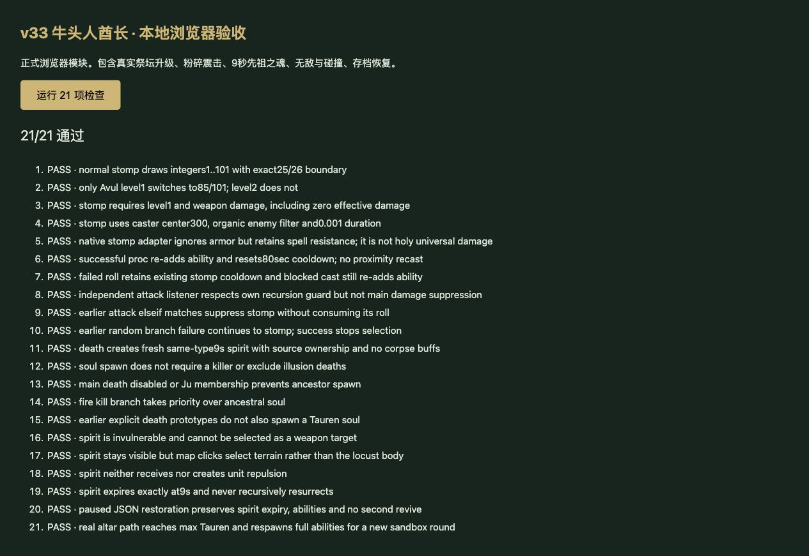

# v33 牛头人酋长机制与上下文归档

日期：2026-10-29。内容版本：`v14-content-20261029-v33-1`。本批补入满级牛头人酋长的粉碎震击、先祖之魂及运行时能力；整体还原目标继续保留。

## 入口及来源

- [规则模块](../../dist/tauren-rules.js)、[22项专项](../../tests/v14-tauren.test.mjs)、[逐行证据](../../reference/tauren-evidence.json)。JASS按Latin-1/LF分行，SHA-256为`e66c55b3b25b185c991be5613e21fbf5b2d598f3cc40f2f8cd01c23bcb828250`。
- 已通过正式建造与升级命令验证h0DB祭坛→h0N3→n03K/L/M/N/O/P/Q/R→n03T→n03S，共11个英雄阶段，最终战斗体h0NE。英雄成长链的推导来源仍遵循既有还原说明，不将Web重建菜单冒充原生完整菜单。
- 独立攻击伤害监听在war3map.j:42804—42808注册；主死亡链在42187—42192注册，包含Ju排除及执行期间的禁用规则。

## 行为变化

- A0N5在武器伤害事件中触发，能力等级必须恰为1；不在攻击启动/抬手时抽签。每次抽整数1—101，正常≤25触发，Avul等级恰为1时≤85触发。零有效伤害的武器事件也会抽签，普通法术事件不会。
- 成功后移除并重新添加A0N7，重置80秒冷却，再发出stomp命令。字段为300范围、100伤害、普通及英雄均0.001秒控制；不采用说明中的25伤害/3秒或0.01秒。前置elseif命中时不会同时触发震击。
- A0N6在主死亡链相应分支创建同类型新单位，而非给尸体回满血。新单位保留归属、位置、朝向和路线编号，使用新原型属性；不复制旧单位的加成、增益、冷却或攻击目标。移除A0N6、添加Avul和Aloc，标记召唤身份，9秒到期后消失。
- 火噬、骷髅王及已定位的前置原型分支保留优先级。主死亡触发器禁用或Ju成员不触发此复活；源代码没有要求击杀者存在，也没有排除镜像死亡，均不自行添加限制。
- 灵魂仍能攻击，不能被武器选作目标；可见但不可点击选择，不参与单位间排斥。退出沙盒战斗再开波后，从建筑重新出战的满级牛头恢复A0N6，不把本波灵魂状态写入建筑。
- `Aloc`并非纯装饰，覆盖改为partial；当前仅对先祖之魂接入上述选中/碰撞适配，其他携带者仍有边界。

## 保留边界

A0N7的Cost1、施法默认字段没有随解析数据提供。当前命令采用即时法术伤害适配，并记录`missingNativeManaCost`；没有声称原生耗魔为0。[原作者的能力伤害类型测试](https://www.hiveworkshop.com/threads/spell-ability-damage-types-and-what-they-mean.316271/)将战争践踏列为Sonic，不能据此证明本地图版本的完整行为；宿主暂沿用现有法术/魔法伤害路径，原生分类、命令仲裁、伤害/眩晕先后及0.001秒最小控制时长仍需验证。

死亡链中的A0IP毁灭标记（哈希键字符串7）位于A0N6前，但该家族尚未接入；完整原生创建钩子、科技属性、范围枚举、JW/JH句柄和地形碰撞同样未闭合。A0N5、A0N6、A0N7与Aloc均保留partial，不把测试通过当作原生引擎等价证明。

## 验收及移交

- `npm test`全量1185项（1094 Node＋91自定义）通过。22项牛头专项包括概率临界值、事件类别/禁用/前置分支、资源和冷却适配、友敌/机械/魔免/范围、新单位属性、死亡和到期、可见与选中、排斥、JSON、暂停及真实祭坛升级/下一波恢复。
- 35波各12秒烟测通过：2784次出生、峰值124实体/16任务，finiteState与saveContinuation均true；不等同于35波自然通关。
- 额外9秒、180帧连续战斗检查中，灵魂正常攻击并在到期后消失，目标累计损失1944.067796610194生命，状态均有限。该场景只验证灵魂接入宿主战斗循环，不代表完整平衡性验收。
- 本地浏览器复跑21项运行时用例（另1项文件来源检查只在Node执行），21/21通过、无控制台警告/错误。正式首页加载正常，48个模块的资源哈希检查通过；临时页面/服务在发布前清理。生产发布状态由回执确认，未声称已在线浏览器复测。

玩家能力649项：410实现、95部分、34标记、110待核定；战斗能力734项：460实现、101部分、47标记、126待核定。新增计入A0N7、Aloc两项动态能力，原有A0N5/A0N6由待核定改为部分实现。v32的萨穆罗源包原型仍单列，不算玩家可达。

本批由主聊天完成，无新增开发聊天；此前3个已完成开发聊天保持归档。源码、证据、检查结果和上下文在此归档。上述未闭合项移交[后续队列P02/P06/P07](../RESTORATION_TODO.md)，主目标不标完成。
