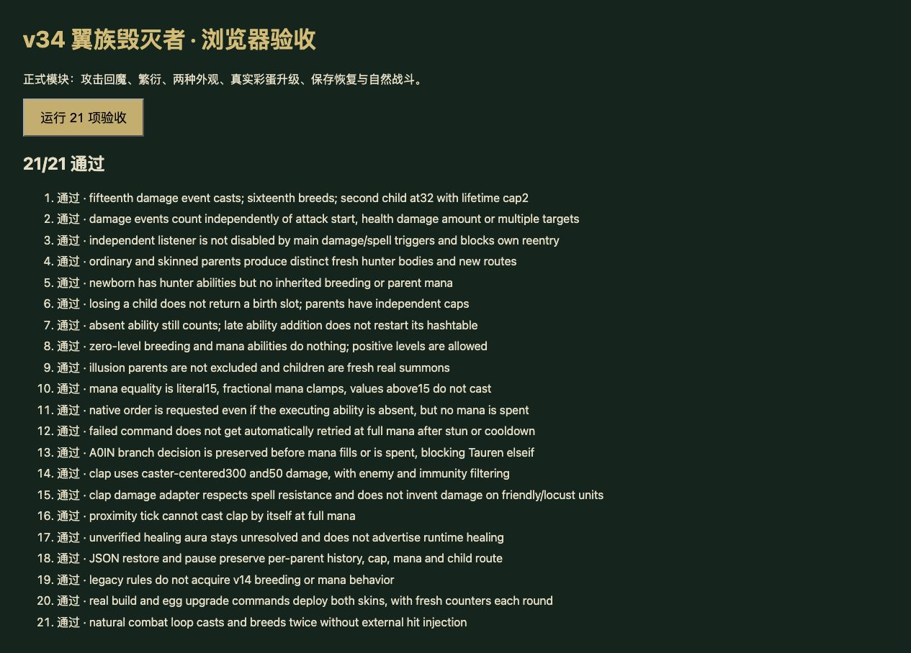

# v34 翼族毁灭者机制与上下文归档

日期：2026-10-29。内容版本：`v14-content-20261029-v34-1`。本批基于`65df68b`，补入毁灭与繁衍的脚本入口；整体还原目标继续保留。

## 来源与实际入口

- [规则模块](../../dist/destroyer-rules.js)、[23项专项](../../tests/v14-destroyer.test.mjs)、[逐行证据](../../reference/destroyer-evidence.json)。JASS SHA-256为`e66c55b3b25b185c991be5613e21fbf5b2d598f3cc40f2f8cd01c23bcb828250`，按Latin-1/LF计行。
- 监听由42804—42807注册，42270—42271按武器伤害事件及来源单位Attack标记防重入；42599—42622包含繁衍及回魔分支。并非攻击抬手或每次普攻动画即触发。
- 正式命令验证：变形建造者建造20只沙丘之虫h0SC，将其中10只升级为翼族猎手h0SD，完成记录达到R00P、兵力恰为1300，再升级h105并出战h106。剧毒异虫h2A9的R0J4资格缺失时会拒绝；经沙盒资格命令开启后正常升级并出战h2A8。没有改写配方或放开真实账号权益。

## 本批行为

- **繁衍A0IO**先检查旧计数是否恰为15、有正等级能力且累计出生不足2；满足后生成并清零，否则加1。新单位从0开始，第16、32次武器伤害事件各生成一只。原文案写每15次，归档保留这一差异。没有能力或已经满额时，计数仍继续增加；事后添加技能不重置旧计数。
- **外观与名额**：h2A8/h2A9生成h2AC，其他携带者生成n0SD。子体死亡不返还名额；每个父体独立计数。脚本没有排除幻象父体，新建子体是真实召唤物。
- **新单位**采用原型属性，继承owner、位置、朝向和userData；不复制父体伤害、增益、追击目标、冷却或建筑句柄。登记JW/JH，发出前往对应玩家起点的attack命令；未设置定时生命。子体保留猎手原型能力，没有继承繁衍。
- **毁灭A0IN**仅在当前魔法不等于15时加1，按上限截断，结果恰为15才请求thunderclap。原本15不发令；施法受控或冷却拒绝后，不会自动在解除时重试。保留修改魔法之前的elseif选择，避免在回魔/耗魔后又触发牛头A0N5。
- **A0J5**不再使用通用靠近自动施法。当前适配物编明确的300范围、50伤害、15耗魔；不把AHtc的0.001持续时间解释成眩晕。保留敌我、距离、魔免、无敌及法术抗性检查。
- **A116纠错**：Aoar对象缺失恢复量、百分比开关、范围和目标默认值。停止将零恢复效果标成implemented，改为unresolved。
- **上批名称纠错**：v33提及的哈希字符串7是骷髅术士A0IP活体炸弹，并不属于翼族毁灭者。已更正v33归档、牛头证据、注释和覆盖清单；活体炸弹死亡优先分支仍在待办中。

## 保留边界

A0J5的Cool1、Cast1、DataC1、DataD1和BuffID1未提供。即时执行、没有额外施加冷却以及spells/magic伤害是当前宿主适配，不是已验证的原生默认值；未从文案补造减速或眩晕。h106/h2A8的mana0同样缺失，保留现有解析器manaStart=0，继承默认值仍未验证。

原生创建钩子、科技属性、出生碰撞、组和句柄生命周期、玩家起点映射仍有边界。猎手A0SB沿用既有死亡适配，完整独立死亡elseif优先级待复核，不在本批宣称还原完成。旧档缺少此前攻击历史时从0计数，不猜造累计次数；已有魔法、冷却和计数保持不变。A0IN/A0IO/A0J5均为partial。

## 验证与移交

- `npm test`全量1207项通过（1116 Node＋91自定义）。其后增加1项v33旧档迁移验证并通过；本批专项最终23/23。测试覆盖计数临界、事件分类、重入、上限、皮肤、幻象、子体死亡、回魔等值、原生命令拒绝、牛头前置、免疫/范围、暂停/JSON、真实建造升级和波次重建。
- 20秒、400帧自然战斗专项无需外部注入攻击：父体正常施法并繁衍两只，生命与魔法保持有限。
- 35波各12秒烟测通过：2784次出生，峰值124实体/16任务，finiteState与saveContinuation均true；不等同35波自然完整通关。
- 本地浏览器复跑21项运行时用例，21/21通过；来源文件检查及随后追加的v33迁移用例仅在Node运行。正式首页加载正常，控制台工具未返回警告/错误；临时页的favicon.ico请求404，不影响正式模块加载。临时页、标签及服务器已清理。
- 49个浏览器模块及样式内容哈希一致，覆盖数据已重新生成。生产发布依最终发布回执确认，不将本地浏览器结果称作在线实测。

玩家649种能力：408实现、98部分、34标记、109待核定；全战斗734种：458实现、104部分、47标记、125待核定。A0IN/A0IO由待核定改为partial，A0J5由implemented改为partial，A116由implemented改为unresolved。运行时猎手n0SD/h2AC显式加入覆盖；能力已在玩家升级链中，因此总数不变。

本批由主聊天完成，无新增开发聊天；既有三个开发聊天保持归档。代码、证据、测试与上下文在此移交，未闭合项进入[后续队列P02/P05/P06/P07](../RESTORATION_TODO.md)，主目标继续保留。
