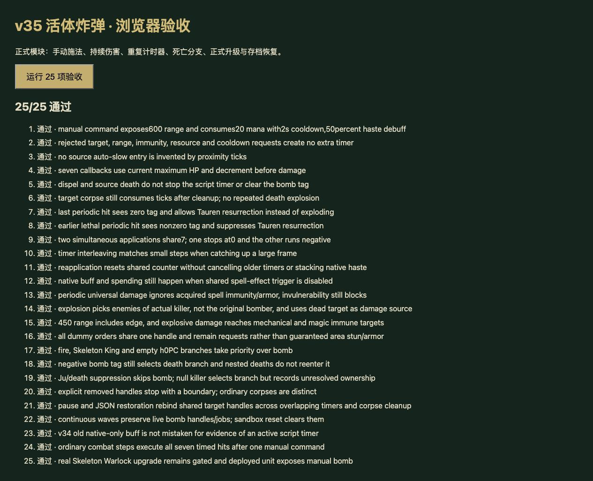
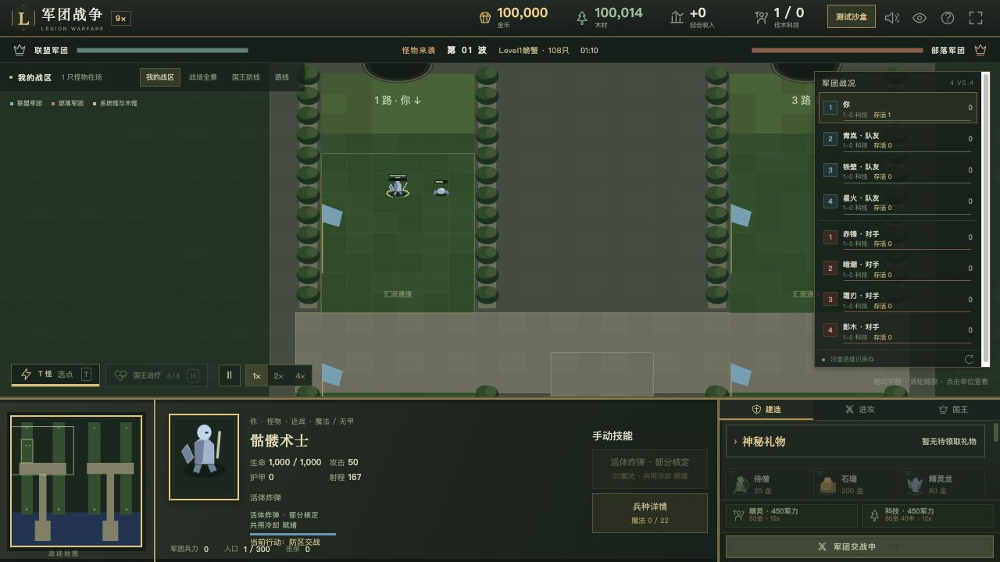

# v35 活体炸弹机制与上下文归档

日期：2026-10-29。内容版本：`v14-content-20261029-v35-1`，基于`ff1dfae`。本批补入骷髅术士A0IP持续伤害和共享死亡链，整体还原目标继续保留。

## 来源及入口

- [规则模块](../../dist/living-bomb-rules.js)、[26项专项](../../tests/v14-living-bomb.test.mjs)、[逐行证据](../../reference/living-bomb-evidence.json)。JASS SHA-256为`e66c55b3b25b185c991be5613e21fbf5b2d598f3cc40f2f8cd01c23bcb828250`，Latin-1解码、按LF计行。
- SPELL_EFFECT在39958—39961注册，39769—39774处理A0IP，38591—38601为BOOMA01计时器；41703—41707为死亡枚举条件，42107—42125为爆炸分支。
- 正式命令验证：骷髅h01P→骷髅法师h01S；先完成黑暗游侠h0DY→h0E8的英雄成长及德鲁伊h08V→女巫h08Y，满足R00U，再启用沙盒h210资格，升级h0JQ并出战h0JP。缺少配方或资格时仍拒绝。新增手动选敌按钮采用已有技能操作界面，没有改写配方。
- 原型auto为`_`，只找到A0IP施法效果和预加载引用，未发现本技能自动slow命令入口。当前提供Web手动施法，不以文案“随机敌人”构造自动AI；这一范围明确保留partial。

## 已接入行为

- Aslo明确字段：20魔法、2秒冷却、600距离、普通及英雄7秒持续、50%攻速削弱。当前即时适配施法；未补造缺失的移动减速。
- 每次施法效果重设**目标共享计数7**并创建新1秒计时器，不取消旧计时器。每次回调先减1，再造成目标当时最大生命5%的混乱攻击/通用伤害；伤害后计数恰为0才销毁当前计时器。
- 回调没有buff、施法者存活或受害者存活条件。驱散不清计数；施法者死亡并清尸后仍保留伤害来源。目标尸体仍消耗计数，普通清尸不同于真实RemoveUnit。
- 两个同刻施法的任务交错执行：第四秒第一个将计数降为0并结束，第二个降至-1继续。保留负计数与潜在无限任务，不擅自改成每次固定7跳；大时间步与逐秒回调结果一致。
- 主死亡链保留火噬→骷髅王→h0PC空分支→非零活体炸弹→骨龙/n004/先祖之魂的顺序。计数为负同样进入炸弹分支；末次伤害先减成0时可进入先祖之魂。Ju或禁用中的主死亡触发器不触发炸弹，爆炸杀死其他炸弹时不重入同一死亡链。
- 爆炸半径450，筛选**击杀者的敌人**；150混乱/通用伤害来源是**死者**，不是原施法者或击杀者。按源码不在枚举条件中排除魔免、机械、Avul或尸体，实际伤害仍受宿主无敌/死亡规则处理。
- 同一e008马甲归击杀者所有，每个枚举目标依次发thunderbolt、faeriefire；记录1秒RemoveUnit和2秒定时生命。A0IS显式1.5秒控制，A0IQ显式减甲5持续3秒，但连续命令执行与默认值未闭合，当前只记录请求，不伪造全范围控制。
- A0IR缺DataA1护甲且目标为none，原生零效果不再标implemented。h0JP另有Attack20创建登记，完整共享增益链移入待办。

## 存档、验证与边界

- 新增livingBombHandles，保存时保留共享句柄、清尸后的施法者和计时任务；恢复后重新绑定活体。连续波保留，普通波/竞技/沙盒重置清理。v34旧档中单独的B04Y不能证明曾触发JASS，因此不据此补造计时器。
- `npm test`全量1234项通过（1143 Node＋91自定义），本批26项专项通过；覆盖施法拒绝、技能资源、共享计数、重叠任务、死亡优先级、阵营/来源、范围/魔免、保存/暂停、连续波与正式获取链。
- 正常战斗步进验证：一次手动指令后，7.05秒内完成7次伤害并清理任务和到期buff。
- 35波各12秒烟测通过：2784次出生，峰值124实体/16任务，finiteState与saveContinuation均true；不等同35波完整自然通关。
- 浏览器25项运行时用例全部通过，来源文件检查仅在Node。另在正式游戏页载入本机验收存档，实际点击骷髅术士→活体炸弹→敌人，看到20魔法扣为0、2秒冷却、成功提示，七次伤害后目标1000生命降为650。控制台工具未返回警告/错误；临时页favicon.ico请求404。临时页、标签及服务器已清理，不影响线上存档。
- 50个模块资源哈希一致。生产部署以发布回执为准，未将本地UI检查称为线上浏览器复测。

未闭合项：Aslo即时命中与原型0.3秒前摇/0.51后摇的原生顺序、缺失移动减速、自动入口、同马甲命令覆盖、默认目标许可、null击杀者所属玩家、真实RemoveUnit句柄、跨家族计时器/范围枚举顺序。null击杀者仅记录边界并占用死亡分支，不擅自改为原施法者所属玩家；显式已移除句柄停止任务并记录边界。A0IP/A0IQ/A0IS保留partial，A0IR改为unresolved。

最新玩家能力651项：406实现、101部分、34标记、110待核定；全战斗736项：456实现、107部分、47标记、126待核定。新增A0IQ/A0IS两项动态能力；A0IP从implemented纠正为partial，A0IR从implemented纠正为unresolved。

本批由主聊天完成，无新增开发聊天；此前三个已完成开发聊天保持归档。代码、证据、截图与上下文在此移交，未闭合项进入[后续队列P02/P04/P06/P07/P13](../RESTORATION_TODO.md)，整体目标不标完成。
