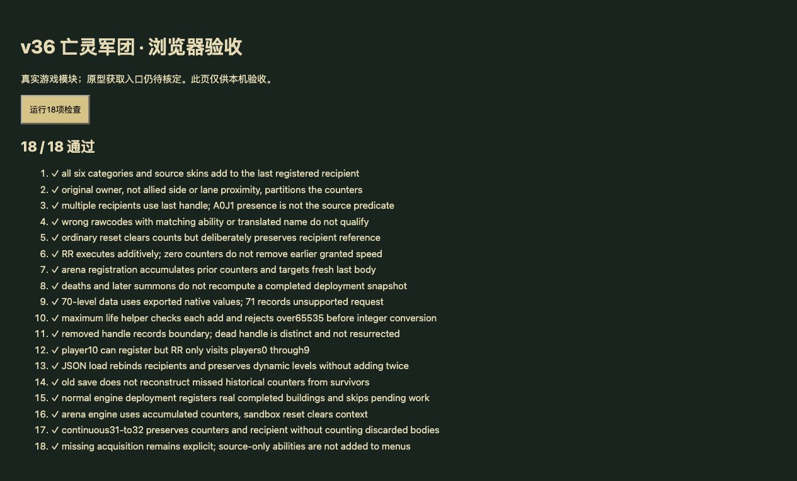

# v36 亡灵军团机制与上下文归档

日期：2026-10-30。基线：`e85df02`。内容版本：`v14-content-20261030-v36-1`。

## 本批范围

接入希尔瓦娜斯 `h0JR` 的开战登记和 `A0J1` 亡灵军团结算，补齐动态 `A0J2/A0J3` 各等级攻速。不是希尔瓦娜斯全技能完成声明。

- [规则模块](../../dist/undead-legion-rules.js)
- [19项专项测试](../../tests/v14-undead-legion.test.mjs)
- [逐行来源及边界](../../reference/undead-legion-evidence.json)
- JASS SHA-256：`e66c55b3b25b185c991be5613e21fbf5b2d598f3cc40f2f8cd01c23bcb828250`；Latin-1解码并按LF计行。

## 核定及实现

1. `vf`（竞技）与 `oldcodefn_Bg`（普通）在建筑转换时登记六种计数，按原建筑玩家划分。`h0JJ`每只加200生命，`h03B/h0OC`加50生命，`h03C`授予1%系列攻速等级，`h0JN/h0OZ`授予3%系列等级，`h0JP`加20攻击，`h03D`加5攻击。普通召唤、复活或战斗后死亡不会重算这一快照。
2. 每玩家仅保存最后登记的h0JR；脚本没有A0J1存在/等级判断，也不为所有同名单位分发加成。原生枚举顺序待核定，Web使用转换顺序。
3. `OC5F_cg`重置六种计数但不清h0JR引用，转换后执行RR。竞技vf不清计数，倒数后再执行RR。连续波在Nj已true时不再次执行OD，因此Web连续波加入跳过重新登记和结算。
4. `YDWEGeneralBounsSystemUnitSetBonus`的第三参数0表示加法，生命200/50与攻击20/5分别相加。最大生命helper对每次请求先校验65535上限，再执行整数差；不会让前一次超限阻止后一次合法加成。
5. A0J2和A0J3明确有70级，读取解析后的每级DataA字段，保留浮点导出值。大于70仅记录未核定的原生等级请求，当前保留已有等级或新添加的1级，未将此适配当作原生事实。
6. 存档保留计数和收件单位；恢复后重绑仍在场的同一实体，避免重复加成。旧档没有历史登记时不根据幸存部队反推。沙盒重置清理登记，连续波保留。

## 入口与剩余差异

源包有n00S→h0JR映射、禁用彩蛋对话框、兵营彩蛋类型标记及月度记录，但未找到可证明的创建/合成/升级入口。另有h0JR→h0JS映射，不能将其当作n00S获取证据。因此不新增建造按钮，以`sourceOnlyCombatForms`单列该原型和动态能力，玩家能力651项、全战斗736项计数保持不变。

本批也纠正上一批文字含义：h0JP的Attack20登记属于亡灵军团，不能证明A0IR护甲光环有效。A0IR仍因缺护甲数据、目标为none而保留unresolved。

剩余：原生枚举顺序、无效/已移除句柄、AIml加最大生命时当前生命的副作用、超过70级的原生响应、其它共享bonusType3能力对容量的影响、竞技原生倒数与区域转换、n00S获取入口及希尔瓦娜斯其余技能。当前生命采用宿主既有加生命适配；这些边界继续列partial，不能称完全还原。

## 验收

- 全量`npm test`：1253项（1162 Node＋91自定义），全部通过。首轮发现新存档默认值缺失导致快照往返不一致，已在构造状态补齐并完整重跑。
- 19项专项覆盖六类精确原型/外观、玩家归属、最后句柄、重复RR、竞技累计、死亡与召唤、70/71级、生命上限、旧档、新档、普通波/竞技/连续波接线。
- 35波各12秒烟测：2784出生，峰值124实体/16任务，有限状态和存档续跑通过；不等同35波完整自然通关。
- 本机浏览器从正式资源哈希导入相同模块，18项运行时检查通过；来源文件检查仅在Node。控制台无警告/错误；临时页favicon请求404。没有声称通过正式菜单获取希尔瓦娜斯或线上完整对局验收。
- 51个模块资源哈希检查通过。临时验收页、浏览器标签及HTTP服务已清理。生产发布以对应回执为准。

本批在主聊天完成，无新增独立开发聊天。代码、来源、测试和上下文随同提交GitHub；原有三个开发聊天保持归档。后续从P04/P06/P08/P13继续，不标记整体还原完成。
