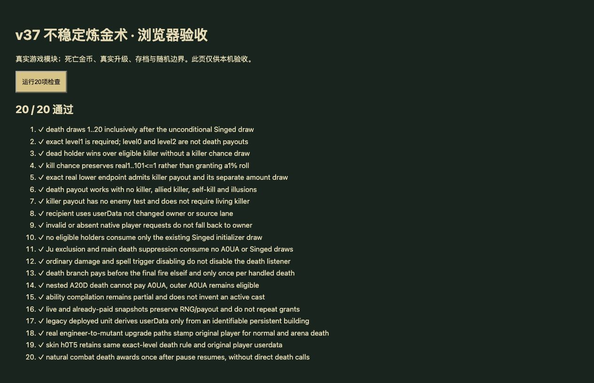

# v37 不稳定炼金术与灵魂链审计归档

日期：2026-10-30。基线：`11207be`。内容版本：`v14-content-20261030-v37-1`。

## 本批实现

[A0UA规则模块](../../dist/unstable-alchemy-rules.js)、[21项专项](../../tests/v14-unstable-alchemy.test.mjs)、[来源证据](../../reference/unstable-alchemy-evidence.json)。JASS SHA-256为`e66c55b3b25b185c991be5613e21fbf5b2d598f3cc40f2f8cd01c23bcb828250`，Latin-1解码并按LF计行。

- 主死亡触发器42033—42045：死者A0UA等级**恰为1**时直接抽整数1—20金币。否则，只有击杀者A0UA等级恰为1才抽实数1—101，结果≤1时再抽金币。
- 文案称“击杀1%”，源码是实数区间最小端点判定，不改成`random<0.01`。保留这一差异和原生随机精度未知的边界。
- 双方都带A0UA时仅死者分支生效，不额外抽击杀概率；没有敌我、普通攻击、波次、幻象或击杀者存活限制。无击杀者仍可得到死亡奖励。
- 金币发给`Player(GetUnitUserData(source)-1)`，不以当前owner或路线代替。正常部署和竞技部署为A0UA携带体记录原玩家编号；变种人h06W、兴奋h077及外观h0T5均覆盖。
- 奖励置于主死亡链独立分支，先于伊瑟拉唤醒和最终火噬/骷髅王/活体炸弹链。主死亡触发器重入及Ju排除时不抽样、不发放；独立监听保留既有行为。
- SingedAlchemyGold在主死亡函数入口的既有抽样仍先执行。重复死亡通知、恢复已处理尸体均不再次发钱。
- 旧档只有能对应持久建筑与原玩家的出战体才补回缺失userData。无证据的召唤/句柄不猜受款人；未表示的原生玩家记录请求边界而不把钱转给owner。

尚未闭合：Warcraft随机序列及浮点精度、同一死亡函数尚未接入的前序分支对随机流的影响、未参加Web对局的原生Player索引、原生金币特效表现。A0UA从unresolved改为partial，不称完全实现。

## 灵魂锁链与魂耀审计

详见[独立审计记录](../../reference/soul-link-source-audit.json)，本批没有加入猜测效果。

- A0JJ原生Aspl有60魔法、12秒冷却、750范围、12目标、10秒和Bspl，但CSV及解析后的对象都缺DataA分摊比例，object_overrides为空；未找到spiritlink自动命令入口。
- 魂耀脚本按伤害来源精确h103判断，无普通攻击条件；1200范围内同盟且带Bspl的单位直接加75生命。
- 后续elseif检测受伤者带Bspl且**受伤前生命≤40**，移除Bspl并设为60%生命；不等同文案的致命伤害保护，不直接取消当前伤害。h103分支优先。
- 需要原生Aspl默认字段、选择规则以及共享伤害链前序条件，继续P01/P05/P06。两项仍unresolved，未将本次审计计作运行时实现。

## 验收与交付

- 全量`npm test`1274项通过：1183 Node＋91自定义；本批专项21项。
- 正式命令路径：半人地精技师h06J→矮人工程师h078→变种人h06I→兴奋h076；外观h0T3在R0BJ资格缺失时拒绝、沙盒授权资格后允许。出战与竞技分别得到h06W/h077/h0T5及原玩家编号，死亡奖正确入账。
- 自然战斗：暂停时不触发；恢复后敌方实际攻击杀死变种人，得到1—20金币；无直接死亡调用驱动该用例。
- 35波各12秒烟测：2784次出生，峰值124实体/16任务，有限状态与存档续跑通过；不等同35波完整自然通关。
- 浏览器正式资源哈希导入20项运行时用例全部通过；来源文件核对仅在Node。控制台无警告/错误，临时页favicon请求404。未声称已完成线上自然对局验收。
- 52个模块资源哈希检查通过。临时验收页、标签和HTTP服务已清理，发布以回执为准。

最新玩家能力651项：406实现、102部分、34标记、109待核定；全战斗736项：456实现、108部分、47标记、125待核定。

本批在主聊天完成，没有新增独立开发聊天；原有三个开发聊天保持归档。源码、证据、测试、审计与上下文一起提交GitHub，整体目标保留未完成状态。
