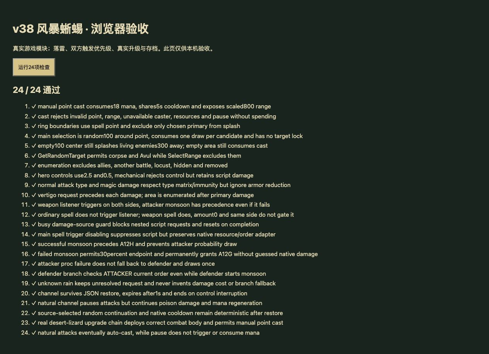

# v38 风暴蜥蜴落雷与闪电风暴归档

日期：2026-10-30。基线：`dd371b2`。内容版本：`v14-content-20261030-v38-1`。

## 本批实现

[规则模块](../../dist/storm-lizard-rules.js)、[25项专项](../../tests/v14-storm-lizard.test.mjs)、[逐行证据](../../reference/storm-lizard-evidence.json)。JASS SHA-256 为 `e66c55b3b25b185c991be5613e21fbf5b2d598f3cc40f2f8cd01c23bcb828250`，Latin-1 解码并按 LF 计行。

- `InitTrig_New_UnitAttack` 注册全局伤害监听，并在主初始化调用。42545—42560 位于独立武器伤害分支内，按伤害来源保存的 Attack 标记防止重入；不是攻击启动事件，也没有正伤害、敌我或存活的额外条件。
- monsoon 命令优先给攻击者，否则给受击者，落点是另一方当时位置。前一方命令失败不回退给后一方。落雷提供手动点选入口，与自动入口共用18魔法、5秒冷却和800距离。
- `SPELL_EFFECT` 的39532—39548：先在落点100范围内随机抽选敌人。此选择没有存活、魔免或Avul过滤；即使抽到尸体也不重抽。先请求A0I7等级5，再造成1000普通攻击/魔法伤害。
- 主目标伤害后才枚举300范围，其间死亡新建的单位可进入本次范围。排除选中的主目标、死亡单位和Avul携带者；按距离≤100、≤200及≤300分别造成200、150和100同类伤害，各自在伤害前请求等级1控制。
- A0I7等级5读取解析后5秒/英雄2.5秒，等级1为1秒/英雄0.5秒。机械、魔免等原生不适用控制者不被强行眩晕；缺失马甲伤害不从文案补入。每个目标均记录独立一秒马甲请求。
- `UnitDamageTargetBJ` 保留武器事件属性。脚本禁用主施法监听期间，嵌套施法保留宿主原生资源/命令状态，但不会再执行落雷脚本。
- A12H 先检查攻击者有能力且攻击者当前命令不是monsoon，否则检查受击者能力；后一分支**仍检查攻击者的命令**。条件命中后抽实数0—100≤30；抽签失败不回退到另一方。命中后添加A12G并请求chainlightning，没有移除语句，也不宣称已调用UnitMakeAbilityPermanent。
- 雷雨A12E只记录独立监听发出的monsoon请求。A12G只记录能力授予和闪电链命令，未知原生效果不执行。两项继续为unresolved；A12F/A12H为partial。
- 落雷当前采用即时施法效果与Dur1的一秒吟唱窗口适配。窗口阻止行走/普通攻击，但不中断中毒、生命恢复和魔法恢复；控制或死亡中断窗口。冷却、动态能力、窗口与随机续跑可保存恢复。

## 仍未闭合

- A12F的原生ANmo额外伤害字段DataA1缺失；原型施法前摇、动画后摇、原生频道命令仲裁及伤害时序未完整接入。即时效果及一秒窗口是宿主适配，不称原生验证。
- A12E虽然有DataA/B/C=20/1/1、范围300、持续3秒等字段，但尚未取得该版本ANmo逐跳行为证据。本批没有猜测逐跳伤害，也不将未执行命令扣魔法、设冷却或伪造成吟唱成功。
- A12G缺DataC1递减比例、Cost1、Cool1、Cast1及原生弹跳选取证据；没有按说明100伤害/4跳或闪电风暴文案的随机3人造出效果。
- A0I7马甲伤害、冷却、耗魔、弹道等默认参数未齐；仅控制适配，不代表命令原生成功。
- 原生群组枚举顺序、随机流、尸体寿命、隐藏/蝗虫枚举、命令移动到施法距离、共享monsoon的多能力仲裁与其他命令覆盖仍有边界。
- 灵魂锁链的原生分摊字段和自动入口仍缺失，沿用[v37审计](../../reference/soul-link-source-audit.json)，本批没有伪造效果。

## 验收

- `npm test` **1299项**通过：1208 Node＋91自定义。新增专项25项全部通过；归档证据补充后复跑25项通过。
- 35波各12秒烟测：2784次出生、峰值124实体/16任务，有限状态与存档续跑通过；不等同35波完整自然通关。
- 53个浏览器模块资源哈希一致。最后只修订“保留能力”的说明措辞和测试标题，重新构建、专项及哈希检查通过，运行逻辑未变。
- 本地浏览器24项运行时用例全部通过，使用正式模块哈希导入；原始文件证据校验仅在Node。控制台无警告或错误，favicon请求404。
- 正式游戏界面通过鼠标建造与升级验证：沙漠建造者u01X，n05U→n05X→n05Y，出战h0Q5。落雷显示“部分核定、18魔法、共用冷却”，初始法力不足时禁用按钮。界面开波后自然战斗结束，回到布阵并显示108次击杀。
- **未声称手动在正式Canvas上完成落雷点选命中**；完整点选命令及扣魔法、冷却与伤害结果由浏览器运行时用例覆盖。该本地单波不替代生产站自然对局验收。
- 临时验收页、两张测试标签与本地HTTP服务已清理。部署结果以外部发布回执为准。

最新玩家能力652项：406实现、104部分、34标记、108待核定；全战斗737项：456实现、110部分、47标记、124待核定。新增动态A12G纳入覆盖；两项unresolved转partial，不能误称只剩少量缺口。

本批由主聊天完成，没有新增开发聊天；原有三个开发聊天保持归档。源码、证据、验证和上下文一并提交GitHub，主目标继续保留未完成状态。
