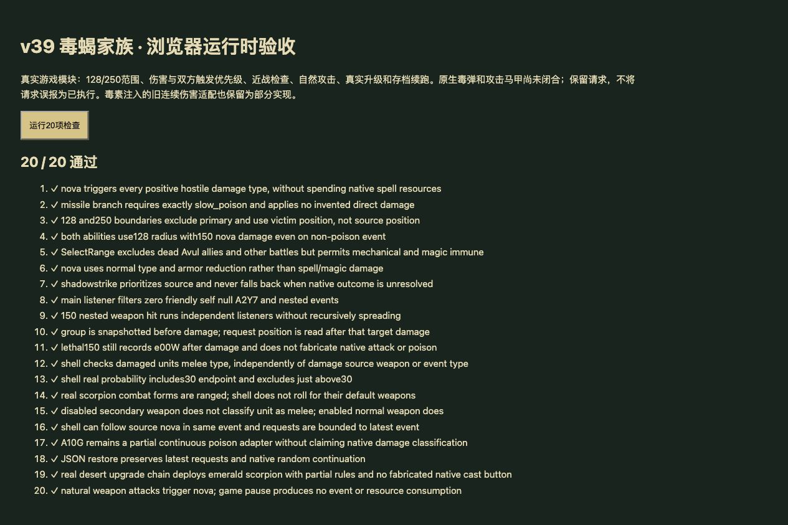

# v39 毒蝎伤害脚本与原生命令边界归档

日期：2026-10-30。基线：`398183a`。内容版本：`v14-content-20261030-v39-1`。

## 本批结果

[规则模块](../../dist/scorpion-rules.js)、[21项专项](../../tests/v14-scorpion.test.mjs)、[逐行与物编证据](../../reference/scorpion-evidence.json)。JASS SHA-256：`e66c55b3b25b185c991be5613e21fbf5b2d598f3cc40f2f8cd01c23bcb828250`；Latin-1解码、LF计行。

- 接入主伤害监听41215—41232，保留正伤害、敌我/self/null、A2Y7和主监听禁用门槛。shadowstrike优先伤害来源，否则受击者；请求失败或结果未知不回退到另一方。
- 原始`and/or`优先级使A10I在每种正值敌对伤害事件中都扩散，不限定普通攻击或毒伤。A10H单独存在时须为SLOW_POISON。
- 40480—40498先围绕主目标SelectRange，再移除主目标。A10H半径128、A10I半径250；同时携带两者时选择128，但仍有A10I的150伤害。
- 每个目标先受到150普通攻击/普通伤害（保留weapon=true），后记录A10G攻击马甲请求。护甲与攻击类型矩阵参与结算，机械或魔免不被范围枚举排除。主伤害监听防递归，但独立武器伤害监听仍执行。
- 组在遍历前固定；此前伤害创建的新单位不加入，已选单位之后死亡或移动不重筛。目标被150伤害击杀仍记录后续请求，马甲落点读取伤害后的目标位置。
- A10J检查**受击者自身**为近战攻击者，再抽实数0—100≤30。实际h0PU/h0SZ只启用missile武器，不满足近战条件；不按文案改成“近战敌人攻击时”。
- 29774—29785的e00W请求保存主人、来源userData（宿主未提供则null）、JH群组、目标位置、270朝向、summoned、A10G、attack与5秒BHwe寿命。记录仅保留最近事件，不随每次命中无限累积。
- A10H/I/J从unresolved改为partial。A10G由implemented纠正为partial，同时保留既有普通攻击附毒适配，没有借改标签停用原有毒伤。

## 未闭合的原生部分

- **未生成e00W实体，也未执行它的攻击/附毒。** e00W缺targs1、dmgpt1、backSw1等字段；请求中的5秒仅来源指令，不代表已验收实体生命周期。JH/userData实际编组及完整创建钩子仍缺。
- **shadowstrike没有实际施法。** 目前只记录双方命令优先级，不扣魔法、不开始冷却、不提供声称能施法的手动按钮。AEsh的DataA等原生默认字段、弹道、初伤事件类型和持续伤害时序尚未核定。
- A10G现有10DPS、30%移速/20%攻速降低、3秒同键刷新仍为连续dt适配。原生DataD1=9叠加位、跳数、施加者归属及免疫关系未闭合。**连续适配的每帧伤害会触发A10I；新星整体触发频率及持续伤害平衡尚未达到原版验收。** 没有额外伪造“毒伤不触发新星”的脚本限制来掩盖此差异。
- H的SLOW_POISON入口仅完成类型正确时的脚本处理；没有把未知AEsh初伤或通用毒伤强行改成该类型。外部[DamageEngine枚举](https://github.com/BribeFromTheHive/DamageEngine/blob/master/ConfigTrigger.txt)区分SLOW_POISON与SHADOW_STRIKE，但不足以证明本图AEsh行为；未据此填补缺参数。
- 原生组枚举顺序、尸体生命周期、隐藏/蝗虫过滤、随机序列和特殊近战类型变换仍有宿主边界。正常形态的远程分类由物编证明。

## 验收与归档

- `npm test` **1320项**通过：1229 Node＋91自定义；新增21项专项。
- `npm run test:smoke`通过：35波各12秒、2784次出生、峰值124实体/16任务、有限状态与存档续跑。不是35波完整自然通关，也不是原生毒素频率验证。
- 54个浏览器模块资源哈希一致。临时浏览器验收页使用正式哈希模块，20项运行时检查全部通过；源文件哈希/行号仅在Node校验。
- 专项包含正式沙漠建造升级命令n05Q→n05R→n05S，出战h0PU；自然武器攻击、暂停、近战门槛、保存恢复与随机续跑通过。浏览器UI另经沙漠沙盒入口和图鉴搜索，确认翡翠/寒冰巨蝎记录以及三项partial说明可读。未声称在Canvas上手动完成建造、完整单波或生产站自然对局验收。
- 两张浏览器测试标签、临时验收页与本地HTTP服务均已清理；控制台无warning/error，服务日志有favicon.ico 404。

[正式图鉴入口截图](v39-catalog.png)保留获取路径；技能长文由浏览器可访问文本验证，截图首屏未展示下方技能内容。

最新玩家能力652项：405实现、108部分、34标记、105待核定；全战斗737项：455实现、114部分、47标记、121待核定。A10G误报已实现被纠正，因此已实现数下降1是审计修正；不代表整体已完成。

本批由主聊天处理，没有新增开发聊天；原有三个开发聊天保持归档。源码、证据、验收和本上下文归档提交GitHub，网站发布使用同一提交，最终成功状态以外部发布回执为准。总目标继续保持未完成。
