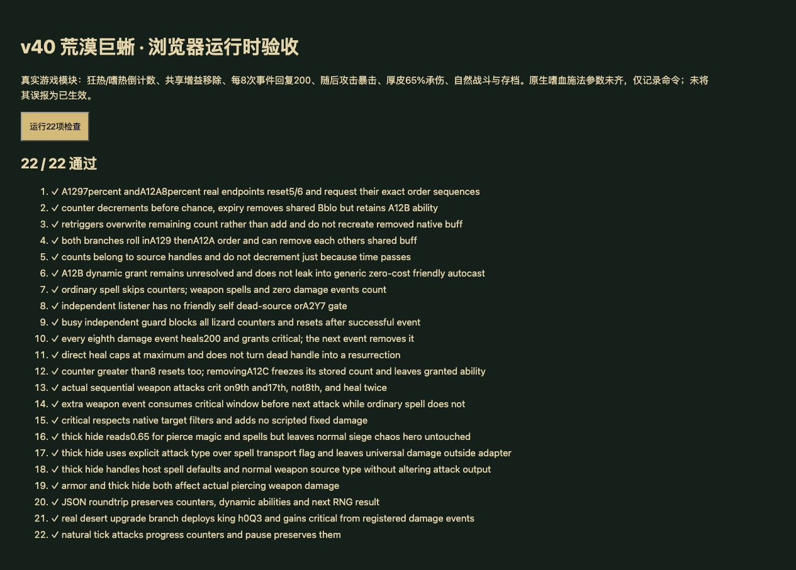

# v40 荒漠巨蜥伤害计数、战斗渴望和厚皮归档

日期：2026-10-30。基线：`d9b4e28`。内容版本：`v14-content-20261030-v40-1`。

## 本批实现

[规则模块](../../dist/desert-lizard-rules.js)、[23项专项](../../tests/v14-desert-lizard.test.mjs)、[源码与物编证据](../../reference/desert-lizard-evidence.json)。JASS SHA-256：`e66c55b3b25b185c991be5613e21fbf5b2d598f3cc40f2f8cd01c23bcb828250`，Latin-1解码、LF计行。

- 42505—42544接入独立武器伤害监听，位置在风暴蜥蜴分支之前。按伤害来源的Attack标记防重入；不加主监听的正伤害、敌我、自伤、A2Y7或存活门槛。普通法术不触发，带武器事件标记的脚本伤害触发。
- A129每个事件先减正计数；旧计数1时移除共享Bblo。之后抽0—100实数≤7，命中重置5并添加A12B、向自己请求bloodlust。
- A12A独立执行相同前置，概率≤8、重置6，依次向自己请求bloodlustoff与bloodlust。保留IssueTargetOrder类型；不擅自改为其他命令API。
- 两项均存在时先A129后A12A、分别抽签与保存计数；第二项可能移除第一项共用的Bblo。重复触发是覆盖剩余次数，不累加；时间流逝不扣次数。A12B能力本身没有被移除。
- 随机值以binary32表示后比较，避免JS的0.07×100浮点尾差漏掉7端点；随机序列仍是宿主序列，不宣称复刻Warcraft PRNG。
- A12C每个事件加1，达到或超过8就清零、存活单位直接回复200并限制到最大生命、添加A12I；其他事件移除A12I。保持源脚本直接生命写入，不用吸血或百分比治疗替代。
- A12I读取100%概率与10倍武器伤害，复用普通攻击暴击。单目标顺序普攻第8次伤害后才获得能力，第9次攻击暴击后移除；后续第17次同理。不是说明文字的第8下当场暴击。夹入的额外武器伤害事件也会推进计数、关闭暴击窗口。
- A12K按对象DataA/E=0.65适配穿刺、魔法/法术攻击类型承伤；非文案“减伤45%”。显式attackType优先于宿主spell传递标记，DataB=1保持输出。普通、攻城、混乱、英雄类型不因此减伤。
- 动态A12B/A12I加入玩家与全战斗覆盖。A129/A12A/A12C/A12K从unresolved到partial；A12I为partial，A12B为unresolved。阻止动态A12B落入通用buff自动施法，避免把缺失耗魔当零耗魔、每秒任意给友军加速。

## 原生证据与剩余边界

- A12B已知攻速300%、持续6秒、冷却1秒，但Cost1、Rng1、Cast1、移动/模型参数及命令仲裁未齐。**只记录请求，没有施放嗜血、消耗资源或添加300%攻速。** 计数与Bblo移除已执行不等于整个狂热已还原。
- 数据包解析脚本按SLK存在的单元格输出；本地缺原始abilitydata.slk及完整原版默认表。不能因CSV空值就认定0，也不能盲用Ablo默认40耗魔替换A12B。
- [原生实验记录](https://github.com/Cokemonkey11/wc3-ability-doc/blob/main/sources/screwthetrees-wc3-editor-ability-insight-document/2023-11-14.md)描述Aegr的穿刺和魔法/法术承伤字段；[字段元数据](https://github.com/dc114154qq/war3-reforged-trainer/blob/master/war3_ability_fields.py)列AIdd的Def1/Def2/Def5映射。本批据此做有限适配，**不是同一Warcraft版本的直接验证**。
- A12K与其他AIdd/主动防御/魔抗叠加、反弹和特殊伤害类型尚未闭合。现有适配不对universal套普通魔抗；显式普通攻击类型＋魔法伤害类型也不会被spell传递标记误判成法术攻击。此分类仍需原生实验核定。
- 死亡句柄的SetUnitState生命直写仅保留requested/before/after记录，保持死亡状态，不伪造复活。真正死亡与HP分离的数据模型尚未具备。
- 宿主仍在攻击释放时计算同步命中，暴击多技能叠加、伤害骰、弹道飞行和原生随机流未完成。独立监听可处理传入零伤害事件，但引擎最外层初始damage≤0会早退，原生零值事件的完整生产路径仍有边界。

## 验收

- `npm test` **1343项**通过：1252 Node＋91自定义；新增23项专项。旧A12K待核定断言已随新证据改为partial并检查0.65说明，没有把未闭合项改为implemented。
- 浏览器使用正式资源哈希模块执行22项运行时用例，全部通过；源码文件哈希与逐行证据在Node验证。控制台无warning/error，favicon.ico请求404。
- 正式建造/升级命令验证n05U→n05V→n05W出战h0Q3；直接武器攻击序列验证第9/17次十倍与两次200治疗；自然tick驱动验证第8次事件获得暴击能力。不是Canvas手动建造验收，也不是生产站完整对局验收。
- 35波各12秒烟测：2784次出生、峰值124实体/16任务，有限状态与存档续跑通过；不等同35波自然完整通关。
- 55个浏览器模块资源哈希一致。临时验收页、测试标签和本地HTTP服务已清理。

最新玩家能力654项：405实现、113部分、34标记、102待核定；全战斗739项：455实现、119部分、47标记、118待核定。数量增加源于动态能力补入，不能把partial当完成。

本批由主聊天完成，无新增独立聊天；此前三个开发聊天保持归档。本文件保存本需求的上下文、实现、依据和未完成点，与源码一并提交GitHub；现有网站使用同一提交发布，成功状态见外部发布回执。整体还原目标继续保持未完成。
