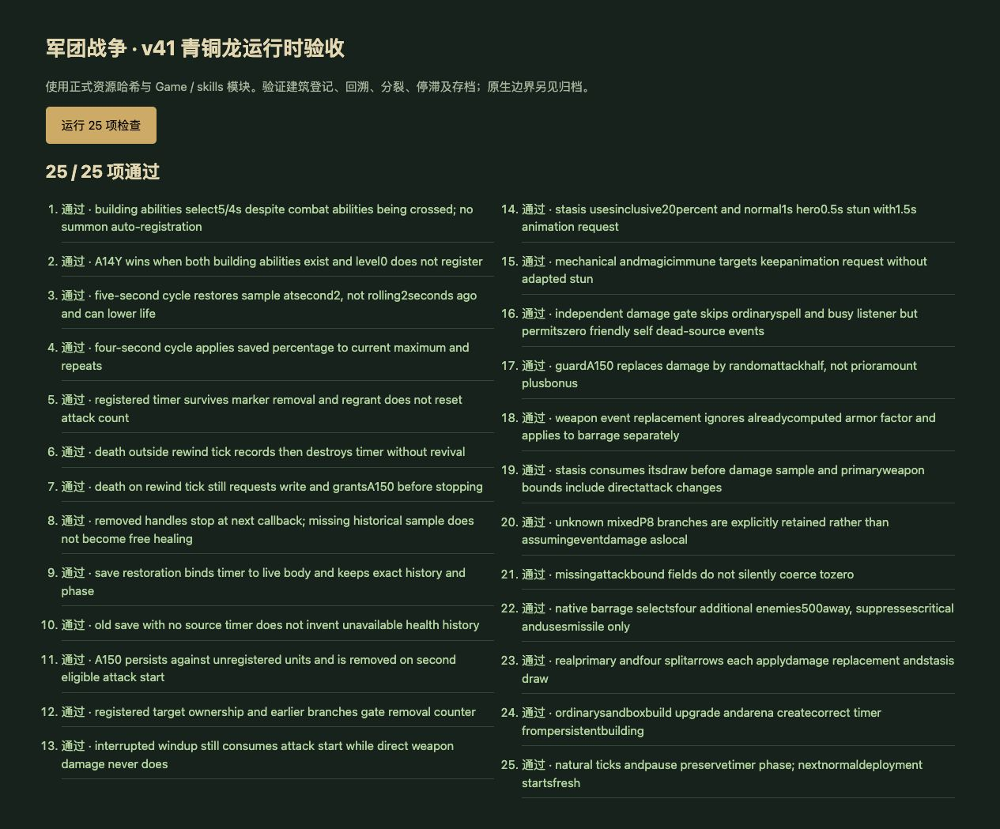
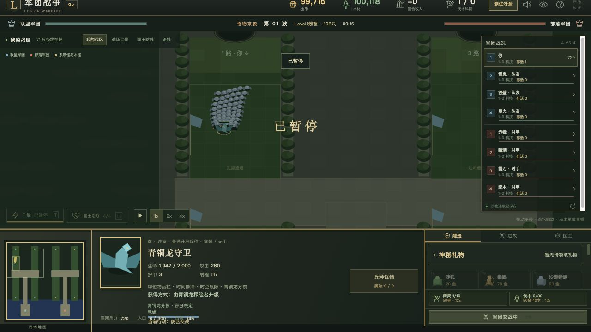

# v41 青铜龙时空回溯、分裂与停滞归档

日期：2026-10-30。基线：`635587549df29e59ab77c12f6fc3c1c8e3b8fdf5`。内容版本：`v14-content-20261030-v41-1`。

## 本批实现

[规则模块](../../dist/bronze-dragon-rules.js)、[26 项专项](../../tests/v14-bronze-dragon.test.mjs)、[逐行源码与物编证据](../../reference/bronze-dragon-evidence.json)。JASS SHA-256：`e66c55b3b25b185c991be5613e21fbf5b2d598f3cc40f2f8cd01c23bcb828250`，Latin-1 解码、只按 LF 计行。

- 普通青铜龙探险者 h0QO→h0QQ、守卫 h0QP→h0QR 的正常出战与竞技转换接入登记。PassiveSkill 43724 起读取的是建筑能力；建筑 A14Y/A14Z 与战斗体标签交叉，不能按战斗体标签反推周期。
- A14Y 每 5 秒、A14Z 每 4 秒回写本轮第 2 秒保存的生命百分比。计时器每秒推进，不是滑动缓存；探险者实际回到 3 秒前，守卫回到 2 秒前。按回写时最大生命换算，可降低生命，不是只治疗。
- 43544—43578 回调先写生命并添加 A150，再检查死亡并注销。移除 A14Y/A14Z 不会取消已登记任务；后续再次授予 A150 不重置独立攻击计数。新出战体重新登记，召唤体不擅自登记；保存恢复保留历史、阶段和活体引用。
- 修复真实升级后建筑 `abilityIds` 仍留旧能力记录的问题：优先读取当前建筑对象模板，避免守卫错误继承探险者 5 秒周期。保留永久追加能力和明确的等级 0。
- AttackTrigegr 的攻击启动事件只登记被攻击单位原生所有者 8—12，并受 Q 表自键登记及整条 elseif 前置分支约束。青铜龙战斗体本身没有 Q 自键登记；攻击普通未登记目标不会推进 A150 计数。
- 满足上述门槛才执行 47801—47810：第一次计数为 1，第二次清零并移除 A150。已启动后取消的攻击仍计数；伤害事件不代替攻击启动事件。因此不能概括成“分裂只持续一次攻击”。
- A150 沿用原生 Aroc 的部分适配：500 范围最多 4 个额外敌方目标、导弹武器、暴击抑制，各箭分别进入伤害监听。动态授予加入覆盖清单。
- 独立攻击伤害 42431—42443 先做 A151，再做 A150。A151 抽 0—100 实数，≤20 时请求 PauseUnitEx(1.5)：动画冻结 1.5 秒；R2I 后调用 A0I7 等级 1，显式普通/英雄控制时间为 1/0.5 秒。不是所有目标眩晕 1.5 秒。
- 只有精确战斗类型 h0QR 且有 A150 时执行改伤。源函数局部 P8 初值为 0，普通守卫没有前置 P8 赋值，所以最终事件改为主武器随机攻击的一半，**不是文案的 150%，也不是现有事件伤害加 50%**。已计算的护甲系数不再次乘入这个改写值；分裂箭分别取样。
- 用数据包主武器最小/最大/平均值及宿主直接攻击增量适配上下限，保留 binary32 取样。缺失或空白字段不默认为 0。混入改变 P8 的红龙 A16Z 或瓦里安 A11Y+A11S 时记录未核定，不伪造前置结果。
- 主伤害事件返回值接回引擎，并传给后续独立分支。普通攻击飘字使用实际结果，避免守卫实际造成 50 却显示旧的护甲计算值。

## 原生依据和剩余差异

- [YDWE 的 UnitState.cpp](https://github.com/actboy168/YDWE/blob/master/Development/Plugin/Warcraft3/yd_jass_api/UnitState.cpp) 定义 0x14/0x15 为主武器攻击上下限，并展示基础、附加、骰子项组成。证据 JSON 记录其下载字节 SHA；它是字段语义参考，不是同一地图运行库版本的实测。
- Aroc 的目标数、命中顺序、飞行时序和混合技能继承现有 partial。攻击上下限的全部原生动态加成、伤害骰和原生随机流仍未闭合。
- 原生所有者映射、Q 表字符串运行时登记、S006 和 Player(2) 前置状态仅有现有宿主表示；普通青铜龙路径有证据，不能据此宣称任意混合技能路径完全还原。诺兹多姆 A15A 的 Ex 计时器不在本批实现范围。
- 死亡句柄的生命写入记录 requested/before/after，保持宿主死亡状态，不伪造复活。原生死亡标志与生命分离、同帧计时器先后尚未建模。旧档没有保存过的历史不补造。
- PauseUnitEx 的马甲命令、原生目标许可和重叠动画恢复仍 partial；机械/魔免目标保留动画请求，但不套用已知不允许的控制适配。
- 直接独立监听调用支持零值事件及返回改伤；宿主 `_hurt` 仍无法完整区分原生拒绝命中与真正零值伤害事件。本批保留既有初始非正伤害早退、前置承伤结果为零后的早退，避免让新改伤穿透宿主无敌或魔免。真正零事件的生成、改伤传播与监听时序仍须单独完成。
- 四项 A14Y/A14Z/A150/A151 均为 **partial**。脚本分支已接入不等于原生机制、素材和完整对局完全还原。

## 验收

- `npm test` **1369 项通过**：1278 Node＋91 自定义；本批新增 26 项。覆盖建筑与战斗体交叉、4/5 秒周期、生命下降、死亡后回调、存档引用、攻击登记门槛、取消攻击、20 端点、改伤顺序与实际飘字、空字段、无敌/魔免拒绝、5 箭分开取样、真实建造升级和竞技重新出战。
- 使用正式资源哈希的浏览器运行时 25 项全部通过；源码 SHA 和逐行证据由 Node 验证。浏览器控制台无 warning/error；本地 favicon.ico 请求 404。
- 正式界面手动完成沙漠建造青铜龙探险者、400 金升级守卫、开第 1 波；最终资源下继续沙盒并再次开波，运行至 16 秒后暂停。选中守卫显示青铜龙分裂、1947/2000 生命，未出现脚本错误。不是生产网站完整对局验收。
- 35 波各 12 秒烟测：2784 次出生、峰值 123 实体/16 任务，有限状态与存档续跑通过；不等同 35 波自然完整通关。最终代码再次执行相同烟测通过，完整专项和浏览器复跑均通过。
- 56 个浏览器模块资源哈希检查；临时验收页、测试标签及本地 HTTP 服务在提交前清理。

最新玩家能力 655 项：405 实现、117 部分、34 标记、99 待核定；全战斗 740 项：455 实现、123 部分、47 标记、115 待核定。增加来自动态能力纳入，partial 不计作完成。

本需求的来源、实现、验收与后续差异保存在本文件，与源码一起提交 GitHub；现有网站使用同一提交发布，实际提交号与部署结果见外部发布回执。本批没有新建开发聊天，原有三个聊天保持归档；主还原目标仍在继续，不将整个目标标为完成。
