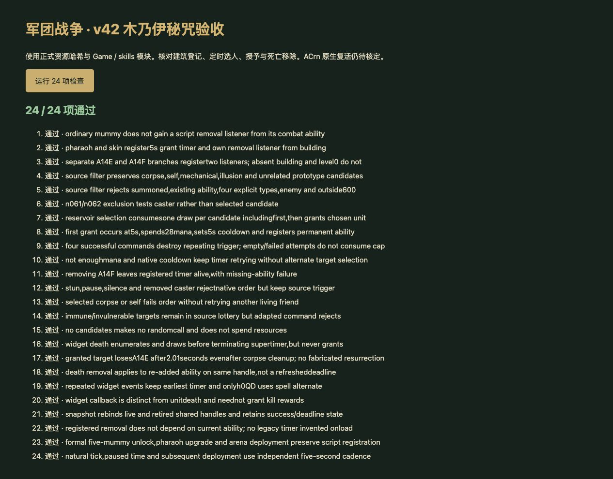
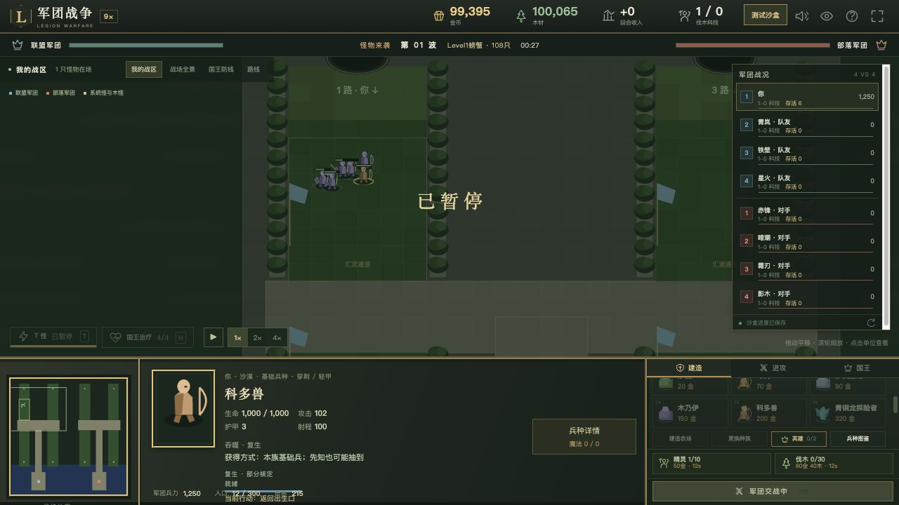

# v42 木乃伊死亡移除与法老王秘咒脚本归档

日期：2026-10-30。基线：`7301681ada8e8a23c6f327bc453d872ee03943e2`。内容版本：`v14-content-20261030-v42-1`。

本批完成的是可以从地图脚本核定的登记、选取、授予和移除流程。**ACrn 原生复活没有实现，A14E/A14F 仍为 partial；不能据此宣称木乃伊家族已经完整还原。** 后续任务必须补齐原生复活耗魔、死亡阶段和复活事件模型。

## 来源与实现

[规则模块](../../dist/mummy-rules.js)、[25 项专项](../../tests/v14-mummy.test.mjs)、[逐行证据及物编行](../../reference/mummy-evidence.json)。JASS SHA-256：`e66c55b3b25b185c991be5613e21fbf5b2d598f3cc40f2f8cd01c23bcb828250`；Latin-1 解码，只按 LF 计行。

- PassiveSkill 43700—43705 读取建筑能力。普通木乃伊 n061 建筑有 A1BL，战斗体 h0QD 才有 A14E，所以不能给普通木乃伊擅加一次性死亡移除登记。法老王 n062→h0QE、骷髅杰克 n07O→h0UX 的建筑有 A14F，登记自身移除和每 5 秒秘咒；同时具有 A14E/A14F 的建筑按两个独立 if 登记两次移除。
- RegisterMummyAbility 43447—43474 登记 widget 死亡，收到事件后创建 2.01 秒移除计时器；h0QD 请求 spell alternate 动画，死亡特效持续 2 秒，并销毁已保存的秘咒头顶特效。计时到点移除原句柄当时的 A14E、清理监听。这里没有脚本复活操作。
- SelectRangeNotMummy 43475—43498 在 600 范围选同盟、没有目标能力的单位，排除召唤物和精确 h0PI/h18J/h0JS/h38J。源码对 n061/n062 的判断对象是施法者 Pf，不是候选 D6。没有存活、非自身或魔免的预筛选，故死亡单位或自己可以被抽到；原生命令不接受时不重抽。
- RadomOfGroup 29844—29856 按枚举顺序蓄水池抽样，每个候选都抽一次整数，包括第一个候选。空组不抽数。秘咒回调的局部选取发生在 widget 死亡分支判断之前，死亡时仍先枚举抽样，再停止计时器。
- 43499—43543 每 5 秒尝试 IssueTargetOrder(unflamingattack)。返回成功才立即授予并永久化 A14E，登记目标死亡移除和特效；累计 4 次成功停止，失败继续后续周期。移除施法者当前 A14F 不会销毁此前登记的计时器。RegisterSupperMummyAbility 的 BF 参数实际未使用，以 QE 保存和授予能力。
- ANcl 宿主命令适配采用显式 28 耗魔、5 秒冷却及已有状态/目标许可。暂按即时接受处理，授予发生在接受后；没有虚构玩家手动按钮或技能完成事件。
- 接入正常及竞技转换，沿用实际五只木乃伊解锁 R0BR 的建造升级路径。保存恢复重新绑定活体及退出实体列表后的共享旧句柄，重复监听共用同一对象；旧档没有登记过的计时器不补造。

## 原生边界与下一项任务

- A14E 的原型是 ACrn，已知 DataA1/Cast1=2、Cool1=240，**缺 Cost1**。空白不是 0；不得拿英雄 AOre 的免耗魔或官方其他野怪的 90 耗魔、7 秒延迟代替本图对象。
- 原生复活的触发门槛、生命/魔法恢复、冷却启动、死亡阶段、buff 保留、widget 死亡与 UNIT_DEATH 的区别仍未实现。当前自动宿主只在终结死亡调用独立 widget 入口；测试直接调用该入口不代表真实原生复活流程已闭合。当前代码不会安排尸体回满血。
- A14F 缺 Cast1、DataA1 FollowThrough 和 DataD1；原生命令仲裁、施法点、渠道时序、目标许可及提前打断没有完整运行证据。28 耗魔及冷却采用即时适配，因此继续标为 partial。
- 同盟映射、原生组枚举顺序、共享随机流、隐藏/移除/蝗虫单位和尸体候选池仍沿用宿主表示。移除能力操作针对原句柄，不能转换为“只删除最初授予的那份能力”。
- 建筑能力 A1BL（Asth）补入覆盖；没有找到直接 JASS 分支及足够原生证据，保留 unresolved，不能因其说明与复生相关就标为完成或纯图标。
- 原生研究参考包括 [能力作者记录](https://github.com/Cokemonkey11/wc3-ability-doc/blob/main/sources/screwthetrees-wc3-editor-ability-insight-document/2023-11-14.md)、[IssueTargetOrder 作者讨论](https://www.hiveworkshop.com/threads/issuetargetorder-returns-boolean.162518/)、[widget 死亡作者实测](https://xgm.guru/p/wc3/197452)和[官方半人马资料](https://classic.battle.net/war3/neutral/centaurs.shtml)。这些支持区分事件或对象默认差异，不是本地图自定义 ACrn 的运行验证；具体适用范围记录于 evidence JSON。

## 验收

- `npm test` **1394 项通过**：1303 Node＋91 自定义，其中新增 25 项。覆盖源文件哈希、建筑登记区别、皮肤映射、重复监听、候选条件、每候选随机调用、5 秒节奏、4 次成功、失败不重抽、mana/cooldown/状态拒绝、2.01 秒移除、死亡前抽样、旧句柄存档和真实建造升级。
- 全量回归发现旧脚本任务可能无 type，已将新模块的 startsWith 判断改为可选检查，重新执行全套通过。
- 使用正式资源哈希的浏览器运行时 **24/24 通过**；控制台无 warning/error。本地 favicon.ico 请求 404 不影响验收。
- 正式界面沙盒手动建造五只木乃伊，以 300 金、5 人口升级法老王，另建科多兽并开第 1 波；运行至 27 秒暂停，科多兽显示“吞噬 · 复生”和“复生 · 部分核定”。这是能力授予验收，不是复活验收，也不是生产网站完整对局验收。
- 35 波各 12 秒烟测：2784 次出生、峰值 123 实体/16 任务，有限状态和存档续跑通过。短时烟测不等于 35 波自然完整通关。
- 57 个模块资源哈希校验。提交前清理临时浏览器验收页、测试标签及本地 HTTP 服务。

最新玩家能力 656 项：405 实现、119 部分、34 标记、98 待核定；全战斗 741 项：455 实现、125 部分、47 标记、114 待核定。两项 unresolved 转 partial，新增 A1BL unresolved；partial 不计作完成。

本批来源、实现范围、验证和剩余任务保存于本文件，与源码一起提交 GitHub；现有网站发布同一提交，实际提交号和部署状态见外部发布回执。本批未新建开发聊天，原有三个聊天保持归档。主还原目标继续，ACrn 原生复活单独保留待办。
