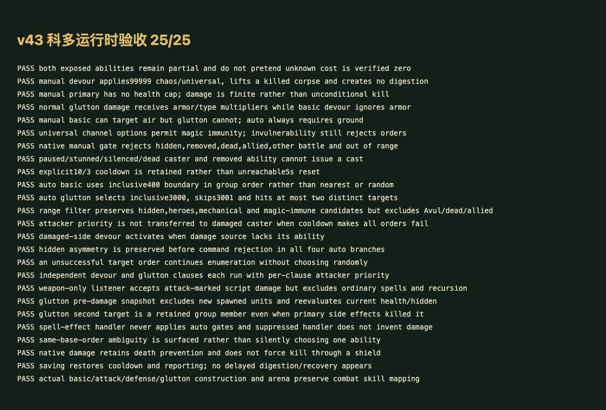
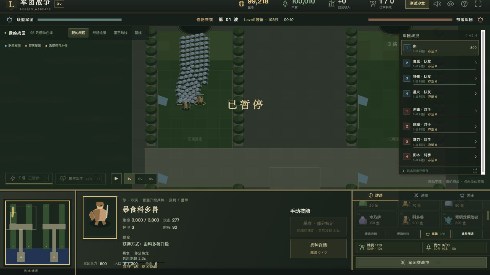

# v43 科多吞噬与暴食脚本归档

日期：2026-10-30。基线：`894a1ec3e3a05f1085c3bc3bb2ae2ccbe4d3a459`。内容版本：`v14-content-20261030-v43-1`。

## 可执行行为

[规则模块](../../dist/kodo-rules.js)、[26 项专项](../../tests/v14-kodo.test.mjs)、[源码与物编证据](../../reference/kodo-evidence.json)。原始 JASS SHA-256 为 `e66c55b3b25b185c991be5613e21fbf5b2d598f3cc40f2f8cd01c23bcb828250`，Latin-1 解码，只按 LF 计行。

- 科多兽、攻击型、防御型、暴食型的建筑/战斗映射为 h0QG→h0QK、h0QH→h0QL、h0QI→h0QM、h0QJ→h0QN。前三种携带 A14T，暴食携带 A14X；实际建造、升级及竞技转换均验证。
- A14T 施法效果 39513—39514 调用 DevourSkill。38465—38473 先请求 0.2 秒闪电特效，再造成 **99999 混乱攻击/通用伤害**；伤害后如果目标已死，启用飞行并请求以 1000000 速率升至 100000 高度，然后直接 return。
- A14X 的 DevourSkillEx 38515—38523 相同，但伤害为 **99999 普通攻击/普通伤害**。它受对应攻击类型倍率、护甲和现有伤害监听处理，并不是直接 KillUnit，也不是无条件秒杀。
- 两个函数的 return 之后才是隐藏、消化计时器、A14W 恢复、移除吞噬、吐出与重置 5 秒冷却。那些代码在本图路径中不可达，本批没有执行，也没有把 A14W 当成可达动态能力计入覆盖。原始文案的每秒 30／30+8% 伤害不替代实际可执行分支。
- 暴食施法效果 39515—39531 **先**调用 SelectRange 保存自身 300 范围的候选，再打主目标，随后遍历保存组，命中首个非主目标、当前生命≤3000、地面且未隐藏者，最多再打一人。第二目标不是随机或最近者；主目标伤害产生的新单位不在组中。主伤害后不重新检查候选的存活或 Avul，仍保留该旧句柄调用。
- SelectRange 29786—29806 筛选敌人、非死亡、无 Avul；没有英雄、机械、魔免或隐藏预筛选。原生枚举在宿主中以实体顺序适配，不能宣称原生 FirstOfGroup 的顺序完全一致。
- 独立武器伤害事件 42447—42504 分别处理吞噬和暴食。每个 if 都优先检查攻击者的能力，否则检查受击者；前者存在但命令失败，不转交给后者。按枚举顺序逐一尝试，首个接受命令时停止。吞噬门槛生命≤400，暴食≤3000，均要求地面；没有随机调用。
- 隐藏条件按四个分支原样保留：吞噬攻击者、暴食受击者分支没有 hidden 判断；另外两个分支有。缺少预筛选不等于命令一定接受，隐藏目标仍由命令适配拒绝，之后尝试下一目标。
- 加入 Web 手动敌方点选入口。400/3000 是自动入口的筛选条件，手动主目标没有脚本血量门槛；A14T 物编只写 enemies，所以手动可选空军，A14X 为 enemies,ground。两个技能 DataC1=13 包含 Universal 标志，目标魔免本身不拒绝本次适配，无敌仍拒绝。
- 保留显式 10/3 秒冷却，独立攻击监听的按伤害来源防重入、施法效果触发器的禁用门槛、普通伤害后续链和存档冷却。受击方施法引发新武器伤害时，保留嵌套命令记录，同时让外层记录仍反映原来的受击分支。

## 原生补证及未完成项

- A14T/A14X 的自定义 CSV 缺 Cost1、Cast1、FollowThrough 等默认字段。当前采用即时命令和即时施法效果适配，不扣未核定耗魔，UI 标明“耗魔待核定”。它不等于证实原生零耗魔。两项能力均保持 **partial**。
- 新找到 [w3x2lni 1.24.4 默认表](https://github.com/sumneko/w3x2lni/blob/master/data/zhCN-1.24.4/prebuilt/Custom/ability.ini)和 [1.27.1 默认表](https://github.com/sumneko/w3x2lni/blob/master/data/enUS-1.27.1/prebuilt/Custom/ability.ini)。两者 ANcl 均有 Cost=0、Cast=0、DataA=180、DataD=0.98、DataE=1。Git blob SHA、章节行号和相关数值保存在[原生研究记录](../../reference/kodo-native-research.json)，没有以外部版本直接覆盖所有自定义空字段。
- 当前地图实际原生版本、地图表默认继承关系、单位 castpt=0.3、180 秒 FollowThrough、DisableOtherAbilities、取消/打断与同命令仲裁尚未验证。对同时具备多个 unflamingattack 能力的单位明确拒绝含混命令，不猜某个能力优先。目标允许规则还需对应原生版本实测。
- 两个外部版本的 ACrn 还提供了 **Cost=0、Cast=3、DataA=7、Cool=240** 的原生默认记录。这是对 v42“缺原生耗魔依据”的新增补证；本图 A14E 的 2 秒自定义值仍优先。后续木乃伊原生复活任务应据此继续核对默认继承、生命恢复和死亡事件，不能据本批研究宣布复活已经实现。
- 飞行尸体仅记录源码要求的高度/速率；现有宿主不渲染尸体，不能据此宣称模型飞升和原生素材完成。原生存活标志、组枚举、队伍映射及引擎尚未闭合的其他监听仍有边界。

## 验证与交接

- `npm test` **1420 项通过**：1329 Node＋91 自定义，本批新增 26 项。验证源码哈希、提前 return、99999 有限伤害、伤害类型/护甲、魔免/无敌、手动与自动不同门槛、四个隐藏分支、失败继续枚举、双方优先级、嵌套监听、暴食预先取组、护盾保命、冷却、存档和真实建造升级。
- 首轮专项暴露外层诊断被嵌套请求覆盖，已修正。另修正测试对 restore 返回对象、死亡链独立随机调用和说明文字的错误假定，随后专项及完整回归通过。
- 浏览器使用正式哈希导入表执行 **25/25** 运行时检查；源码证据由 Node 校验。正式界面沙盒手动建造两只科多，将一只以 400 金、5 人口升级暴食后开启第 1 波；10 秒暂停时两只存活，暴食显示共用冷却 2.3 秒、部分核定及耗魔待核定。浏览器 warning/error 为空；本地 favicon.ico 404 不影响验收。
- 35 波各 12 秒烟测通过：2784 次出生、峰值 123 实体/16 任务，有限状态和存档续跑通过。这不是 35 波自然完整通关，也不是生产网站整局验收。
- 58 个浏览器模块资源哈希校验，提交前移除临时验收页并关闭自建标签和 HTTP 服务。

最新玩家能力 656 项：405 实现、121 部分、34 标记、96 待核定；全战斗 741 项：455 实现、127 部分、47 标记、112 待核定。本批两项从 unresolved 转 partial，不把部分实现计成完成。

本独立需求的源码、证据和验收一同提交 GitHub，并将同一提交发布到现有网站；实际提交与部署结果见外部发布回执。未新建开发聊天，原有三个聊天保持归档。完整还原目标仍继续。
