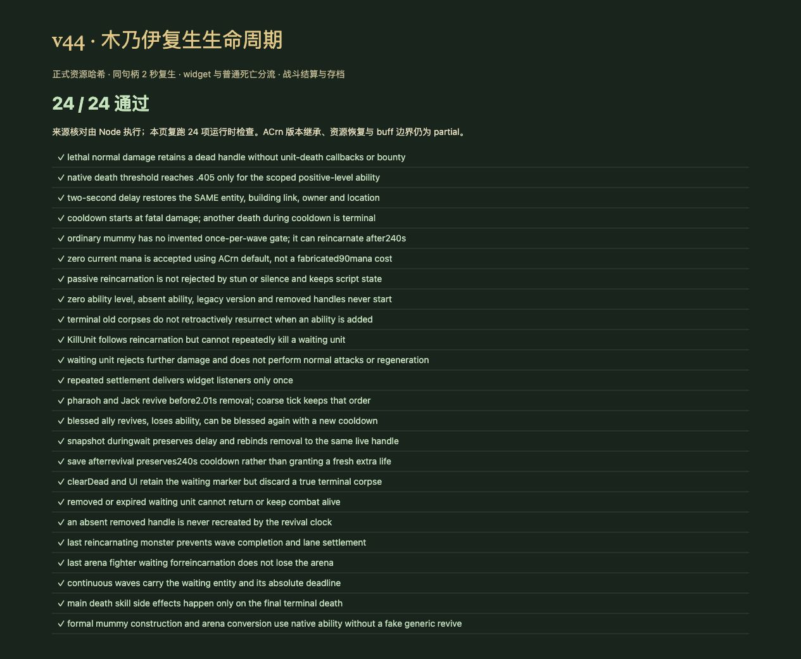
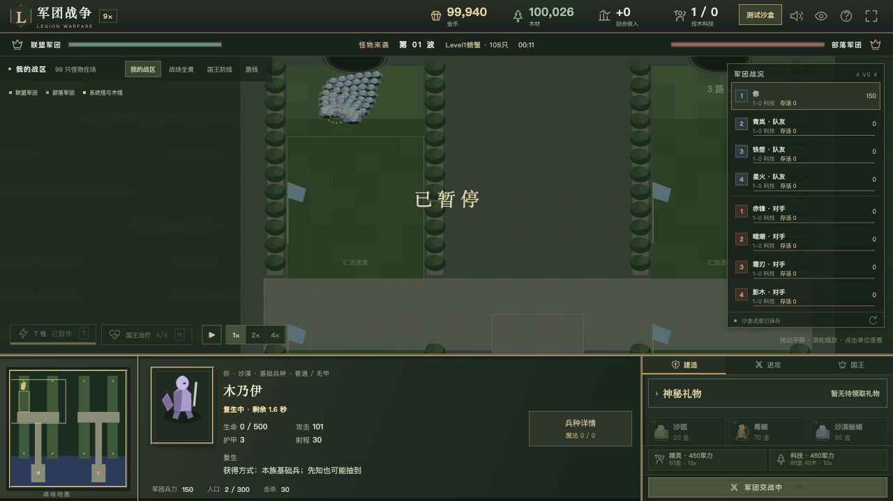
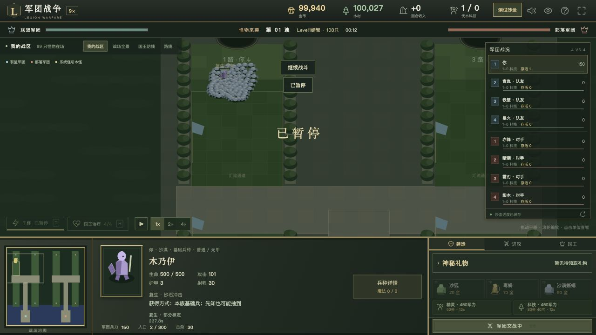

# v44 木乃伊复生生命周期归档

日期：2026-10-30。基线：`1436a59916f803cdb2bcf1a0eff6dc38df262bb5`。内容版本：`v14-content-20261030-v44-1`。

本批补上此前完全缺失的 A14E 复生阶段。木乃伊以及被法老王授予复生的单位，现在可以在致命伤害后保留原句柄、等待 2 秒，再返回战场。**A14E/A14F 仍为 partial**；版本默认继承、资源恢复与 buff 的原生表现没有本图运行证据，不以新增适配宣布完全还原。

## 来源与实现

- [复生模块](../../dist/reincarnation-rules.js)、[25 项专项](../../tests/v14-reincarnation.test.mjs)、[来源及边界](../../reference/reincarnation-evidence.json)。地图脚本 SHA-256 仍为 `e66c55b3b25b185c991be5613e21fbf5b2d598f3cc40f2f8cd01c23bcb828250`，Latin-1 解码、仅按 LF 计行。
- 本图 A14E 是 **ACrn**，显式 DataA1=2、Cast1=2、Cool1=240，Cost1 缺失。v43 收集的 w3x2lni 1.24.4 与 1.27.1 两份 ACrn 默认表都记录 Cost=0。本批只为 A14E 明确采用该默认值，并记录来源；没有把任意空字段统一补零，也没有使用 AOre 或官方半人马页面的 90 耗魔覆盖本图。
- [widget 死亡作者记录](https://xgm.guru/p/wc3/197452)与 [Unit Event 作者说明](https://www.hiveworkshop.com/threads/detect-reincarnation.274322/)支持把复生等待和普通 UNIT_DEATH 分开。等待中的单位按死亡处理，但不进入普通单位死亡链；[官方说明](https://classic.battle.net/war3/basics/spellbasics.shtml)也区分复生死亡与最终死亡的经验结算。
- `Game._settleDeath` 先尝试 A14E；仅限 v14 正等级能力，使用该能力的原生死亡阈值 0.405。冷却中、无能力、0 等级、移除或已终结死亡的句柄不产生新的复生。正常死亡的原有负生命值保留。
- 触发时将生命设为 0、取消当前攻击/目标，开启 240 秒冷却；保存绝对返回时间。只通知一次 `mummyWidgetDeath`，不设置终结死亡标志、不运行主死亡或独立 UNIT_DEATH 技能、不发击杀奖励。重复结算不会重复通知或计数。
- 2 秒等待期间不攻击、移动、回蓝或受击。清尸保留这个死亡句柄；波次清空、清路和竞技场胜负都等待它返回。31—35 连续波也携带原实体和原绝对时刻。
- 到期恢复同一对象的最大生命和魔法，保留 id、owner、位置、建筑关联、其他技能冷却和脚本计数，不重新创建单位、不重跑出生钩子。满资源返回是通用复生行为的宿主适配，**本图 ACrn 的准确恢复与 buff 清除仍需原生实测**；不把其他英雄原型的资料当成 ACrn 参数证明。
- 法老王和骷髅杰克的 widget 监听会停止其秘咒定时器，并在 2.01 秒移除 A14E。粗步长跨越两个时刻时，先处理 2.00 秒返回，再处理 2.01 秒移除。被祝福友军同样执行这一顺序；移除后可再次获得祝福，并创建新的能力冷却状态。
- 普通木乃伊建筑 n061 只有 A1BL，未登记上述移除监听；保留 A14E，因此 240 秒冷却后仍能再次复生，不按“每波一次”的文案添加源码没有的次数门槛。
- 直接 KillUnit 进入同样的能力判断；RemoveUnit 或宿主限时寿命到期取消等待，不在到期时重建被移除对象。旧存档中已经终结的尸体不会追溯复活。等待中/返回后存档分别保留剩余延迟与冷却，木乃伊移除任务重新绑定同一个句柄。

## 界面与验收

- 新增战场复生占位标记、倒计时和单位面板状态。等待期间显示生命 0，完成后显示返回后的生命。首次截图发现新增状态与底部统计行重叠，已将倒计时放在单位名称下方，并为桌面详情区域设置滚动及底部统计预留空间。
- `npm test` **1445 项通过**：1354 Node＋91 自定义；本批新增 25 项。包含真实建造、竞技转换、零耗魔适配、正反门槛、240 秒后再次复生、2/2.01 秒顺序、法老王再次祝福、骷髅王死亡链延后、终结奖励、清尸/清路/波末/连续波、移除/过期和存档。
- 回归初轮揭示无条件把终结死亡 HP 归零会改变科多原有伤害记录；已将正生命归零限定在新能力阈值路径，保留其他死亡负值。新增测试也从不必要的“尸体必须为 0”改为验证不再存活、不能追溯复生，随后完整回归通过。
- 正式资源哈希的浏览器运行时 **24/24 通过**。来源哈希与外部表记录由 Node 验证。最终资源更新后重新载入复跑通过，控制台 warning/error 为空。
- 正式界面使用沙漠沙盒，手动建造一只木乃伊并开启第 1 波。自然战斗约 11 秒时出现生命 **0/500**、复生剩余 **1.6 秒**、冷却 **239.6 秒**；继续后恢复 **500/500**，冷却 **237.8 秒**。通过暂停前后观察核对等待与返回；没有用调试注入替代正式界面操作。
- UI 刷新后通过“继续上次沙盒”恢复阵容，再自然触发并拍摄修正后的截图。正式界面验证范围是这只木乃伊的单波复生；法老王/祝福/竞技/连续波由运行时测试覆盖，不声称都进行了手动 UI 操作。
- 35 波各 12 秒烟测通过：2784 次出生，峰值 123 实体/16 任务，有限状态与存档续跑通过。不是完整自然通关或生产网站整局验证。
- 构建并校验 59 个浏览器模块。提交前移除临时验收页，关闭自建浏览器标签及本地 HTTP 服务。

## 保留边界与交接

1. 两份旧版本默认表提供了明确的 0 耗魔来源，但不证明本图完整原生表的继承结果。数据包 w3i 的格式 25 / 编辑器 6052 是遗留元数据，不能据此断言实际平台运行补丁。
2. ACrn 满生命/魔法恢复、冷却启动的本图原生精确时序、死亡 buff 清除/持久性、等待时移除能力及与其他复活能力的仲裁仍需验证。当前不批量清空脚本状态或强行补造 buff 清理。
3. 动画、尸体高度、碰撞和素材仍是 Web 表现。科多对复生尸体的飞高请求也仍未渲染。没有新增原始模型或声音。
4. A14F 的 ANcl 命令、FollowThrough 和施法打断仍为 v42 的已列边界；A1BL 仍 unresolved。
5. 玩家 656 项能力：405 实现、121 部分、34 标记、96 待核定；全战斗 741 项：455 实现、127 部分、47 标记、112 待核定。**分类计数不变**，本批是在 partial 内补齐一个实际缺失机制。

本独立需求的实现、证据和验收截图一同提交 GitHub，并把同一提交发布到现有网站；实际提交及部署结果另存外部发布回执。未新建开发聊天，原有三个聊天保持归档。完整还原目标仍继续。
