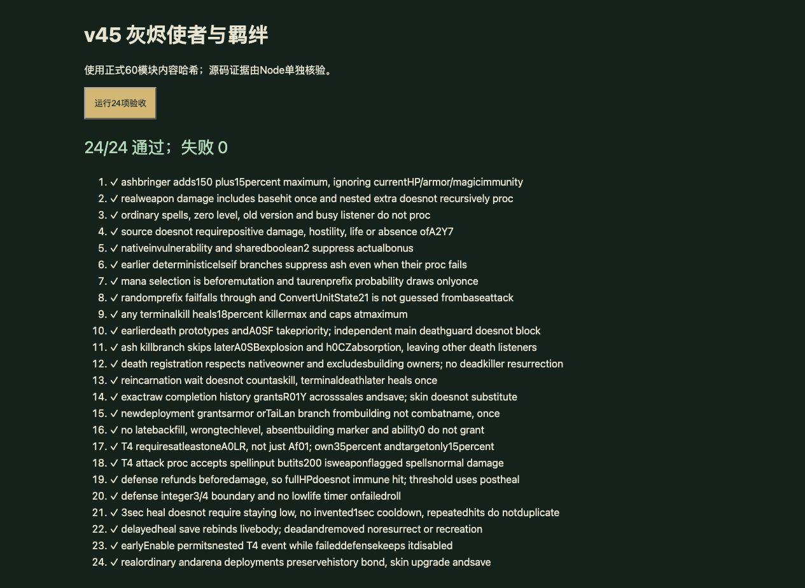
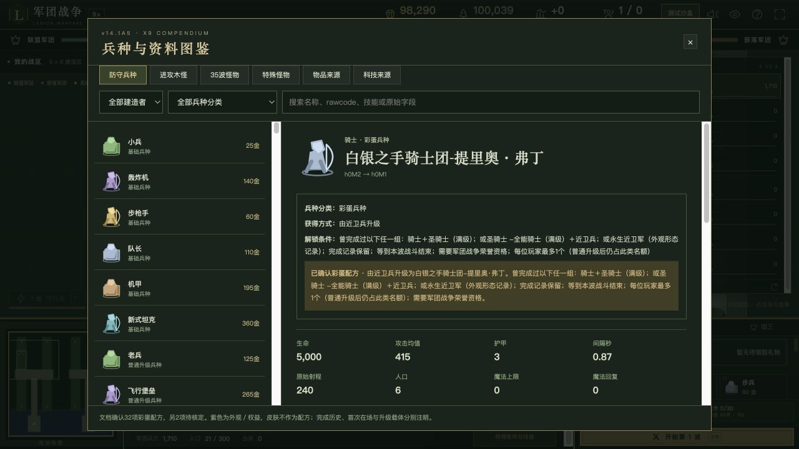
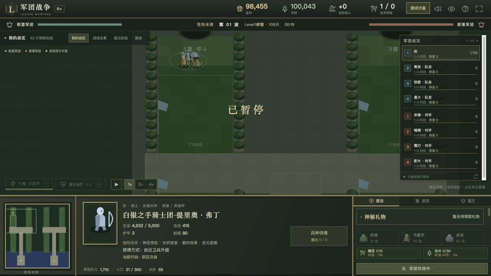

# v45 提里奥灰烬使者与羁绊归档

日期：2026-10-30。基线：`5408dd2d1af99aac1d10a9c5c202f9832455ea92`。内容版本：`v14-content-20261030-v45-1`。

本独立需求补入提里奥灰烬使者和提里奥／泰兰羁绊的可核定脚本行为，并纠正神圣愤怒的完成状态。**不是提里奥或泰兰整个家族已完整还原。** 源码、证据、验收和未完成事项在此交接；完成后不继续占用独立开发聊天。

## 来源与实现

- [独立规则模块](../../dist/tirion-rules.js)、[25 项专项](../../tests/v14-tirion.test.mjs)、[逐行证据与字段](../../reference/tirion-evidence.json)。原始脚本 SHA-256 为 `e66c55b3b25b185c991be5613e21fbf5b2d598f3cc40f2f8cd01c23bcb828250`，Latin-1 解码、仅按 LF 分行。
- A0LH 灰烬使者在独立武器伤害监听 `Trig_New_UnitAttackActions` 的后置分支追加 **150＋目标最大生命 15%** 混乱攻击／通用伤害。沿用武器事件与 Attack 重入门槛，保留前置 elseif 的选择，包括毁灭者变更魔法之前的判断、牛头粉碎概率失败仍占据分支，以及后续精确原型分支。没有额外添加正伤害、敌对、存活或 A2Y7 门槛。
- `ConvertUnitState(21)` 的含义没有用物编基础攻击猜测。混合 A05R 的测试实体若没有明确原生状态证据，记录未核定前置分支并抑制灰烬追加；共享布尔键 2 也会抑制追加。
- 独立 `Trig_DeathTriggerActions` 在 48011—48012 行回复击杀者最大生命 **18%**；脚本没有要求是普攻击杀。保留原玩家 8—12 登记、A0SF 和六种前置死亡原型分支，命中后跳过后续吸收／爆炸分支。它与主死亡监听的禁用状态分别处理。复生等待不计终结击杀，真正死亡才触发；不通过治疗复活死人。
- 同一玩家完成原始建筑 **h0M2 与 h203** 后授予 R01Y，完成历史跨出售和存档保留。并不要求此刻两者同时在场；h0VU 外观完成记录不能单独替代 h0M2。
- 普通出战 `oldcodefn_Bg` 与竞技 `vf` 使用同一授予规则：当前建筑含 A0LP 且 R01Y **恰好为 1** 时，新战斗体仍含 A0LP 则授予 A0LO/A0LQ，否则授予 A0LR。不追溯补给已经出战的对象、不重复增加护甲。A0LQ 显式 AIde DataA1=15 已实现；A0LO/A0LR 的 AIas DataA 缺失，不用名称推定 30% 攻速。
- A0LR 独立监听源于 `A_TirionFordring`，登记于 27153—27156 行。受害者或伤害来源至少一方持有 A0LR 才执行，Af01 本身不足以进入。受害者 A0LR 抽整数 1—10≤3：**先回复事件伤害，再承受外层伤害**，满生命时仍会掉血，不能按文案改成伤害免疫。
- 防御成功后源码立即重新启用监听；保留嵌套伤害再次进入的行为。回复后生命≤1000、共享键 1 未占用时安排 3 秒后的单次治疗，届时存活则回复 1000 并清键。没有“持续低生命 3 秒”要求，也没有文案所写的额外 1 秒冷却。重复伤害不重复安排同一等待任务。
- 来源持有 Af01 时，概率为 15%，自身同时持 A0LR 时为 35%。追加 200 点 ATTACK_TYPE_NORMAL（宿主 spells）／DAMAGE_TYPE_NORMAL 伤害，保留 weapon=true，再回复自身 1000。原事件不限定为普攻。任务保存恢复重绑同一对象，死亡／移除不重建单位。
- A0LG 神圣愤怒保留显式 ANpi 每秒 15 点、350 范围的基础灼烧，但改为 partial。h0M1 的攻击启动共享键 1、事件伤害恰好 15 时追加 105、受击回复事件伤害 50% 尚未接入。h0VT 外观不满足原始 h0M1 精确判断。图鉴明确显示这些缺口。

## 验收

- `npm test` **1470 项通过**：1379 Node＋91 自定义，零失败。本批新增 25 项，覆盖源码哈希、分支优先级、伤害类型、概率边界、重入、主／独立死亡分流、复生、原玩家归属、历史解锁、建筑／战斗体差异、普通／竞技出战及存档任务重绑。
- 牛头 22 项、独立死亡 19 项、复生 25 项受影响回归通过。新增 A0LG 证据行后再次运行本批 25 项通过；没有改变运行时代码。
- 最终构建资源哈希下，浏览器运行时 **24/24 通过**。浏览器不执行 Node 的源文件哈希检查；该项由 Node 覆盖。正式界面与验收页 warning/error 均为空。
- 正式界面选择骑士沙盒，通过已有沙盒资格开关提供本地测试资格；不代表真实平台账号权益。建造步兵→升级近卫兵，建造满级圣骑士及骑士后，直接点击 **700 金、6 人口** 的提里奥升级按钮成功。没有使用兵种训练礼物。未核定外观档位仍保持禁用。
- 刷新最终构建后，“继续上次沙盒”恢复相同阵容。选中提里奥显示 5000 生命、415 攻击和由近卫兵升级；图鉴显示神圣愤怒／灰烬使者／羁绊的部分实现说明。正式开启第 1 波，自然战斗 19 秒时三名单位存活、55 次总击杀，提里奥为 4932/5000 生命。
- UI 只验收提里奥的获取、存档恢复和单波战斗；泰兰羁绊与竞技等由运行时测试覆盖，不声称经过真实平台或全部手动 UI 流程。
- 35 波各 12 秒烟测通过：2784 次出生，峰值 123 实体／16 任务，有限状态及存档续跑通过。这不是 35 波完整自然通关。
- 构建和哈希校验覆盖 60 个浏览器模块。临时验收 HTML 已移除，自建浏览器标签和本地 HTTP 服务关闭，截图保留用于复核。

## 未完成边界与下一项交接

1. 神圣愤怒 h0M1 的上述共享键写入和主伤害链分支需要核对完整前置 elseif 及 ANpi 原生事件类型后实现；不能只加 105 伤害就宣布完成。
2. A0LO/A0LR 原生 AIas DataA、能力依赖／默认继承、完整监听注册顺序及共享键的其他写入仍无完整证据。A0LO unresolved，A0LR partial。
3. Af01 的其他圣光旗帜／全队治疗分支与无羁绊时的行为仍待核定。泰兰取得条件 R00M 尚未闭合，本批没有虚构解锁菜单。
4. Web 治疗对死亡／移除对象不复活，原生对已死句柄写生命的细节仍需实测；宿主零／拒绝伤害事件分派与所有原生 listener 的排序也仍有边界。
5. 新纳入三个动态能力。玩家 **659**：405 实现、126 部分、34 标记、94 待核定；全战斗 **744**：455 实现、132 部分、47 标记、110 待核定。A0LG 的降级是纠正统计，不是删掉已运行的灼烧。

本项代码、证据和独立归档一同提交 GitHub，现有网站发布同一源码提交；具体提交和部署结果保存在仓库外的 `v45-publication.json` 回执中，避免发布后修改归档造成来源不一致。没有新建开发聊天，原三个聊天保持归档。完整还原尚未完成，后续从本交接与总待办继续，不重复执行已通过的验收。
