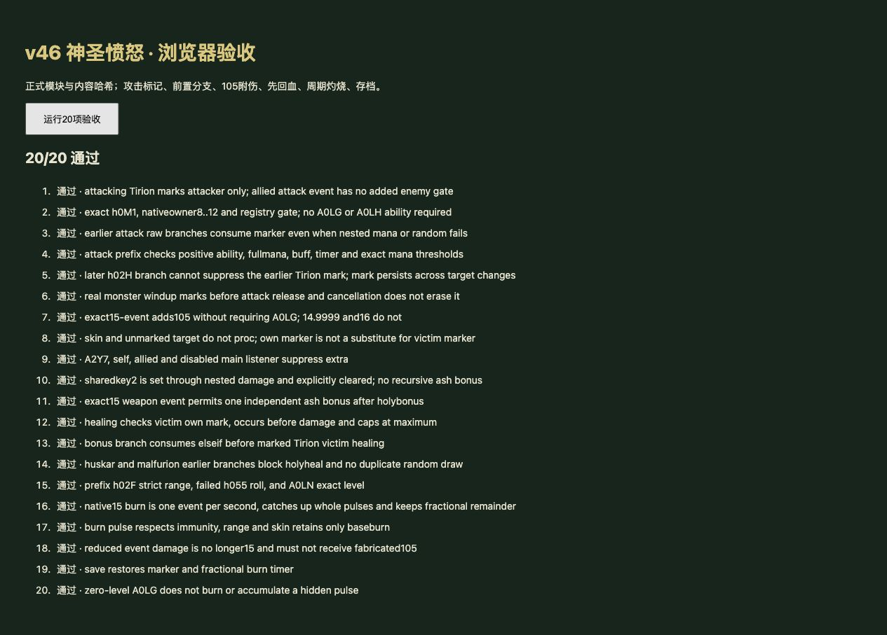

# v46 神圣愤怒脚本与周期灼烧归档

日期：2026-11-03。基线：`e8bbb86827044dc13ee44476ad58b27e8958db0c`。内容版本：`v14-content-20261103-v46-1`。

本项继续补齐 v45 留下的提里奥神圣愤怒分支，并修复 v45 状态调整带来的基础灼烧停用。整体还原目标仍未完成，A0LG 仍为 partial；本档案只关闭这批已实现并验收的工作。

## 来源和行为

- [规则](../../dist/tirion-rules.js)、[运行时接线](../../dist/skills.js)、[21 项专项](../../tests/v14-tirion-holy.test.mjs)、[逐行证据](../../reference/tirion-holy-evidence.json)。来源仍是原始 JASS，SHA-256 `e66c55b3b25b185c991be5613e21fbf5b2d598f3cc40f2f8cd01c23bcb828250`，Latin-1 解码，仅按 LF 分行。
- `Trig_AttackTrigegrActions` 的 i 是被攻击者、Pf 是攻击者。47735—47736 行在 i 为 h0M1 时，将 **攻击者 Pf 的共享布尔键 1** 置真，不是给提里奥本人标记。h0M1 在 48453 行明确注册到 Q；攻击事件仅登记原玩家 8—12。
- 标记接入攻击启动事件，怪物前摇开始便发生，取消攻击并不清除。前置原型、能力、魔法、buff、S006 定时器条件按源码选择；前置分支内部概率或魔法检查失败，仍占据该 elseif，不能继续标记。h02H 等后续分支不阻止标记。不额外要求 A0LG/A0LH 图标、伤害命中或敌对关系。
- 神圣愤怒位于从 41337 行开始的独立 elseif 链。沿用已执行的不屈、狂战、星火、暮光结果，再判断 h02F 严格伤害区间、h055 随机分支、h0O7 随机分支及 A0LN 恰好 1 级。这条链不被更早的另一个 elseif 链整体吞掉。
- 来源原型为 **h0M1**、事件伤害**恰好 15**、受害者共享键 1 为真时：来源键 2 置真，追加 **105 混乱攻击／通用伤害**，随后明确清为 false。使用事件伤害而非之前可能被改写的局部 P8。主监听禁用避免递归，独立武器监听仍保持自己的语义。
- 否则，受害者原型为 h0M1 且其自身键 1 为真，先回复事件伤害的 **50%**，随后外层伤害正常扣除。回复有最大生命上限，满血时不能等同于 50% 减伤。附伤分支优先于回血分支。
- 两个精确原型分支不要求 A0LG 图标；h0VT 外观不满足 h0M1 判断。没有把文案里的“10＋目标最大生命 0.5%”替换成实际代码参数。
- A0LG 的显式 ANpi DataA1=15、Dur1=1、Area1=350。基础灼烧改为每 1 秒完整 15 点事件，保留小数周期进度及存档；原先按 dt 拆分会让精确等于 15 的脚本条件无法触发。0 级不伤害、不累积隐藏周期；仍遵守地面敌方、范围和魔免。

## v45 勘误

v45 将 A0LG 从 implemented 改为 partial，保留了编译后的 immolation 类型，但没有把 A0LG 加入 `active()` 的部分实现放行列表，实际基础灼烧因此被停用。v45 归档所称“保留基础灼烧”只验证了编译字段，没有验证实际扣血，证据不足。本项修复放行并增加完整周期、真实伤害、外观、魔免、范围及存档检查。

## 验收

- 新增 **21 项 Node 专项**，其中一项校验源文件哈希与逐行证据，另 20 项执行实际规则和游戏接口。覆盖标记对象、原玩家登记、前置分支、前摇取消、15 精确比较、共享键 2、灰烬使者联动、满血治疗、优先级、周期、保存恢复和 0 级能力。
- 最终运行时 `npm test` **1491 项通过**：1400 Node＋91 自定义，零失败。
- 浏览器加载正式资源哈希，**20/20 通过**，warning/error 为空。临时验收页只复跑运行时测试，源文件哈希由 Node 校验。截图随归档保留。
- 35 波各 12 秒烟测：2784 次出生，峰值 123 实体／16 任务，有限状态与存档续跑通过。最后新增 0 级门槛由全量和浏览器专项覆盖；烟测没有人为移除 A0LG，不声称这是原版引擎实测或自然完整通关。
- 构建与版本校验覆盖 60 模块。临时测试页面、本地服务器和验收标签在交付时清理。
- 本项没有重新手动执行完整建造升级路径；其 v45 UI 验收保留为历史证据。本次新增逻辑由真实 Game 接口的 Node／浏览器测试证明，不以图鉴文字证明战斗逻辑完成。

## 后续交接

1. ANpi 的首次跳时刻、原生伤害类别、暂停／控制状态下周期及出入范围采样仍需原版实测。当前每秒完整事件是依据显式字段的宿主适配，不将其扩大宣称为完整原生行为。
2. 未实现前置分支的效果、其他共享键写入以及所有原生监听改伤顺序仍有边界。S006 定时器等沿用明确的宿主状态表示，不补造其余技能行为。
3. A0LO/A0LR 原生攻速字段、泰兰 R00M 获取和 Af01 其他规则继续留在队列。A0LG 保持 partial，覆盖计数不变：玩家 659（405/126/34/94），全战斗 744（455/132/47/110），顺序为 implemented/partial/marker/unresolved。
4. 本项独立归档、测试、源码提交 GitHub；同一提交发布现有网站，实际结果另存仓库外 `v46-publication.json`。没有新增开发聊天，原三个聊天保持归档。
