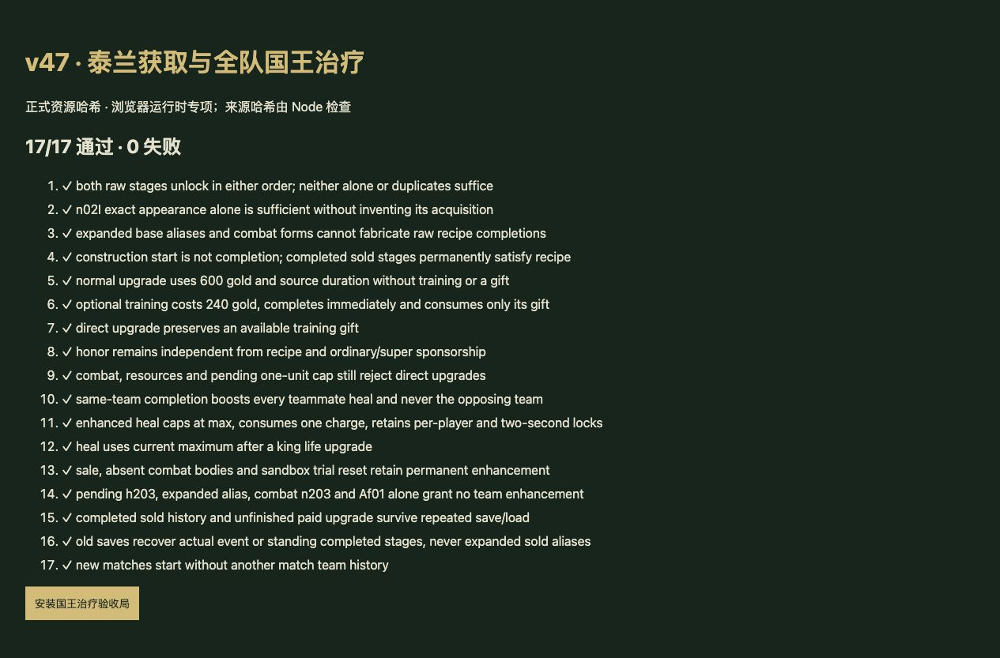

# v47 泰兰获取与全队国王治疗归档

日期：2026-11-03。基线：`b9576b597131db044cd9206e7263a23317c56642`。内容版本：`v14-content-20261103-v47-1`。

本项关闭 R00M 正常配方误拦截和泰兰全队治疗增强缺失，整体还原目标仍未完成。Af01 保持 partial。

## 来源与实现

- [逐行证据](../../reference/tailan-acquisition-evidence.json)固定原 JASS SHA-256 `e66c55b3b25b185c991be5613e21fbf5b2d598f3cc40f2f8cd01c23bcb828250`，Latin-1 解码，仅按 LF 分行。
- 28880—28885 行的正常 R00M 条件为实际完成 `h09U AND h0J3 OR n02I`。按原始 rawcode 保存永久完成历史，不要求同时在场；外观别名、战斗体、施工开始不能伪造实际完成。`n02I` 单独足够是原始条件，不代表其外观获取入口已开放。
- 22195/22205 行的老兵替代条件要求 `T1>=125 AND T2 AND T3`。全脚本只有 T2/T3 的声明和读取，没有任何赋值，两者默认 false；不能因此拦截已证明的正常配方，也不能捏造击杀 125 次直接解锁。老兵金币监听确实注册，其金币收益另待实现。
- 老兵可以原价 **600 金**直接升级泰兰，保留物编施工时间；兵种训练仍是可选 **240 金**即时折扣。荣誉 h230、战斗结束、人口、资源、每玩家 1 个的限制不被配方确认绕过。
- 28892—28898 行在实际完成 h203 时永久设置对应队伍 H4/H5；24594—24622 行据此将国王治疗从最大生命 **50% 提高到 60%**。使用同队原始完成历史表示，固定队伍中任一队友完成即生效，出售后保留。未完成目标、n203 战斗体和 Af01 图标不能替代建筑完成。
- 保留每人一口、全队四口、2 秒队伍间隔、生命上限；按国王当前最大生命计算。旧存档只恢复能证明的完成事件或现存已完成阶段，模糊别名不补造。
- 治疗按钮、国王面板及帮助说明读取实际治疗值；面板缓存随治疗值变化刷新。
- 图鉴同步为 **33 确认＋1 待核定**，泰兰归为正常彩蛋升级。原修订文档保持历史输入，生成器用显式来源审计覆盖旧结论，重建不会恢复错误拦截。

## 验收

- 新增 18 项专项（1 项来源与负证据、17 项运行时），验证正常/外观条件、真实升级与训练、权限限制、团队治疗、存档及旧档恢复。
- `npm test` 全量 **1509 项通过**：1418 Node＋91 自定义；图鉴修正后再跑全量。
- 浏览器专项 **17/17 通过**，加载当时正式资源哈希。该检查在最后图鉴文案与生成器修正之前完成，之后由全量检查覆盖图鉴；不宣称完成自然获取全流程或正式游戏面板的手工验收。
- 35 波各 12 秒烟测：2784 次出生、峰值 123 实体/16 任务，有限状态与存档续跑通过。该短时检查不等于自然完整通关。

## 后续交接

1. 老兵金币收益监听保留独立待办；注意条件里 Player(9) 的 or 优先级，以及 Sf[0] 对概率的影响。
2. CancelSave 自动保命治疗触发时机、Af01 依赖及其他独立效果、A0LO/A0LR 原生攻速字段仍待核定。现有 AI 自动治疗继续使用宿主时机，不宣称原版时序已还原。
3. 玩家覆盖 659（405/126/34/94），全战斗 744（455/132/47/110），顺序 implemented/partial/marker/unresolved，计数不变。
4. 本项独立归档与提交；用户新提出的 AI 强度提升作为下一项开发。没有新增聊天，原三个开发聊天保持归档。网站可随下一项一并发布同一仓库状态，最终部署另存外部回执。
