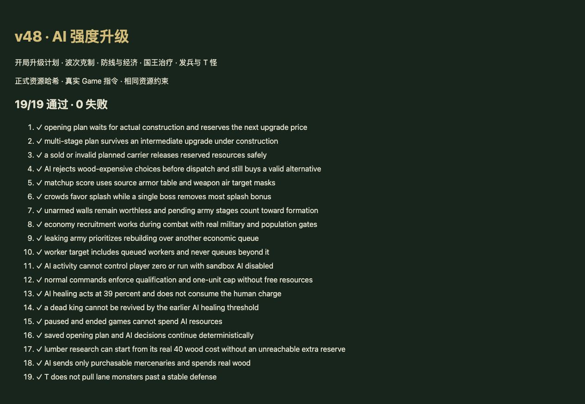

# v48 AI 强度提升归档

日期：2026-11-03。独立基线：`b4dc2ec78f5019a567035935cd7a0295229c8451`（v47 泰兰修正）。内容版本：`v14-content-20261103-v48-1`。

用户要求增强 AI。本项实现浏览器模拟的对手策略，不声称来自原版地图 AI。双方 AI 队友与对手使用同一套策略，玩家 0 不被自动操作。

## 完成内容

- [独立策略模块](../../dist/ai-controller.js)通过已有 Game.command 执行所有建造、升级、经济、国王强化和发兵；保留金币、木材、人口、施工时间、库存、资格、波次与数量限制。
- 开局评估基础兵到后续两级的路径。预留实际升级金币及木材，等待建造完成再升级；多阶段施工不丢失计划，载体失效则释放计划，存档可以恢复。
- 使用当前波次的护甲、攻击类型、武器对空掩码和已解析技能估算战力；九倍杂兵提高范围攻击优先级，少量首领降低范围收益。前排生命、后排输出、同类兵种和重复辅助参与权重，施工目标也计入阵容。
- 购买前检查木材、人口和来源条件，失败候选不会阻断其他合法选择；保留两座祭坛与不同英雄家族的正常选择流程，支持变形兵种候选池。
- 工人目标包括训练队列，战斗期间也可发展经济；漏怪后先补约20%兵力再继续经济。修复研究伐木需要额外木材储备却始终被国王和发兵花掉的决策死锁。
- 国王强化与真实威胁、阶段上限联动；发兵按收益与战力排序，每轮最多3次，仍支付资源并扣真实库存。国王低于40%时尝试使用 AI 自己的治疗次数，保持队伍间隔，不消耗人类玩家次数。
- 对照中发现频繁 T 怪会拉怪穿过防线，因此只对低于65%生命的国王面前、正在攻击国王的怪物使用；不再随机干扰稳定防线。

## 验收与实际表现

- [19项专项](../../tests/ai-strategy.test.mjs)覆盖延迟/多阶段计划、资源预留、非法候选、攻击克制、范围攻击、工人/伐木、发兵、治疗、T怪、沙盒开关、玩家隔离、暂停和存档续跑。
- 最终 `npm test` **1528 项通过**（1437 Node＋91 自定义）；浏览器正式资源 **19/19 通过**，warning/error 为空。
- 35波各12秒烟测：2784次出生，峰值123实体／16任务，数值与保存续跑通过；该烟测默认关闭沙盒AI，主要检查战斗机制未回归，AI策略由专项及对照验证。
- [可复跑脚本](../../scripts/benchmark-ai.mjs)与[原始对照结果](../../reference/ai-strategy-benchmark.json)保留。默认三种子，至第4波、比赛结束或1200秒；两版本都为玩家0提供测试用自动建造，统计对手4名AI。

| 种子 | 旧/新漏怪 | 旧/新工人总数 | 旧/新伐木等级总和 | 旧/新发兵次数 |
| --- | --- | --- | --- | --- |
| 42 | 254 / 337 | 8 / 16 | 0 / 5 | 7 / 10 |
| 173 | 272 / 264 | 6 / 16 | 0 / 6 | 5 / 22 |
| 615 | 688 / 408 | 5 / 12 | 0 / 5 | 4 / 18 |

旧615在第3波提前结束，新版三个种子均进入第4波。因此并非严格等时或等暴露比较；AI随机调用改变后，后续战斗随机序列也会变化。42种子漏怪增加，不能把本次结果宣称为所有阵容、所有波次均更强。早期经济和进攻更积极，薄弱阵容与后期策略仍可继续调优。

## 交接与归档

本项单独提交 GitHub、更新现有网站；v47泰兰修正包含在此次发布中。最终发布回执另存仓库外 `v48-publication.json`。原有三个开发聊天保持归档，没有新增聊天。当前主聊天仍承接未完成的整体还原目标，本档保存本次需求的完整边界。

后续可扩展更长波次的阵容对照、控制技能/礼物主动决策和玩家可选策略档位。没有用额外金币、木材或战斗属性加成掩盖决策问题。
