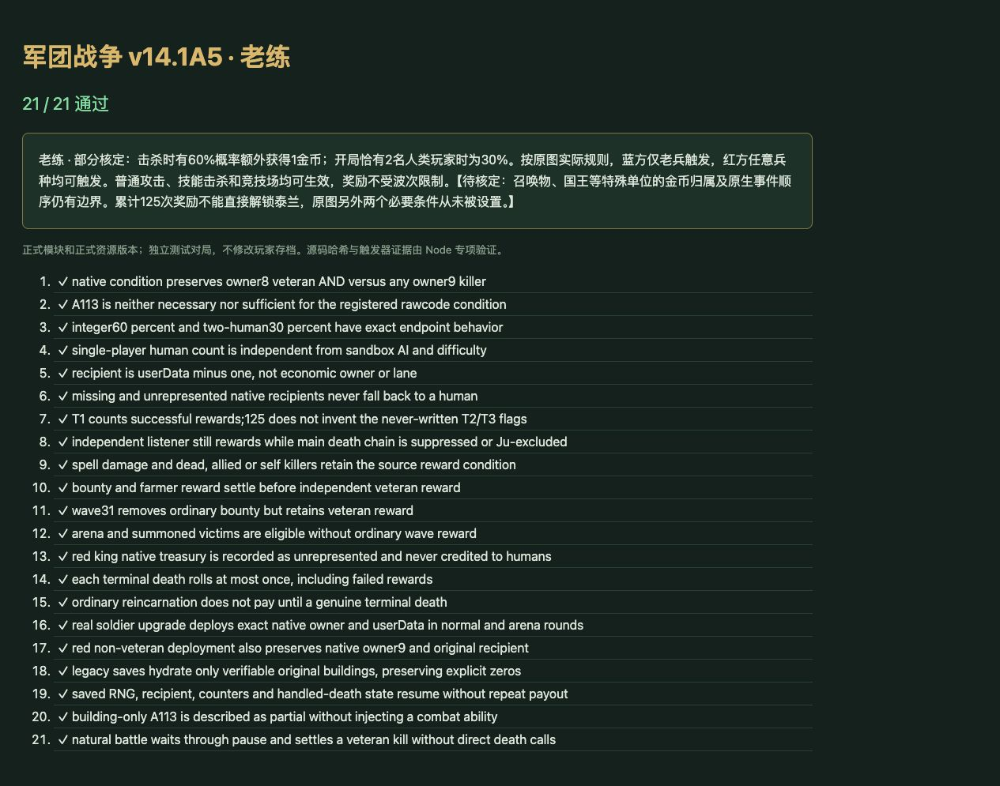

# v49 老练击杀金币归档

日期：2026-11-03。基线：`9ee9d149d419166e7ba73797266df93076d392df`（v48 AI 增强）。内容版本：`v14-content-20261103-v49-1`。

## 源码核定

- [证据与行号](../../reference/veteran-reward-evidence.json)固定原始 `war3map.j` 的 SHA-256。`T0` 在 27137—27140 行注册为全单位死亡监听，没有禁用语句；普通击杀金币 `qC` 先注册，主死亡触发器也先初始化。
- `C_ExperiencedSoldierSkill` 的实际条件是 `(h028 && owner == Player(8)) || owner == Player(9)`。因此蓝方只有老兵，红方任意击杀者都可能触发；不按说明文字将两边改为相同条件。A113 只在 h00T 建筑体上显示，战斗体 h028 没有该图标，监听器也不检查能力等级。
- `Sf[0]` 是开局处于游戏中的人类玩家数，不是怪物倍率。恰有两名人类时整数随机 1—10 ≤3，其余情况 ≤6。当前单机游戏是一人加 AI，默认人类数为 1；沙盒 AI 开关不会改变人数。
- 成功后给击杀者 `GetUnitUserData() - 1` 对应的原生玩家加 1 金币，并增加 Jh 收益和 T1 成功次数。没有普通攻击、敌方、波次或竞技场限制。
- 125 次奖励只是替代解锁条件的一部分；T2/T3 两个布尔数组从未赋值，默认 false。因此不根据次数伪造 R00M 或泰兰资格；v47 已核定的正常获取路径保持有效。

## 接入范围

- 新增 [veteran-rules.js](../../dist/veteran-rules.js)，在真正的终结死亡、普通金币结算后执行独立监听。主死亡链的 Ju 排除与临时禁用不屏蔽本监听；复生等待期间不发钱，重复处理同一死亡不重复抽样。
- 普通与竞技部署携带原生队伍所有者和原始玩家 userData，泛用召唤继承原生所有者，不凭经济 owner 猜测 userData。国王保存自己的原生所有者和国库编号。
- 成功次数与已处理标记随存档保存。旧存档只对能匹配持久建筑与战斗类型的原始出战单位补全身份；明确的 0 值、分身、召唤物及不可识别单位不强行改写。
- 老兵技能详情增加 A113 的实际收益说明，保留“部分核定”；不向战斗单位注入不存在的 A113。统计补上此前遗漏的建筑图标及其运行规则。

## 验证

- [22 项专项](../../tests/v14-veteran.test.mjs)：原始哈希与行号、条件优先级、30%/60% 整数边界、金币归属、成功计数、独立死亡监听、农夫和普通金币叠加、31 波与竞技、国王边界、复生、真实升级出战、旧存档、暂停及自然战斗。
- `npm test` **1550 项通过**（1459 Node ＋ 91 自定义），包括 v48 AI 策略检查；最后仅调整说明文案和条件括号，再次执行 22 项专项。
- 正式资源导入图在浏览器 **21/21 通过**；源码文件哈希检查留在 Node，浏览器警告/错误为空。测试在独立对局中执行，不修改用户正在玩的本地存档。
- 35 波各 12 秒烟测：出生 2784，峰值 123 实体／16 脚本任务；有限数值与保存续跑通过。短时烟测不是完整自然通关。
- 62 个浏览器模块及样式内容版本已更新。玩家能力 660 项：405 实现、127 部分、34 标记、94 待核定；全战斗 745 项：455／133／47／110。玩家范围是全战斗的子集，不能相加。

## 未闭合边界与交接

原生 Player(8/9) 国库并不等于八个人类玩家账户。红王成功触发时记录未映射的国库请求和次数，不把它错误发给某名人类玩家；完整国库资金与后续转账仍需还原。独立技能马甲没有全部补齐原生所有者/userData，完整原生事件顺序、随机数序列和召唤身份仍待继续核定，因此 A113 保留 partial。

本批独立提交 GitHub 并更新既有网站；最终提交和部署回执保存在仓库外 `v49-publication.json`。原有三个开发聊天保持归档，没有新增聊天。当前主聊天继续承接整体还原目标；本档保存本需求的证据、实现、验收和剩余边界。
