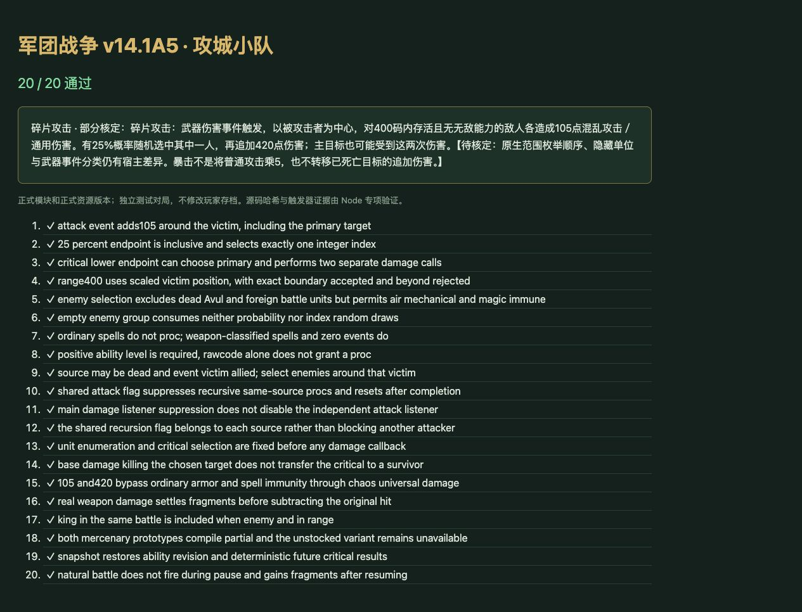

# v50 攻城小队碎片攻击归档

日期：2026-11-03。基线：`7ed58886f7c3463d76d2155ab977bd3a959b3c15`。内容版本：`v14-content-20261103-v50-1`。

## 来源与行为

[原始证据](../../reference/siege-team-evidence.json)固定 `war3map.j` 哈希与行号：`New_UnitAttack` 注册在 42804—42807，42270—42271 / 42794 使用每个伤害来源独立的 Attack 布尔值防止重入。A20C 分支位于 42291—42311，前有剑圣暴击和蓝龙攻击，后有其他攻击附加和瓦斯琪冰箭。此次在共享事件入口中按已接入分支的源顺序放到剑圣后、瓦斯琪前。

- 只在武器伤害事件且 A20C 等级大于零时执行；原脚本没有正伤害量、敌对原目标或存活攻击者前置。
- 使用被攻击者的位置而非攻击者的位置，以 `SelectRange` 一次性选定400码内存活、敌对、无Avul的单位。没有排除主目标、空中或机械单位。
- 组非空才进行一次实数0—100≤25抽样，成功后再抽一次整数1—人数，指定单个组成员。不是每人25%，也不是逐个水塘抽样。
- 按组顺序给每人105点混乱攻击／通用伤害，选中者紧接着额外请求420。两次是独立伤害事件，合计525；它们不把原普通攻击伤害乘5。105已击杀目标时仍保留其追加请求，不把420转给另一人。
- 使用已核定的 `UnitDamageTargetBJ` attack=true适配，沿用每攻击者重入保护。原始伤害在回调之后结算，A20D死亡爆发仍走已有主死亡链。

## 实现与入口

- 新增 [siege-team-rules.js](../../dist/siege-team-rules.js)，编译和事件接线位于 [skills.js](../../dist/skills.js)。本次不改变其他单位的资源或战斗数值。
- h0XK为可购买的攻城小队，花500木材并按现有波次收入规则结算；第11波验收获得12收入。购买、排队和实际出生均使用正常命令。
- h0XL机械变体仍为无库存预览，虽具有同一碎片机制，不因说明中的第10波限制新增购买入口。
- 技能描述显示实际范围与两段伤害，标为partial。事件选组、暴击目标、伤害请求和重入状态随存档保存。

## 验收

- [21项专项](../../tests/v14-siege-team.test.mjs)：源码哈希、注册、概率边界、索引抽样、主目标、边界距离、敌我/类型/无敌筛选、空组随机、武器与普通法术、零事件、递归防护、死亡目标、分段伤害、国王、实际发兵、保存续跑及自然战斗暂停恢复。
- `npm test` **1571项通过**（1480 Node＋91自定义），包括共享攻击/死亡链和AI回归。
- 正式资源导入图在浏览器 **20/20通过**；源码文件哈希检查留在Node。浏览器warning/error为空。验收对局与用户本地存档隔离。
- 35波各12秒烟测：2784次出生，峰值123实体／16任务，有限数值与存档续跑通过。不是完整自然35波通关。
- 63个浏览器模块与样式内容版本一致。玩家660种能力统计不变：405实现／127部分／34标记／94待核定；全战斗745种：455实现／134部分／47标记／109待核定。A20C是发兵能力，不计为玩家建筑能力。

## 边界与交接

Web按实体登记顺序枚举，尚未证明与原生Group枚举一致；隐藏/蝗虫单位可见性、原生伤害分类、拒绝命中与零事件的细分仍沿用现有宿主边界，A20C保留partial。没有声称攻城小队全能力或整体游戏还原完成。

本项独立提交GitHub并发布既有网站。最终提交及部署回执另存仓库外 `v50-publication.json`；原有三个开发聊天保持归档，没有新增聊天。本档保存此次单项需求上下文，主聊天继续整体还原目标。
