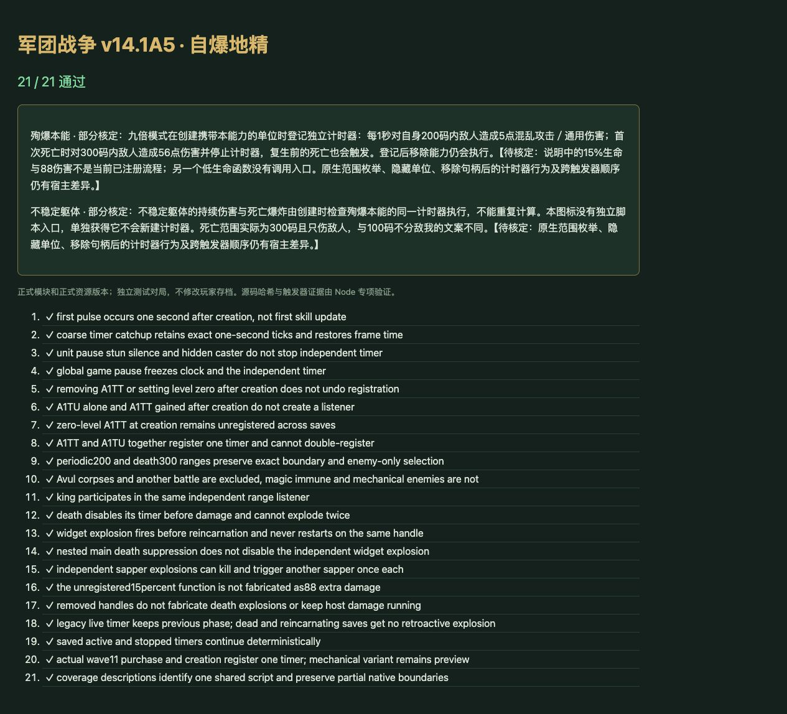

# v51 自爆地精创建计时器与死亡事件归档

日期：2026-11-03。基线：`0d693c6e679b5e5c239306943bf9801cf3468a1d`。内容版本：`v14-content-20261103-v51-1`。

## 源码核定及旧实现问题

[原始证据](../../reference/sapper-evidence.json)固定原始JASS哈希与行号。九倍模式设置C6=true，`CreateUnitHook` 监听世界边界进入并检查A1TT等级，调用 `X9WoodSkillTwo`。该函数登记1秒循环计时和 `TriggerRegisterDeathEvent`，不是普通 `EVENT_PLAYER_UNIT_DEATH`。

- 原计时器对200码内存活且无Avul的敌人造成5点混乱攻击／通用伤害。死亡分支先销毁自己的触发器，再对300码内敌人造成56点同类伤害。
- A1TU没有字面量、十六进制或十进制脚本引用；说明对应的实际效果由创建时A1TT检查登记。不能再为A1TU增加第二套持续伤害或爆炸。
- `X9WoodSkillThree` 只定义一次，没有调用或字符串执行登记。它内部的≤15%生命分支也只写5点，而文案说88。此次不把未注册函数或说明文字接入战斗。
- 旧实现把计时器放在可行动单位的技能更新中、以当前A1TT存在与否决定执行，并把爆炸放到普通死亡结算。这样单位暂停会停跳、移除能力会停跳、复生等待不会爆炸，国王也未纳入范围。因此此前A1TT的implemented标签过于乐观，现纠正为partial。

## 修正内容

- 新增 [sapper-rules.js](../../dist/sapper-rules.js)。实际实体创建时记录独立登记状态与首跳时间；获得A1TT或A1TU本身不等于重新进入世界，后加能力不新建监听。
- 计时器由全局脚本调度执行，单位暂停、眩晕、沉默或移除A1TT不停止；游戏整体暂停仍冻结时间。粗帧追赶保持每秒完整5点伤害，并保留每次回调时刻。
- 真正终结死亡和复生等待均进入独立widget回调。先停止计时器再爆炸，避免嵌套重入；复生恢复同一句柄后不重新登记，第二次死亡不再次爆炸。独立地精间的爆炸仍可相互触发。
- 范围包含同一战场内的敌方国王；保留敌我、Avul、存活以及通用伤害语义，使用已有 `UnitDamageTargetBJ` attack=true适配。
- 老存档只在原始模板能证明创建时拥有A1TT时迁移。保留旧 `nextPulseAt`；已有停止状态不重启，旧死亡/复生等待不追补历史爆炸。创建时A1TT为0级的明确观察也会保存。
- A1TT与A1TU显示同一机制及边界；两者均partial。机械h0WJ仍是无库存预览，h0WI仍要求第11波，购买花480木材，真实队列及出场不变。

## 验证

- [22项新增专项](../../tests/v14-sapper.test.mjs)：源哈希与入口、首跳/追赶、单位控制与整体暂停、能力移除/后加/零级、范围边界、筛选、国王、终结死亡、复生、触发器禁用、独立连锁、未注册低生命分支、旧存档、移除边界及真实购买。
- 原有技能测试改为显式模拟创建登记及全局调度，保持其原始5/56伤害断言。
- `npm test` **1593项通过**（1502 Node＋91自定义）；浏览器正式资源 **21/21通过**，warning/error为空。源码文件哈希检查留在Node。
- 35波各12秒烟测通过：2784次出生，峰值123实体／16任务，有限数值与保存续跑一致。不是完整自然35波通关。
- 64个浏览器模块及样式版本一致。玩家660能力统计不变：405实现／127部分／34标记／94待核定。全战斗745能力：454实现／136部分／47标记／108待核定。

## 保留边界与交接

源码以进入世界边界为入口，Web映射为实体创建；重复离开/进入世界、原生Group枚举、隐藏单位、RemoveUnit后仍保留的触发器与句柄、完整跨触发器顺序尚未原生核定。当前移除状态停止Web伤害并记录未核定结果，不虚构死亡爆炸。没有声称完整原生等价。

本项独立提交GitHub并发布既有网站，最终提交和部署回执保存在仓库外 `v51-publication.json`。原有三个开发聊天保持归档，没有新增聊天；本档保存单项需求上下文，主聊天继续整体还原目标。
