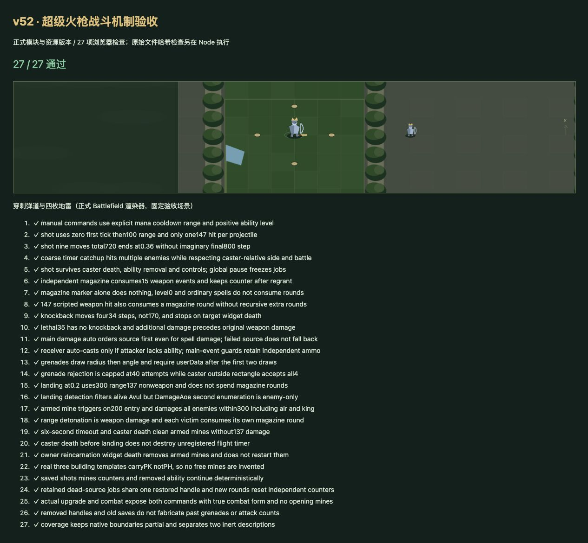

# v52 超级火枪穿刺、地雷与弹夹归档

日期：2026-11-03。基线：`c080d84ac93c1155b10166cb31309d21470895f5`。内容版本：`v14-content-20261103-v52-1`。

## 来源与实际行为

[原始证据](../../reference/musketeer-evidence.json)固定JASS文件哈希及注册、调用、回调行号，并记录五项能力及六个建筑/战斗原型的对象字段。

- A1PG穿刺射击、A1PH蜘蛛地雷是ANcl，显式耗魔分别8/19、冷却8/6秒、距离500。主伤害事件为正数、敌对、非自身且攻击者无A2Y7时，分别优先向攻击者、否则向受击者请求；没有武器类型限制，前者命令失败不回退后一方。
- 穿刺调用ChargeDistance(800,0.4)，0秒和每0.04秒回调。结束检查在移动之前，通常9次80码移动、累计720码，0.36秒结束。每步SelectRange100，每个敌人只受一次147混乱/通用伤害，BJ调用保留attack=true。
- 地雷最多尝试40次，先抽半径0—600再抽角度0—360，随后检查userData。对应玩家建筑区内落点，或施法者本身在区外时，最多投出4枚；没有文案所说的后跳。当前矩形采用Web地图映射，原生尺寸仍未核定。
- 0.2秒落地时，SelectRange300非空才调用AoeDamage137；后者重新枚举、仅检查敌对，使用attack=false。否则埋雷并登记施法者widget死亡、200范围进入和6秒超时。只有敌人进入事件对SelectRange300造成137点BJ武器伤害；死亡和超时只是清理。
- A1PJ独立武器监听前15次各追加35混乱/通用伤害，目标仍存活才击退，第15次移除能力。击退ChargeDistance(170,0.2)通常4次34码共136码。已消耗计数不因重新授予重置；穿刺及踩雷BJ伤害也可消耗弹夹，不能限定成普通攻击。
- A1PI和A1PK均为Asth说明，无脚本rawcode引用。常规超级火枪n07R、鬼炮h2A7、水枪老头n07S建筑都只有A1PK，而PassiveSkill检查建筑A1PH，因此不凭说明制造开局免费地雷；战斗体h0VG/h2A6/h0VJ有A1PH，正常施法可用。

## 实现与验证

- 新增 [musketeer-rules.js](../../dist/musketeer-rules.js)，接入主伤害请求、独立武器事件、手动施法、建筑出战检查、独立脚本调度及widget死亡。源码中仍可到期的飞行任务在施法者死亡后继续，已埋地雷则清理；复生也触发widget清理。
- 存档保存弹夹计数、已命中组、位移进度、地雷阶段、到期时间与来源句柄；恢复时重绑共享句柄，不补造旧档中不存在的历史布雷。下一轮与沙盒重置沿用现有任务清理。
- 正式Battlefield渲染器增加穿刺弹道和地雷标记，使用现有Canvas表达；不宣称已恢复原始模型/特效资产。
- [28项专项](../../tests/v14-musketeer.test.mjs)覆盖注册证据、边界与抽样顺序、伤害类别、事件优先级、控制/死亡/复生、存档和真实建造升级；喷火兵正常升级超级火枪花费375金，开波为h0VG且显示两个手动技能。
- `npm test` **1621项通过**（1530 Node＋91自定义），浏览器正式模块 **27/27通过**、warning/error为空。文件哈希及原文校验只在Node运行。
- 35波各12秒烟测通过，2784次出生、峰值123实体/16任务、有限数值及存档续跑通过。此烟测不等于35波自然通关，也不替代本家专项。
- 65个浏览器模块及样式哈希一致，临时浏览器验收HTML已删除。玩家661种能力：405实现/130部分/36标记/90待核定；全战斗746种：454实现/139部分/49标记/104待核定。新增建筑说明A1PK覆盖，A1PI核定为marker，三项战斗技能为partial。

## 剩余边界与交接

ANcl原生施法前摇、引导、同帧连续命令仲裁；AIob原生额外攻击/冰冻执行；世界范围枚举、建筑区原生尺寸、SetUnitPosition碰撞、浮点与0秒计时精度、范围进入及嵌套死亡回调顺序，仍需原生运行证据。当前只实现明确脚本35点附伤，不把AIob的DataA1再次直接加到普通攻击。移除句柄停止宿主任务并保留未核定边界。

本项独立提交GitHub并发布现有网站，最终提交与部署回执保存在仓库外`v52-publication.json`。三个原开发聊天继续保持归档，没有新增聊天。此文归档单项需求上下文；主聊天继续尚未完成的全量还原目标。
