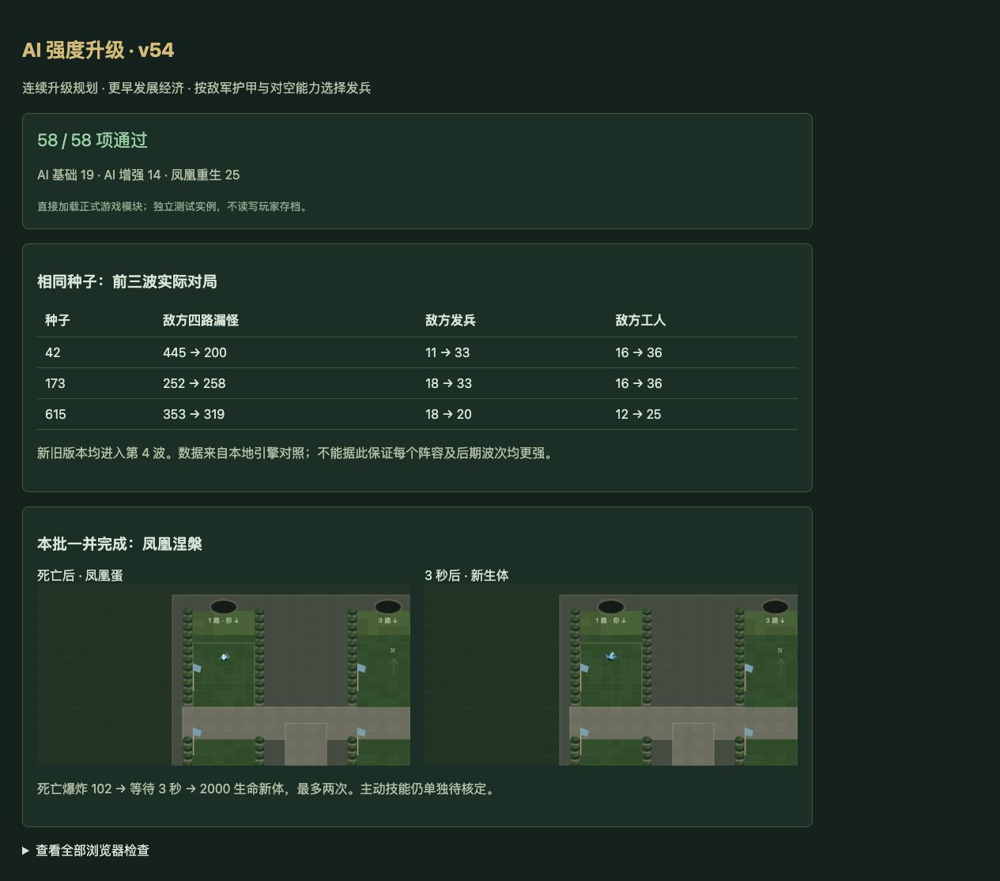

# v54 AI 强度升级归档

日期：2026-11-03。用户需求：升级 AI 的强度。基线：`212acd8fcc87b355391456b6e8b8cbc4aa7991d3`。内容版本：`v14-content-20261103-v54-1`。

## 结果与实现

- 开局之后也会评估最多三步的连续升级，按最终兵种的收益比较方案，预留剩余金、木和人口。施工完成后继续付款升级，失效载体或资格变化会释放计划。工人、新兵、农场与祭坛共同遵守预留，避免低阶购买挤掉升级资源。
- 首波优先当前防守；第 2 波起以当前波次 80% 和下一波 20% 评估克制，并提高同种低阶单位重复购买的扣分。仍考虑前排比例、范围伤害与辅助种类。
- 工人目标从旧版 `3+floor(wave/2)` 提高为 `min(10,6+wave)`；伐木可从第 1 波开始，目标上限 `min(30,wave+1)`。仍检查真实军力、金木、人口、队列、施工时间，漏怪后的补防和国王低血量限制保留。原脚本工人预付退款由原有正式指令处理，没有增加 AI 专属资源。
- 发兵根据可见敌方军团的护甲和武器对空掩码评分；持续检查阶段、库存、费用，保留收入收益。为下一次真实伐木费用预留木材，满级时停止无效储备。
- 静态升级图和当波兵种评分缓存减少重复扫描；缓存不进存档、不消耗随机数。队友和敌方 AI 均使用更新策略，玩家 0 不受自动控制。

这些是浏览器 AI 决策，不声称还原了原图 AI 代码。没有新增难度档位或免费战斗属性。

## 对照数据

[机器可读记录](../../reference/ai-advanced-benchmark.json)保留全部数据、场景和局限。基线在 AI 编辑前复制，包含相同的待发布凤凰代码，以隔离 AI 改动。普通 4v4，种子 42/173/615；两版玩家 0 均接受相同的测试专用建造辅助，指标取敌方玩家 4—7。

前三波后，两版均到第 4 波：

| 种子 | 漏怪，旧→新 | 发兵，旧→新 | 工人，旧→新 |
| --- | --- | --- | --- |
| 42 | 445→200 | 11→33 | 16→36 |
| 173 | 252→258 | 18→33 | 16→36 |
| 615 | 353→319 | 18→20 | 12→25 |

合计漏怪 1050→777，下降 26%；发兵 47→86。但种子 173 的漏怪略升，不能宣称每个阵容都更强。

另运行至第 8 波结束或对局结束：42 从第 6 波结束提升到完成第 8 波；173 两版均在第 8 波结束；615 两版均在第 4 波结束。新版三组发兵 507/356/32，旧版 43/79/21。173 和 615 的漏怪分别从 748/425 增至 1018/468，国王承压和阵容存活仍需优化。AI 策略改变随机调用、怪物暴露和战斗时长，因此不把这些结果当作等时胜率实验，更不代表 35 波通关。

## 验证与交接

- AI 专项 **33/33**（原 19＋新增 14），覆盖连续升级付款、金木与人口预留、失效资格、施工和存档、早期经济、队列上限、实际科技储备、满级释放、护甲及对空发兵。
- 本批同时完成 [v53 凤凰涅槃](integration-v53.md)，其 Node 专项 26/26。
- `npm test` **1661 项通过**（1570 Node＋91 自定义），35 波各 12 秒烟测通过：2784 次出生，峰值 123 实体／16 任务，有限数值和存档续跑通过。短时烟测不等于自然通关。
- 浏览器正式模块 **58/58**（AI 33＋凤凰 25），控制台 warning/error 为空；原始源文件哈希只在 Node 验证。66 个浏览器模块及样式哈希一致，临时验收页面已删除。

GitHub 主分支和现有网站按既有授权提交与发布；最终回执保存在仓库外 `v54-publication.json`。本次没有创建新聊天；三个原开发聊天仍已归档。本文件归档当前 AI 需求上下文，主聊天继续未完成的整体还原目标。下一批可继续评估第 4 波娜迦／幽魂组合、第 8 波对空与技能权重，不能把局部指标改进当成全部完成。
