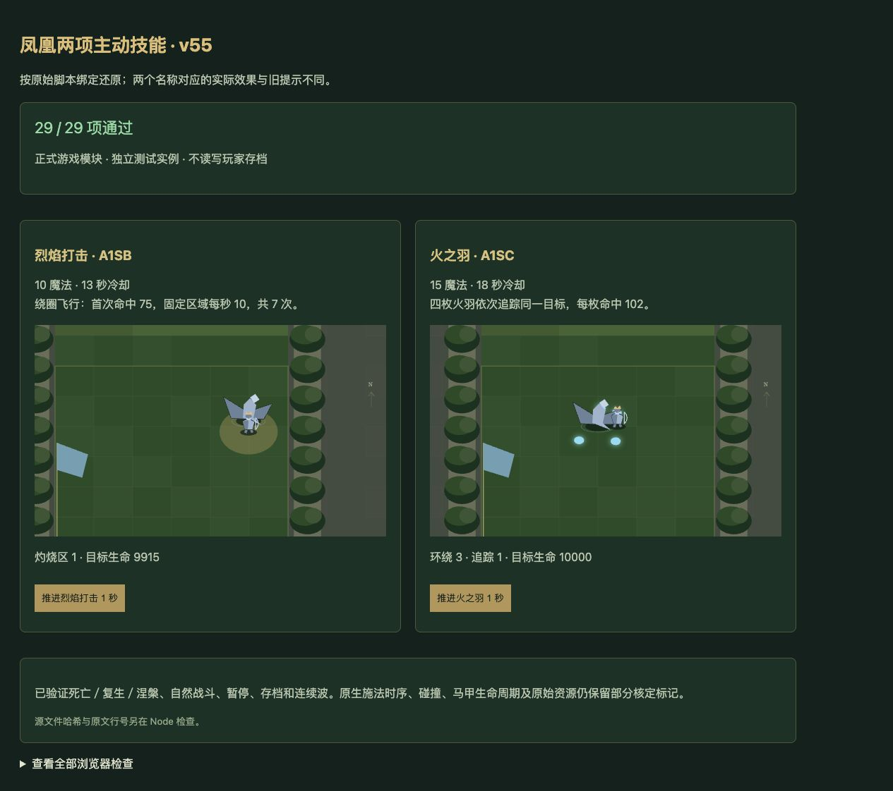

# v55 凤凰主动技能归档

日期：2026-11-03。基线：`d06feea352c2530df94691ee26e1866575feb447`。内容版本：`v14-content-20261103-v55-1`。上一目标回合已完成 v54 提交发布，属于有效进展；本批继续原始全量还原目标。

## 脚本证据与实际绑定

[证据包](../../reference/phoenix-active-evidence.json)固定原始 JASS 文件 SHA256，保存 SelectRange、LoopDamageRange、两个技能函数、施法绑定和主伤害请求的逐行原文，以及能力和单位对象字段。

- **A1SB 烈焰打击**在 39318—39319 行调用 `PhoenixShot`，实际是本体绕圈与灼烧。对象明确耗魔 10、冷却 13 秒、距离 800。旧提示的 5 精灵、89 点和 8% 暴击不在此实现中。
- **A1SC 火之羽**在 39321—39322 行调用 `PhoenixFlamestrike`，实际是 4 枚环绕／追踪火羽。对象明确耗魔 15、冷却 18 秒、距离 500。旧提示的 10% 减速、每秒 20 点及 15 秒持续不按文本补造。
- 40749—40758 行的自动请求优先 `i=GetTriggerUnit()`，即受伤者；只有受伤者没有能力时才向攻击者 `bV` 请求。前者命令失败不回退。仍受正数、敌对、非自己和攻击者无 A2Y7 的主伤害条件约束，没有武器伤害限定。不要套用超级火枪不同的攻击者优先顺序。

## 本体绕圈与固定灼烧

`PhoenixShot` 以初始施法者到目标的方向，取最大值 `max(300,距离)` 为半径；圆心位于初始位置向前一个半径。登记 0.02 秒计时和普通单位死亡，暂停本体、关闭寻路、透明度设为 50。

第一跳使用 10 度，直接 SetUnitX/Y；正常到 350 度共 35 次移动。到 360 度先结束，不做最后移动，也不强制回起点。每次移动前检查不可行走地形和 userData 对应玩家矩形，越界立即清理；结束恢复寻路、255 透明度和暂停状态。

每步 SelectRange225 里的敌人只首次受 75 点混乱／通用 BJ 武器伤害。随后在该敌人当时的坐标创建独立灼烧区，1 秒后开始，每秒 10 点，共 7 次，仍保留 BJ 的 attack=true。多个受击者产生的区域可重叠；不跟随原目标、不附加减速。灼烧没有死亡登记，施法者死亡不会取消它。

## 四枚火羽与死亡边界

创建 4 个 e01G，初始角度 -360/-270/-180/-90；后续轨道使用 +360/+270/+180/+90 减去 `1.8×旋转计数`，保留这个实际方向差异。旋转帧围绕当前施法者、半径 200，缩放固定为 2.25。第 1/2/3/4 秒各派出首个尚存活的槽位，派发帧不增加旋转计数；第 5 秒超时在派发前判断。

派出的火羽追踪同一个原始目标，每 0.02 秒向目标移动 **1 个原生坐标单位**，移动后距离严格小于 50 才造成单体 102 点混乱／通用 BJ 武器伤害，再 KillUnit 和隐藏。不是直接瞬发，也没有落地范围爆炸。

未派发的火羽由施法者 widget 死亡清理，因此 ACrn 复生等待也清理它们；本体绕圈与追踪火羽分别登记普通单位死亡，不能混用。追踪期施法者、目标或火羽普通死亡时只隐藏火羽并结束监听，不擅自补 KillUnit；已存活的隐藏马甲仍作为辅助句柄保存，按 e01G 明确的 60 生命与 -1 恢复字段连续衰减，原生恢复节拍仍属适配。

火羽没有加入原图 JW/JH 军团组，也没有被赋予召唤物标志。Web 把它们留在脚本任务中，避免通用战士 AI、人口、竞技存活或清线判断把辅助对象当成军团。

## 接入与验证

新增 [phoenix-active-rules.js](../../dist/phoenix-active-rules.js)，接入自动请求、手动选敌、普通／widget 死亡和独立任务调度。快照恢复重绑共享施法者、目标、火羽句柄，连续波保留任务，下一轮和沙盒重置清理。Canvas 增加轨迹／灼烧区域、火羽及本体透明度替代表现；未包含原始模型资源。

- [30 项专项](../../tests/v14-phoenix-active.test.mjs)全部通过，覆盖来源、费用、冷却、目标、优先级、精确步进与范围、固定灼烧及重叠、轨道计数、追踪、隐藏与死亡、复生、暂停、存档、连续波。
- 自然竞技帧实测 4×102 伤害，辅助对象不延长已失败军团的战斗；真实角鹰链按首波判定、荣誉和真实费用升级神奥，初始体与涅槃后的 h0VZ 均提供两个手动技能。涅槃后原有灼烧仍属于旧施法者，不转移给新体。
- `npm test` **1691 项通过**（1600 Node＋91 自定义）。35 波各 12 秒烟测通过：2784 次出生、峰值 123 实体／16 任务、有限数值及存档续跑通过；不代表 35 波自然通关。
- 浏览器正式模块 **29/29**，warning/error 为空。实际点击推进后灼烧目标 9925→9915，火羽从环绕 4／追踪 0 转为环绕 3／追踪 1。源文件哈希只在 Node 校验。
- 67 个模块与样式哈希一致，临时验收页已删除。两个能力从 unresolved 转为 partial；玩家661种：405实现／133部分／36标记／87待核定；全战斗746种：454／142／49／101。e01G 纳入运行时原型覆盖，Aloc 已在既有能力集合内。

## 尚未闭合的原生边界

ANcl 前摇、引导、同帧连续命令及目标许可；地形与玩家矩形的原生尺寸；SetUnitPosition 碰撞；浮点和不同触发器交错；隐藏／蝗虫、创建钩子及缺失的移速／武器原生字段；施法者 RemoveUnit 后保留所有权用于灼烧的结果；原始资源。当前同帧先派发 A1SB 后本体暂停，因此后续 A1SC 适配请求失败；不将这一宿主结果宣称为已验证原生仲裁。

本项按授权推送 GitHub 并更新既有公开网站，最终回执保存仓库外 `v55-publication.json`。上下文在此归档，无新增聊天；原三个开发聊天保持归档，主聊天继续尚未完成的全量还原目标。整个目标未完成，不因本批测试通过而改变剩余清单范围。
