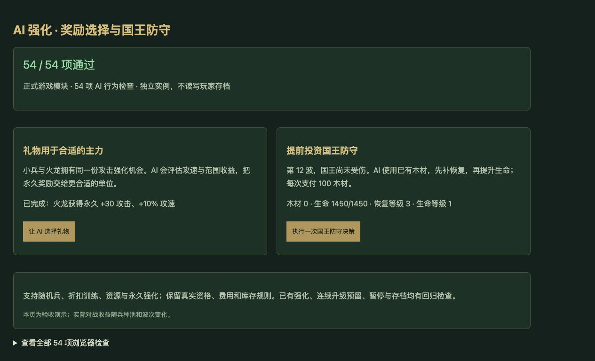

# v56 AI 奖励利用与后期防守归档

日期：2026-11-03。用户需求：升级 AI 的强度。基线：`908939b79f7a5d8ba4231fb1d66b6d3cc7ea4a02`。本批修改浏览器对手策略，技能覆盖保持 v55 的统计口径。

## 最终行为

- AI 在备战阶段比较自己已经获得的神秘礼物：金币、木材、伐木、人口、随机兵、永久强化和折扣训练。收益参考当前阵容、当前波次与已有兵种购买效率。选择和领取使用正式 `boxReward`／`boxTrain` 指令，保留费用、资格、数量及成功后整组消费规则。
- 攻击强化优先考虑攻速与范围收益；不重复授予已有能力。随机兵选择自己的空格并按正式来源池随机；评估本身不抽取随机数。不可用的奖励保留，其他可用奖励仍可被选中。
- 训练不会花掉另一条连续升级计划预留的金币、木材；替换自己的计划载体后清理旧句柄。携带永久强化或宝藏护甲的单位不用于会丢失这些收益的替换。A18P／自动职业派生能力单独识别，A2ZG 遵循已核定的复制规则。
- 前 10 波保留既有国王与经济优先级。第 11 波起，在健康且没有漏怪时，补足生命与恢复到 `floor(wave/4)`，攻击目标仍为 `ceil(wave/2)`，受真实阶段上限约束。低生命仍先补生命，正在漏怪仍沿用攻击／生命／恢复的紧急顺序。共享国王等级避免多名队友重复购买已达标项目，费用及军团升级木材预留照常执行。
- 不自动控制玩家 0，尊重暂停、结束和沙盒 AI 开关。存档使用现有奖励、建筑、资源和国王字段，无新增迁移需求。

## 对照结果与限制

[机器可读结果](../../reference/ai-rewards-defense-benchmark.json)保留最终实现的全部对照数据及复现命令。

固定压力测试使用第 8 波、第 4 路、两名豺狼人和两条火龙、已有 A136 礼物、零金币木材，180 秒；关闭后续 AI 决策。为了不因国王提前死亡而截断测量，两版国王均设为 100 万生命，攻击不变。这是专项实验，不是自然通关或胜率评估。

| 种子 | 漏怪：旧→新 | 军团伤害：旧→新 | 国王净失血：旧→新 |
| --- | --- | --- | --- |
| 42 | 96→91 | 8278→11626 | 181876→165114 |
| 173 | 93→93 | 9488→9374 | 177961→175224 |
| 615 | 91→81 | 12696→14249 | 160663→142306 |

合计漏怪 **280→265，下降5.4%**；军团伤害 **30462→35249，增加15.7%**。三组均到达 180 秒上限且未清线。173 的军团伤害略降，因此不把所有单项指标都描述为提升。

普通 4v4 另测试至第 8 波结束或对局结束，玩家 0 接受两版相同的测试建造辅助、两队 AI 同时升级：42 从旧版完成第 8 波变为第 8 波失败，敌队漏怪837→862；173 两版均第8波失败，漏怪1018→959；615 两版均第4波结束，尚未到礼物发放，结果不变。策略影响后续随机调用、发兵和持续时间，不能据此宣称整体胜率已提高。后期主动国王强化仍需更长自然对局评估。

## 验收与归档

- AI 专项 **54/54**（原33＋新增21），覆盖自动奖励与保留、正式发放、玩家归属、真实折扣费用、已有强化保护、预留资金、随机兵落点、永久能力部署、前期保留经济、后期付费防守、共享目标、暂停和存档一致性。
- `npm test` **1712项通过**：1621 Node＋91自定义。35波各12秒烟测通过，2784次出生、峰值123实体／16任务，有限状态及存档续跑通过；不等同于自然通关。
- 浏览器正式模块 **54/54**。实际点击后火龙获得+30攻击／+10%攻速；第12波国王在健康状态依次支付100木材补恢复、100木材提升450生命。warning/error为空，用户原对局未刷新。
- 全部67个模块哈希已更新；临时验收页已删除，截图保留在本目录。

没有自动化换位、拆除、尚未实现的建造者主动技能或免费建造券。本项代码、测试、基准和交接按既有授权提交 GitHub 并更新现有网站；部署回执保存在仓库外 `v56-publication.json`。本文件归档本次需求上下文，未创建新聊天，原三个开发聊天保持归档；主聊天继续尚未完成的全量还原目标。
