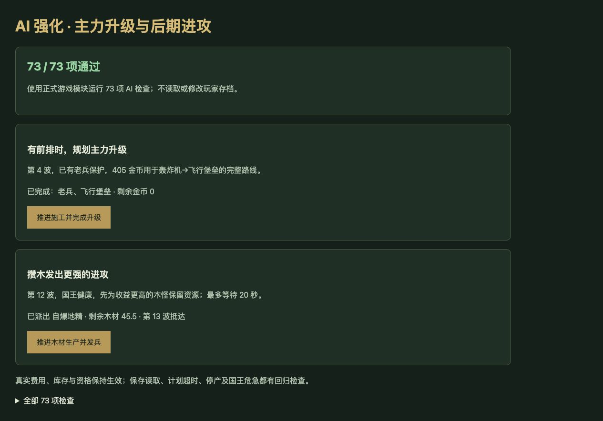

# v57 AI 主力规划与后期进攻归档

日期：2026-11-03。需求：升级 AI 的强度。基线 `542559d11051c111dbe1ab867050179d9c5c1ade`。开发及验收使用独立工作区，主工作区未完成的玛里苟斯技能草稿予以保留，未纳入发布。

## 最终行为

- 保留开局及前3波策略。第4波起，新建军队同时比较初级形态与最多两级升级后的战力，计入整条路线费用、资格及人口。远程升级路线须已有前排保护，避免只造一名脆弱主力。已有计划时不另开升级链；继续通过原来的实际施工和正式 `build`／`upgrade` 指令执行。
- 购买初级兵后，剩余升级费用保存在现有 `aiUpgradePlan` 中，金币、木材、人口均受既有预留机制保护。中途资格变化或载体消失仍会取消计划，保存读取后继续执行。
- 发兵收益使用源对象收入点数，第11波起按正式发兵规则向下取整减半，不再把实际零收入木怪当成能增加收入的选择。
- 普通对局第11波后的战斗期，国王健康且本队未漏怪时，可以为评分比当前可买木怪高至少8%的选择攒木。只考虑已解锁、有库存、20秒实际产量可覆盖的目标。计划包含目标、波次和固定期限，重复决策不会延长期限；足额后优先购买该目标，正式付款、减库存并派往下一波。
- 停产、缺货、换波、20秒到期及国王危急时释放发兵计划。军队升级及国王防守资源仍优先。沙盒备战直接发兵，沙盒战斗继续遵守禁发规则。暂停、结束和玩家0不受 AI 控制。

这属于浏览器对手策略，并非恢复原版地图 AI；没有增加免费金币、伤害或生命。

## 对照与边界

[可复现脚本](../../scripts/benchmark-ai-planning.mjs)与[完整结果](../../reference/ai-planning-benchmark.json)保留全部最终对照。

固定第4波、已有一名老兵、405金币、轰炸机兵种池、人口300，给予20秒正常施工；之后关闭 AI，只比较该路180秒战斗。国王双方均设100万生命以避免提前截断，攻击属性不变。旧版购买两台轰炸机并剩125金，新版完成一台飞行堡垒并用完预算。

| 种子 | 漏怪：旧→新 | 军团伤害：旧→新 | 国王净失血：旧→新 |
| --- | --- | --- | --- |
| 42 | 100→99 | 710→1502 | 58214→57140 |
| 173 | 100→99 | 710→1502 | 57865→57116 |
| 615 | 100→99 | 710→1502 | 57872→57196 |

三组均未清线。结果说明这个固定阵容更充分地使用预算，不能外推成全局胜率。

普通4v4测试至第8波或结束，两队 AI 同时更新，玩家0获得相同测试建造辅助。42从第8波红方国王死亡变为第6波结束、红方国王剩5000生命；173结果保持不变；615红方漏怪468→482、国王生命3467→1022，出现回退。后续随机调用和对局时长不同，无法直接汇总漏怪为强度百分比。这些对局都未到第11波，后期发兵计划的长期收益仍需更多自然对局检验。

## 验收与交付

- AI专项 **73/73**，新增 **19** 项，覆盖路线规划、保护前排、真实费用、施工部署、预算、满场、资格变化、实际发兵收入、定时攒木、库存失效、停产、换波、防守优先和存档恢复。
- 完整 `npm test` **1731项通过**，其中1640项 Node检查和91项自定义检查。
- 35波各12秒烟测通过，出生2784次、峰值123实体／16任务，有限状态及存档续跑检查通过；不等同于35波自然通关。
- 浏览器正式模块 **73/73**，无warning/error。实际点击完成老兵保护下的飞行堡垒升级，并在木材生产后支付480木材派出自爆地精。测试使用独立实例，没有读取或刷新玩家原对局。
- 已更新67个模块的资源哈希；临时验收页删除。发布使用已验证的独立工作区，回执保存在仓库外 `v57-publication.json`。

本文归档本项需求及验证上下文；没有新增开发聊天。原三个开发聊天保持归档，主聊天继续尚未完成的全量还原目标。
