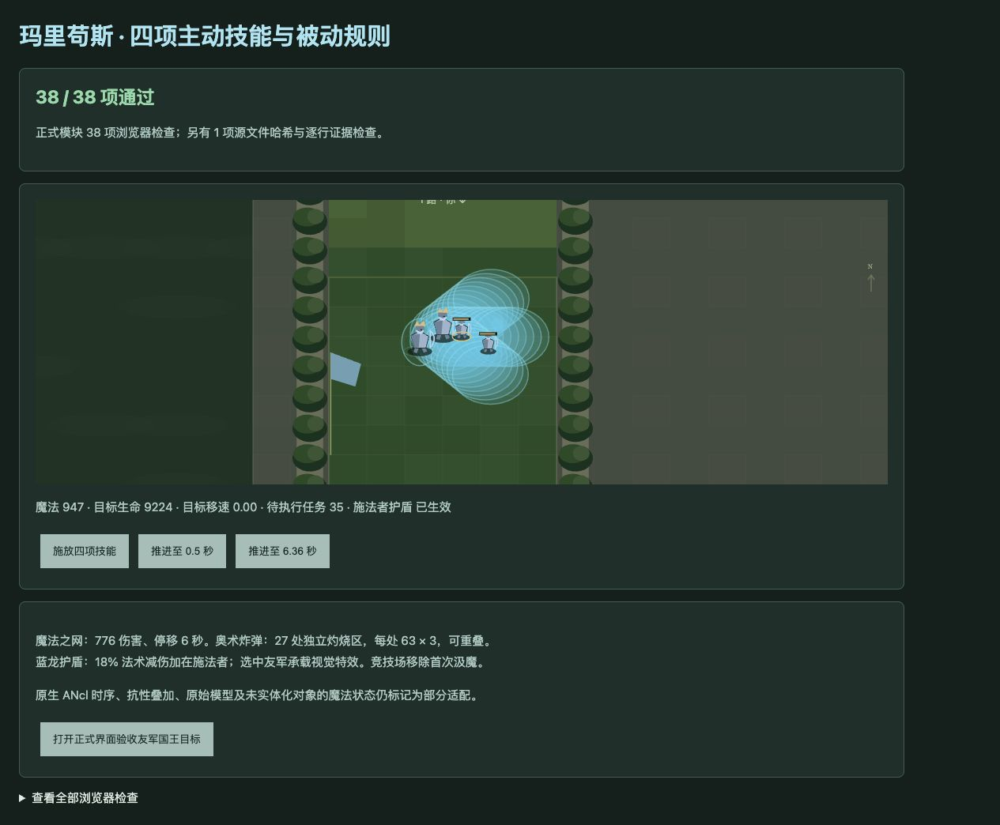
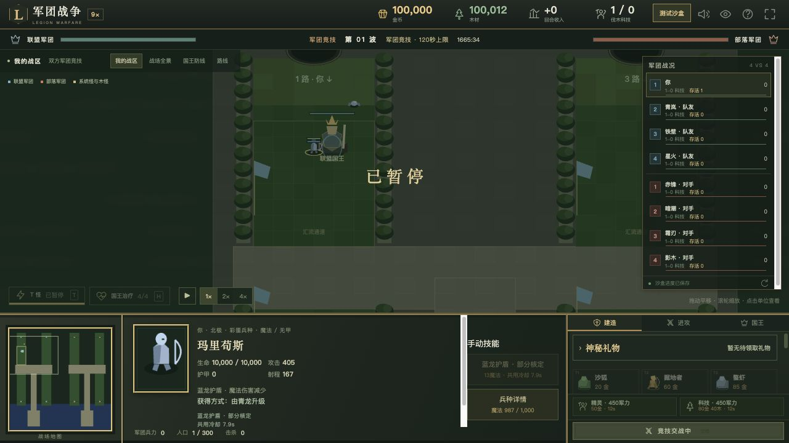

# v58 玛里苟斯技能还原归档

日期：2026-11-03。基线 `947e735c1e299ab2f4fe18857aff969a9ed2b1ea`，内容版本 `v14-content-20261103-v58-1`。本项完成玛里苟斯脚本主体接入及验收；原生边界仍标记 partial，不宣称整个地图已完整还原。

## 来源与最终行为

[源码证据](../../reference/malygos-evidence.json)固定 `war3map.j` SHA256 `e66c55b3b25b185c991be5613e21fbf5b2d598f3cc40f2f8cd01c23bcb828250`，606行原文断言，并保留能力字段、辅助原型和真实升级入口。

- **A1PZ 奥术风暴**：10魔法、8秒冷却、500码范围。五次依次抽角度与0—350码半径，每枚实际 e008 辅助句柄在0.5秒后对250码敌群造成137混乱／通用武器伤害并移除。创建这些不参加自主战斗的辅助单位时，跳过网页战士攻击/技能初始冷却的额外随机抽取，五枚飞弹只使用十次脚本抽样。
- **A1Q1 魔法之网**：20魔法、12秒冷却、500码范围。按初始距离的1/10每0.04秒追踪，首跳在0秒，通常9次移动后0.36秒结算；中心使用目标当时位置。400码内敌人先移速设0，再受776伤害，6秒后各自恢复原型默认移速。多个计时器独立，早先恢复不会因重施而延期。目标或辅助单位 widget 死亡立即结算，施法者死亡不取消飞行；复活等待也走 widget 分支。
- **A1Q2 奥术炸弹**：10魔法、16秒冷却、500码范围。源码角度为目标方向-44.75°、+0.5°、+45.75°；每枚以60码步长移动9次共540码，通常0.36秒移除。每步创建一个固定300码灼烧区，1秒后首次造成63伤害，每秒一次，共3次；三枚共27区，可重叠，无脚本击退。
- **A1Q3／A1Q5 蓝龙护盾**：13魔法、8秒冷却、500码范围。目标可为友军或自身，但 AIsr 能力实际加给施法者，特效挂在所选目标上；6秒独立计时移除。单独存在时按 DataB1=0.18 处理法术减伤，不降低普通魔法攻击或通用脚本伤害。与其他原生抗性并存时保留已知宿主并标明叠加待核定。
- **A1Q4 魔法汲取**：首次正数敌对伤害来源事件先移除能力，再从999999码内每个魔法至少5的敌人扣5、向自身加5并钳制上限。满魔仍扣敌方魔法。按实际阵营检查已实例化的两队单位及国王，不局限于当前战场。竞技部署按源码提前移除此能力，与旧提示不同。
- **A1Q0 碧蓝之火**：从普攻命中尾部移到独立武器伤害事件，追加20混乱／通用武器伤害；BJ `attack=true` 的脚本事件也触发，同来源防重入。旧“implemented”标签改为诚实的部分适配标签。
- 自动命令保留被伤者优先、攻击者 `elseif` 后备顺序，优先者失败不改选后备；护盾友军组始终围绕被伤者坐标。选随机友军发生在命令冷却校验前。
- 新增飞弹、追踪网、灼烧区和护盾的网页视觉提示。正式手动单位技能可点击本方国王，后台按技能重新校验，不改变费用、施法距离及所有权规则。

## 获取、生命周期与边界

保留青龙 `h0BP`／`n05M` → `n07T` 的正式升级，战斗体为 `h0VP`。真实完成历史（中子＋圣龙，或指定圣龙形态）、本波结束、超级赞助、数量上限仍由既有来源规则限制；普通升级650金币，不要求先消费兵种训练礼物。验收实际走建造、记录资格、付费升级及部署。

辅助句柄保留在技能任务中，未加入存活军团、召唤计数或胜负判定。所有任务可保存，恢复后重新绑定共享来源、目标和辅助句柄；定时伤害保留死者来源。暂停冻结时间，连续波保留未结束任务，重置清空任务。

仍未闭合：原生 ANcl 前摇/引导/同帧命令仲裁、原生移动限值及碰撞、浮点计时和跨触发器顺序、范围枚举顺序、AIsr 混合叠加、辅助原生创建/生命周期、未实例化商店/建筑/建造者的全图魔法状态、原模型及特效素材。缺失默认移动字段时标记不确定并保留已知速度，没有捏造原生值。

## 验收

- 专项 **39/39**，含源文件哈希与606行证据、价格/范围/冷却、随机顺序、辅助身份、精确伤害/步数/计时、死亡与复活、护盾归属、世界汲魔、竞技移除、独立武器事件、防重入、暂停和存档、真实升级部署。
- 完整 `npm test` **1770项通过**：1679项 Node＋91项自定义检查。AI v57及英雄彩蛋直接升级回归保持通过。
- 35波各12秒烟测通过：2784次出生，峰值123实体／16任务，有限状态与存档续跑通过；不等同于自然通关。
- 浏览器正式模块 **38/38**（另1项文件证据由 Node验证）。四技能实际消耗53魔法；0.36秒先结算网络伤害，0.5秒飞弹爆炸，6.36秒移速恢复0.90、护盾移除且任务清零。warning/error为空。
- 正式游戏界面载入独立测试存档，选择玛里苟斯护盾后点击友军国王，显示“已施放蓝龙护盾”，魔法1000→987、共用冷却约8秒，玛里苟斯增加“魔法伤害减少”。原用户8417对局未刷新，测试仅使用独立8418端口。
- 实际全能力战斗体8秒短测：5点汲魔、三项自动主动技能各一次、目标100000→93824生命、峰值33任务，未生成可自主战斗的辅助兵；不作为原生伤害总量完全一致的证明。

## 覆盖与交付

当前玩家范围662种能力：404已实现、140部分、36标记、82待核定；全战斗747种：453已实现、149部分、49标记、96待核定。两范围不能相加。新增动态A1Q5，五个原待核定能力进入部分适配，A1Q0纠正旧过高标签。

源码、测试、证据和本归档按既有授权提交 GitHub 并更新现有网站；发布回执保存在仓库外 `v58-publication.json`。本文件归档本项需求上下文；没有新增开发聊天，原三个聊天保持归档，主目标继续推进。
