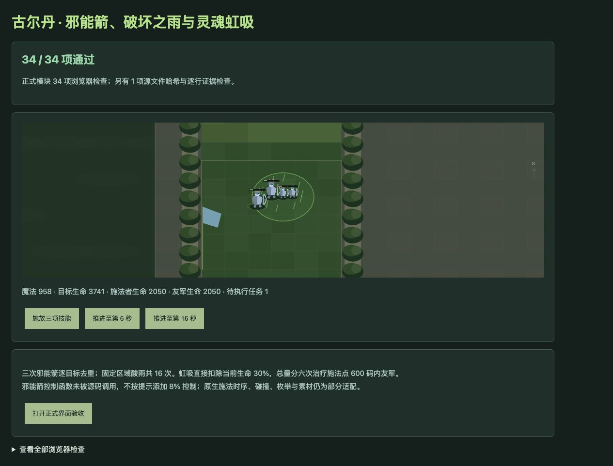
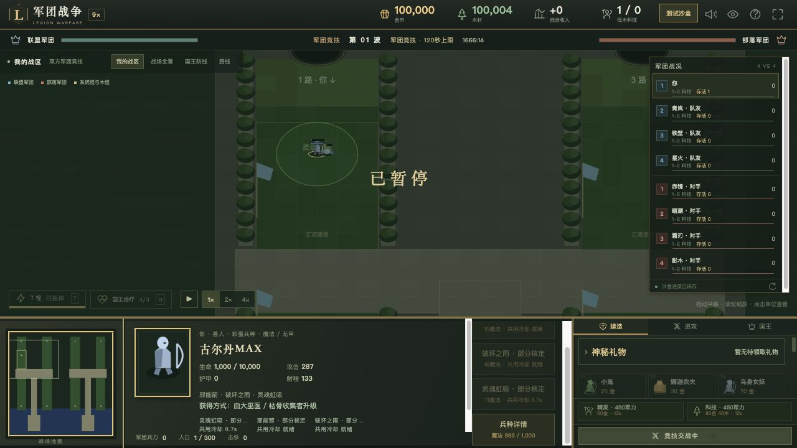

# v59 古尔丹技能还原归档

日期：2026-11-04。基线 `4fe8f186308ce0bc88fa8c84d017414291da3b54`，内容版本 `v14-content-20261104-v59-1`。本项接入古尔丹三项缺失脚本，不表示原生引擎行为已全部核定。

## 来源和最终行为

[源码证据](../../reference/guldan-evidence.json)固定 `war3map.j` SHA256 `e66c55b3b25b185c991be5613e21fbf5b2d598f3cc40f2f8cd01c23bcb828250`，包含428行原文、三项能力字段、辅助单位和建筑／战斗原型。

- **A1QL 邪能箭**：15魔法、13秒冷却、500码选点距离。0、1、2秒各从施法者届时位置朝原始选点发射一枚e008。`ChargeDistance(800,.2)` 首跳在0秒，判断终止在移动之前，因此通常4步、每步160码、总640码，0.16秒结束位移，0.2秒独立移除辅助。每步200码内每敌人101点法术／魔法伤害，非武器事件；一枚箭通过施法者句柄保存的组去重。
- 去重组每次发射替换，结束回调销毁当时的组；保留这种共享关系，而非改成完全独立的每箭集合。家族内到期回调按时间排序，一帧跨越多次发射时也得到相同结果。源码 `NewGuldanSetOwner` 只有定义，没有引用调用；不加入提示中的8%控制敌军。
- **A1QM 破坏之雨**：16魔法、16秒冷却、500码选点距离。固定点400码，每1秒对当时敌人造成26点法术／魔法伤害，共16次，第一次在1秒后。多次施放独立；施法者死亡不撤销区域。
- **A1QN 灵魂虹吸**：11魔法、9秒冷却，无目标即时施放。当前施法位置400码内敌人各直接扣除当前生命30%；这不是伤害事件，魔免、护甲、护盾不会代替直接生命设置，受伤技能和伤害统计不额外触发。Avul、死亡和不可枚举辅助被排除，已实例化敌方国王可被选入。极低生命跨过死亡阈值走无击杀来源死亡结算。
- 虹吸总量分六份，每1秒一份，在**最初位置600码**内当时全部存活友军之间均分。满血友军也计入分母，生命钳制到上限；无人时该份消耗，不累积到后续。来源死亡不取消计时，也不复活来源。
- 自动命令保留受伤者优先、攻击者 `elseif` 后备，优先者施法失败不转给后备。邪能箭、凤凰两项、破坏之雨／虹吸及玛里苟斯之间的已接入调用次序保留。30魔法时可先付15释放邪能箭，16费用的雨失败，随后11费用的虹吸成功。
- 建筑 `n07V` 的 ancient 类型在已付费的脚本入口返回；实际战斗体 `h0VR` 正常执行。新增邪能箭、酸雨区域及治疗区域视觉提示，正式界面有两项选点按钮和一项即时按钮。

## 生命周期、资格与边界

辅助对象不加入军团计数、胜负判定或召唤计数，创建不会抽取普通战士的初始攻击／技能冷却随机数。widget死亡停止该箭位移，0.2秒移除计时和未来两次发射仍继续。暂停冻结任务；存档重新绑定活体或已死亡来源与辅助句柄；连续波保留任务，沙盒重置清空。

现有正式路径为大巫医 `h0C2`／枯骨收集者 `h1C2` → `n07V`，出战为 `h0VR`，520金币。保留 `u004`、`R0AK`（精确 `h1CC` 完成历史）、超级赞助 `h220` 和1个数量上限。专项通过正式完成历史接口登记资格，再实际支付升级和部署；没有把兵种训练重新设为前置。

仍为部分适配：ANcl前摇、引导和同帧命令仲裁；原生枚举与浮点计时；原生e008生命周期和位移碰撞；销毁组后原生无效句柄语义；不同家族的跨触发器注册顺序；未实体化建筑／商店、隐藏与移除对象的生命设置；原模型、贴图与特效。当前Web提示明确显示“部分核定”。

## 验收

- 古尔丹专项 **35/35**，包含428行来源及哈希、价格／距离／控制、古树分支、三次发射、4步／去重、无控制概率、共享组、魔法伤害类别、直接生命设置、六次治疗及范围分母、自动顺序、死亡／暂停／存档、正式付费获取。
- 古尔丹＋玛里苟斯＋凤凰主动技能联动专项 **104/104**。
- 完整 `npm test` **1805项通过**：1714项Node＋91项自定义检查。已有AI与英雄彩蛋直接升级检查继续通过。
- 35波各12秒烟测通过：2784次出生、峰值123实体／16任务，有限状态与存档续跑通过；不是35波自然通关证明。
- 浏览器正式模块 **34/34**，另1项文件哈希由Node验证。演示三技能共耗42魔法；两敌方初始6000／1000生命，经虹吸后继续受到箭和雨；第6秒主目标3741，施法者与友军各从1000恢复到2050；第16秒主目标3481、任务清零，warning/error为空。
- 正式游戏界面在独立8418端口载入测试存档：选中古尔丹后点击虹吸，魔法1000→989、显示约9秒共用冷却；随后选择邪能箭并点击地面，邪能箭和伤害触发的破坏之雨相继扣费，魔法变958，三项按钮均正确显示冷却。原用户8417对局未刷新。

## 覆盖和交付

三项能力从 unresolved 进入 partial。玩家662种：404已实现、143部分、36标记、79待核定；全战斗747种：453已实现、152部分、49标记、93待核定。两范围不能相加。

源码、测试、证据及本文按已有授权提交GitHub并更新现有网站；发布回执存于仓库外 `v59-publication.json`。本文件归档单项需求上下文；没有新增开发聊天，原三个开发聊天保持归档。全量还原目标继续。
