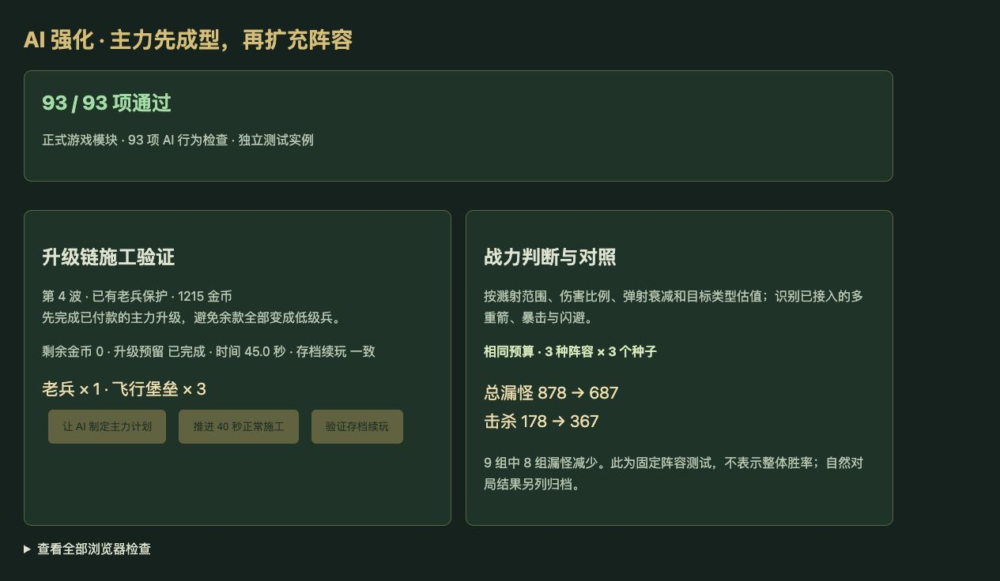

# v60 AI 主力成型与战力判断归档

日期：2026-11-04。需求：升级 AI 的强度。基线：`6d89b4c0be1f49792e5c1207a31d3849442eb4db`。本批使用独立工作区开发、验证和发布；主工作区的安度因技能草稿保留，未纳入此次提交。

## 最终行为

- 第4波起，AI 会先推进已付款的主力升级链，再使用剩余资金扩军。原策略虽预留当前升级费用，却在施工等待期间把其余金币买成初级兵；现在完成一条路线后可以接着规划下一条，减少高级主力迟迟无法成型的问题。
- 中后期兵种评分计入实际武器槽、攻击间隔、攻防类型和护甲。溅射按内外圈范围、伤害比例和对地／对空限制估值；弹射计入目标数、半径和衰减；直线攻击计入宽度与长度。
- 已接入的原生多重箭、暴击、重击和闪避进入估值；未核定的圣龙多重箭不添加假定收益。范围内能命中多少敌人仍属于有上限的策略估计，并非新增战斗效果。
- 保留前3波的原有采购评分，继续使用正式建造、升级、人口、资格、扣费和施工流程。当前计划失效或载体消失后释放；存档读取后继续。未修改玩家资源、兵种数值、难度倍率、波次和技能覆盖分类。

## 对照结果

[完整机器数据](../../reference/ai-matchups-benchmark.json)保留最终版本全部结果及限制。[固定阵容脚本](../../scripts/benchmark-ai-matchups.mjs)使用相同预算、相同种子和60秒正常付费施工，然后关闭经济与发兵，只比较同一路180秒战斗。国王生命统一提高到100万以避免提前结束，其他属性保持不变。

| 场景（各3种子） | 漏怪：旧→新 | 击杀：旧→新 |
| --- | --- | --- |
| 骑士，第8波，3000金币 | 279→158 | 46→166 |
| 野兽，第8波，3000金币 | 215→154 | 111→171 |
| 森林，第13波空军，6000金币 | 384→375 | 21→30 |
| 合计 | **878→687（减少21.8%）** | **178→367** |

9组中8组漏怪减少；野兽种子42由57增加到60。所有场景都达到180秒上限而未清场，这些结果不等于自然通关或整体胜率。

[固定蓝队脚本](../../scripts/benchmark-ai-opponents.mjs)另保持蓝队旧策略，仅替换红队 AI；玩家0在双方都接受相同的测试用旧版建造辅助，无额外资源。3个种子中红队胜负仍为2胜1负：种子42胜利时国王剩余生命5000→8091；种子173仍负，结束944→918秒、漏怪959→1045；种子615不变。两队同时更新的自然对局也完整记录，因时长和后续随机调用改变，不直接把累计漏怪当作同条件战力结论。

复现时把第二个参数指向基线提交的独立检出目录，避免主分支更新后误把新版当旧版：

```sh
node scripts/benchmark-ai-matchups.mjs /path/to/baseline
node scripts/benchmark-ai-matchups.mjs /path/to/candidate
node scripts/benchmark-ai-opponents.mjs /path/to/baseline /path/to/baseline
node scripts/benchmark-ai-opponents.mjs /path/to/candidate /path/to/baseline
```

## 验收与归档

- 新增20项行为检查；AI专项93项通过。全量1825项通过（1734项Node测试、91项自定义检查）。
- 35波×12秒运行检查通过：2784次生成、峰值123实体／16脚本任务，状态有限、保存续跑一致。此为短时运行检查，不代表自然通关35波。
- 浏览器正式模块93项通过，无warning／error。实际点击验证1215金币依次完成3台飞行堡垒、余额归零，以及存档续玩一致。独立验收页未读写玩家正在玩的对局，临时页在发布前删除。
- 更新69个模块的浏览器资源哈希。本次按既有授权提交GitHub及发布现有网站，发布回执保存在仓库外的 `v60-publication.json`。
- 本文归档该需求的实现及验收上下文。原三个开发聊天保持归档，没有新增聊天；主聊天继续尚未完成的全量还原目标。


