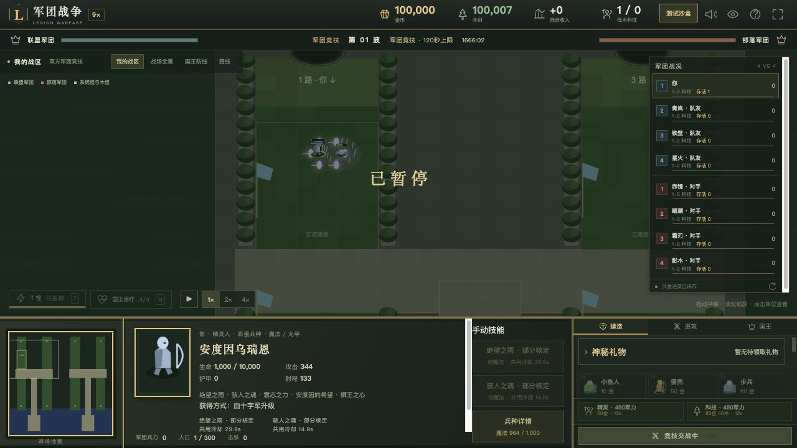
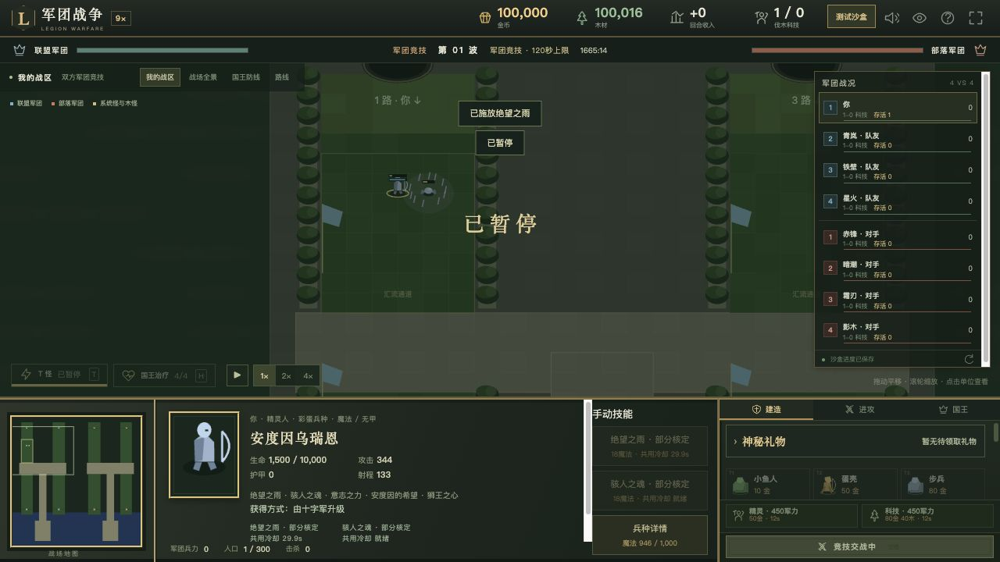
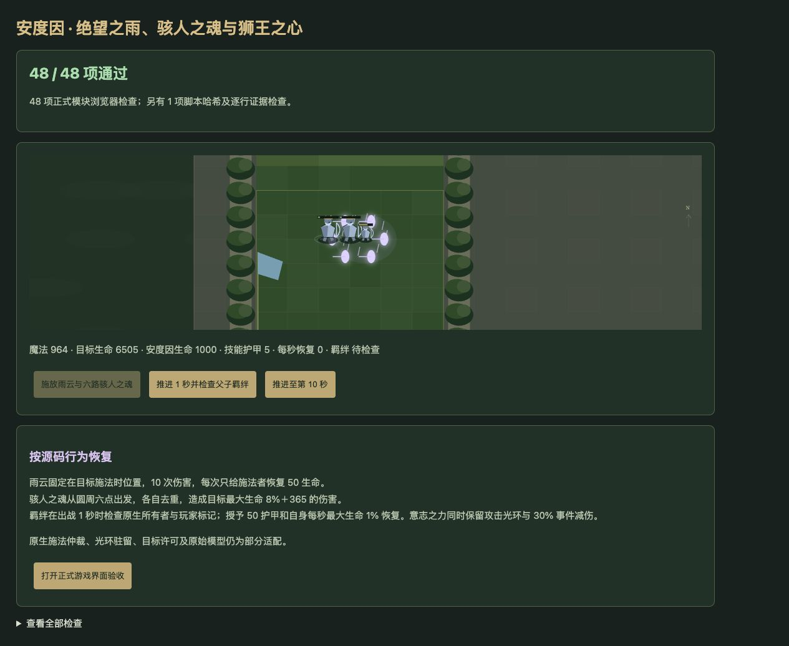
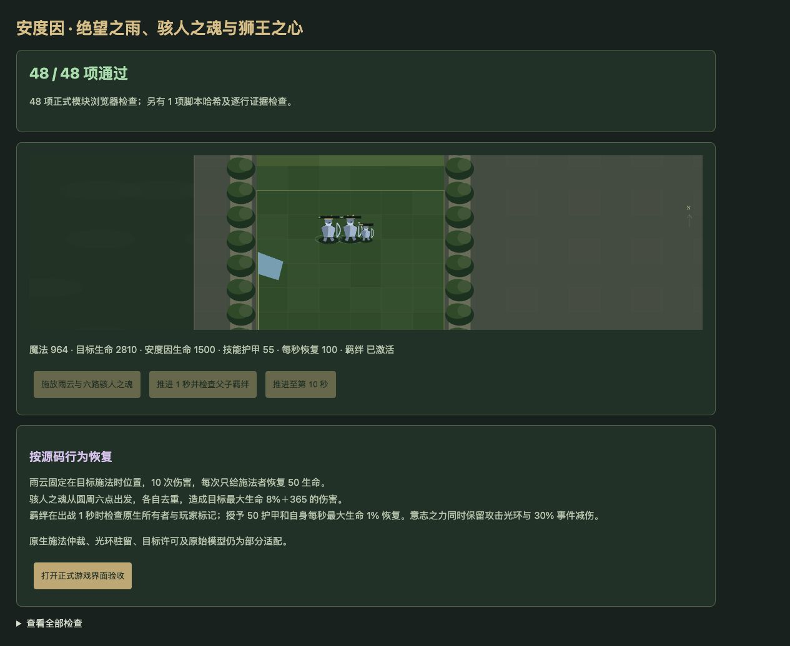

# v61 安度因技能与父子羁绊归档

日期：2026-11-04。基线：`ca79b04ec99ae128678b816282cc2159106f499a`。内容版本：`v14-content-20261104-v61-1`。本批承接内容还原目标，保留此前已发布的 AI 强化。

## 最终行为与来源

[源码证据](../../reference/anduin-evidence.json)保存407行逐字来源及能力、单位字段，测试校验原始文件 SHA256 与行号。源码按 Latin1 解码、仅以换行符分行；以下行号均指 `reference/v14-source/raw_extracted/war3map.j`。

| 能力 | 本批行为 | 源码位置 |
| --- | --- | --- |
| A1SP 绝望之雨 | 18魔法、30秒冷却、500码目标距离。锁定目标施法时位置，300码内每秒20魔法武器伤害，共10次，首次1秒后；每次伤害后仅施法者直接恢复50生命。 | 3–6、1290–1366、39312–39317 |
| A1SV 骇人之魂 | 18魔法、15秒冷却、500码选点距离。250码圆周六个等分辅助沿同一方向移动，各自记录命中过的对象；每目标最大生命8%＋365魔法武器伤害。每0.04秒80码、首跳0秒，9步720码后于0.36秒移除，结束不追加伤害。 | 30160–30219、35575–35651 |
| A1SQ 意志之力 | 保留400码8%攻击光环。主监听在正数敌对伤害、非A2Y7来源等条件下检测B080，将事件值写为局部伤害的70%；后续炼金门槛仍读取原局部值。 | 1367–1372、40553–40590 |
| A1SS 狮王之心 | 建筑能力登记后1秒只检查一次。同原生所有者的h0PZ优先；没有任何普通版对象才查h0XC外观。userData相同则双方永久获得A1SU和A1ST，不要求存活或距离。 | 1373–1415、43637、43824–43825 |

自动命令先骇人之魂、后绝望之雨；各自优先受伤方，已选择受伤方但施放失败时不退到攻击方（40734–40743）。自动与手动共用各技能冷却。古树效果入口在已支付费用后返回，不能根据界面文案额外生成效果。

六条灵魂轨迹按下一次回调时间交错执行，粗时间步与细时间步保持相同伤害顺序；命中组在伤害前登记，因此免疫目标也不能在同一轨迹内重复受击。e008作为脚本辅助句柄，不参与军团数量、寻路队列及无关随机抽取。施法者死亡不会取消已建立的雨云或轨迹；直接生命设置不擅自复活。

父子羁绊保留已死亡、尚未移除的瓦里安句柄，避免宿主清理军队数组后错误触发外观回退。普通版存在但玩家标记不匹配时也不回退；明确移除的句柄才不再参与枚举。存档恢复重新绑定活体及保留句柄，授予只属于当前战斗实体，不写回建筑。A1ST按AIde字段增加50护甲；A1SU按AUau字段恢复最大生命1%，当前目标适配仅自身，同buff不重复叠加。原有A1SR的5护甲光环保留。

获取路径使用真实命令验收：十字军h08L具备h220资格后，历史hA0B解锁R0FM，可支付605金币直接升级n087，开战映射h0W3。未加入兵种训练前置；训练优惠规则不变。

## 验收

- 新增49项专项检查；与古尔丹、玛里苟斯和原生光环合计127项通过。
- `npm test` 全量1874项通过：1783项Node测试、91项自定义检查，失败0。
- 35波各12秒运行检查：2784次生成，峰值123实体／16脚本任务，状态有限、保存续跑一致。这是短时烟测，不代表自然通关35波。
- 浏览器使用正式模块运行48项行为检查（唯一文件系统证据校验保留在Node端），全部通过，warning／error为0。雨云10秒后生命1000→1500；羁绊后护甲55、每秒恢复100；六个辅助可见。
- 正式游戏界面：手动骇人之魂成功并因命中自动触发雨云，魔法1000→964、冷却分别约15／30秒；等待冷却后手动点击敌方施放雨云，魔法964→946。暂停禁用施法，两项均显示“部分核定”。
- 独立8418端口验收；未刷新或修改玩家8417对局。临时验收页在打包前删除，70个模块资源哈希核对通过。

## 保留边界与归档

ANcl原生前摇、引导、同帧命令仲裁、浮点计时与枚举顺序尚未完整核定；辅助位移使用Web通行图，可能被通道边墙截断。B080首次应用与离圈驻留、混合伤害监听注册顺序、A1SU原生目标许可与缺失移动字段、未实例化建筑和原始模型／特效仍有缺口。不得将脚本主体通过验收写成完全还原。

覆盖清单玩家664项：404已实现、148部分、36标记、76待核定；全战斗749项：453已实现、157部分、49标记、90待核定。新增动态能力并将原来乐观标记的A1SQ改为部分，保留真实缺口。

本文归档本批实现、证据、验收与限制。按既有授权提交GitHub并更新现有网站；发布回执保存于仓库外的 `v61-publication.json`。原三个开发聊天保持归档，没有新增聊天；主聊天继续尚未完成的全量还原目标。
