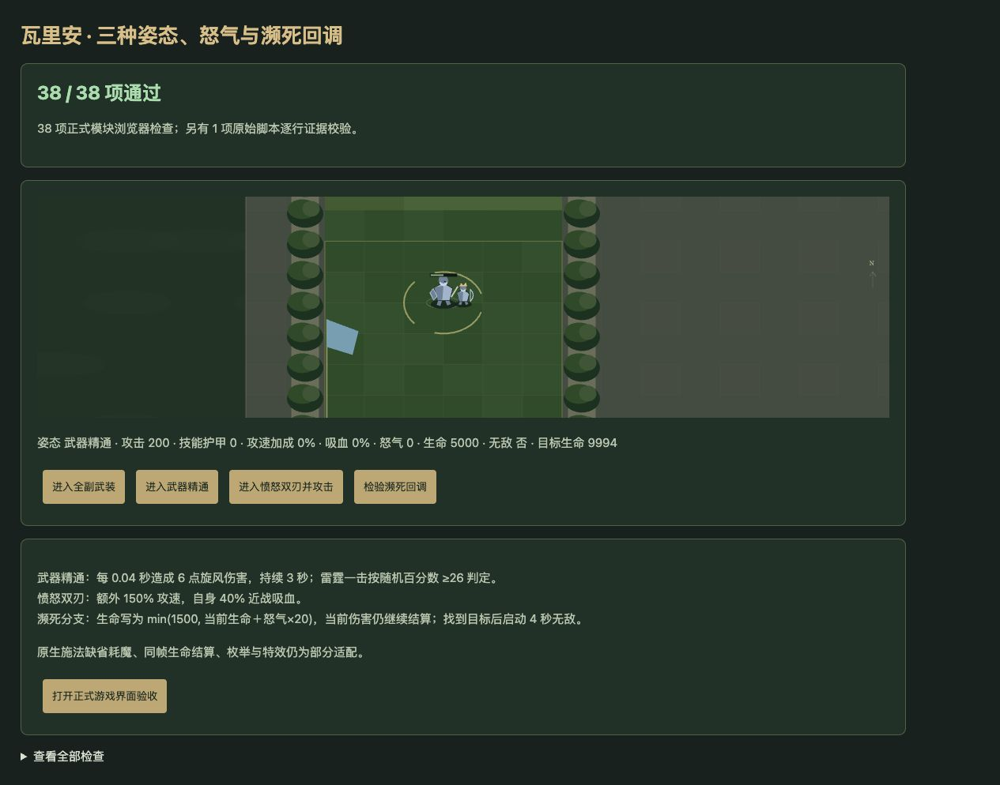
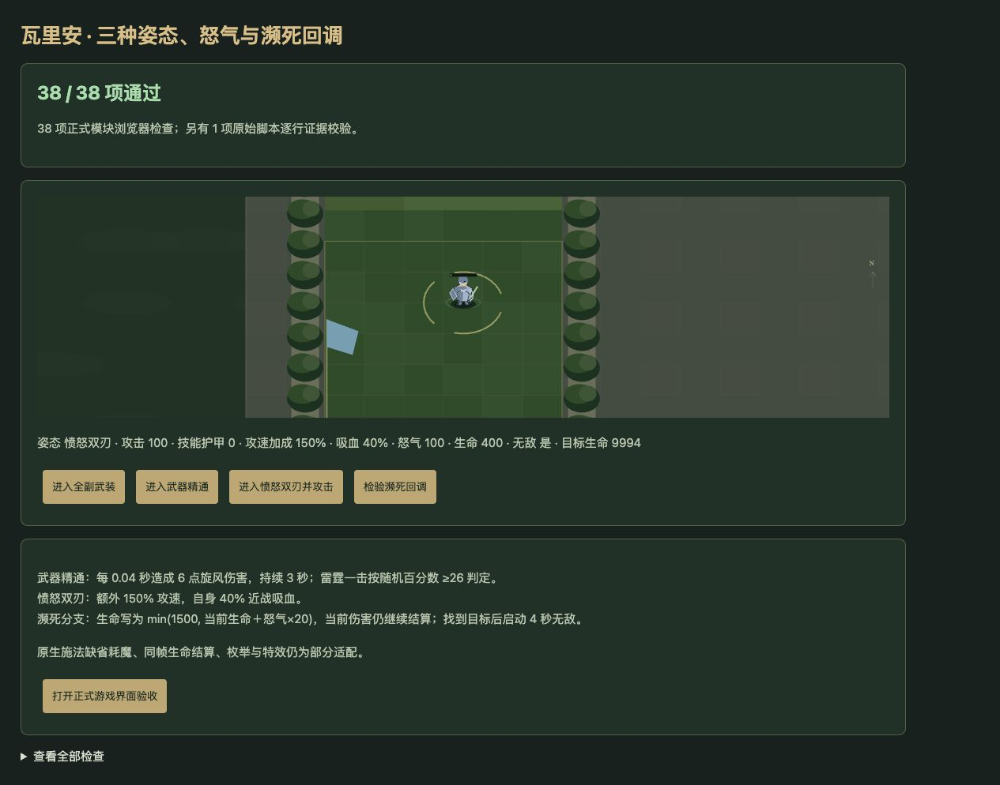
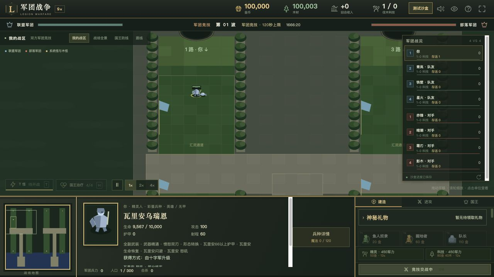

# v62 瓦里安姿态、怒气和濒死回调归档

日期：2026-11-04。基线：`a6acc79d98a1383bc5aec253c2c7b0b0367ba439`。内容版本：`v14-content-20261104-v62-1`。本批承接全量内容还原目标，重点修复瓦里安只有技能说明、姿态脚本没有运行的问题。

## 来源与实现

[证据文件](../../reference/varian-evidence.json)固定404行原始JASS及原生能力、单位字段；专项检查逐行核验源码与SHA256。源码路径 `reference/v14-source/raw_extracted/war3map.j`，采用Latin1解码、仅按换行符分行。

| 分支 | 本批按来源接入的行为 | 来源行号 |
| --- | --- | --- |
| 受伤登记 | 出战时A11V、A11W、A11X齐全才建立独立伤害/死亡监听；没有出生自动姿态。移除原图标后已注册监听继续。按本次伤害扣除前的生命比例，≥66%、33%至不足66%、不足33%切换。 | 43243–43446、43649 |
| 全副武装 | 动态A11O护甲15、A11P每秒恢复30、A11R物理闪避30%。首个高血姿态计时请求A121咆哮：600码友军30%攻击、6秒；此后每5秒请求A11Q嚎叫：600码敌军减攻30%、2秒，并独立请求A122等级1的0.1秒控制。 | 1194–1205、43243–43275、43354–43378 |
| 武器精通 | 动态A11S平攻+100，离开姿态减回。每次进入且具有A11Y时生成旋风，首次0.04秒，75次每次6点混乱/通用非武器伤害，范围跟随施法者300码，姿态变化不取消旋风。 | 43276–43293、43379–43405 |
| 武器事件 | A11Y每个独立武器伤害事件增加1魔法，双怒气时2。具有A11S时重新抽主武器攻击上下限写入事件伤害；百分数≥26才对目标中心300码敌人追加125混乱/通用武器伤害，没有减速调用。 | 42252–42273、42383–42405 |
| 愤怒双刃 | 动态A11T的DataA=1.5为额外150%攻速，A11U为自身40%近战吸血。每次进入设5秒双怒气；离开删除标记但不取消旧计时器，旧计时器可能清掉后来的一次窗口。 | 43294–43302、43406–43428 |
| 一次濒死 | 事件伤害≥当前生命且尚未使用时，生命设为min(1500,当前生命+魔法×20)，再按最大生命钳制；魔法不清空。500码选主攻击值最高敌人，平值选后枚举者；位移、攻击请求、A0I7等级1控制、A11Z一次重击及4秒无敌。没有目标则不授予这些效果。 | 43303–43353 |

濒死脚本没有调用事件伤害清零，因此宿主保留该事件在生命写入之后的扣血：例如生命1000、怒气100、伤害1100，先写1500再扣为400；伤害超过新生命仍可能死亡。原生引擎同帧生命设置语义尚未实测，保留部分适配，不能凭技能说明擅自添加免疫。A0I7原生适配对英雄为0.5秒，对魔免或机械目标不保证成功，也没有按文案强行无视魔免。

高血姿态计时器低于66%后销毁，但来源没有清除已存句柄，因此回到高血姿态不会重建。武器精通和双刃则按每次进入触发。旋风、无敌、双怒气和受伤监听均处理死亡与保存恢复；动态攻击加成使用属性记录，避免读取存档重复增加。安度因授予的A1ST/A1SU在姿态切换中保留。

瓦里安重写的局部P8继续传给青铜龙A150，修复此前该混合分支只能报告未接入的问题；未实现的红龙前置分支仍明确记录边界。正式面板增加姿态、怒气、双倍怒气和濒死次数使用状态，旋风使用宿主绘制效果。

## 验收

- 新增39项专项，连同安度因、青铜龙共114项通过。
- 全量 `npm test` 1913项通过：1822项Node测试、91项自定义检查，失败0。
- 35波×12秒运行检查通过：2784次生成、峰值123实体／16脚本任务、状态有限、保存续跑一致；不等于自然通关35波。
- 浏览器38项正式模块行为检查通过，另1项原始文件校验在Node端执行，warning/error为0。实际点击确认三姿态属性、双怒气+2、旋风与濒死生命400/无敌状态。
- 正式游戏界面从独立沙盒存档继续，选中瓦里安显示“全副武装 · 怒气0/120”，生命恢复和嚎叫冷却继续更新。未刷新或修改玩家8417对局。
- 获取路径以真实命令验证：十字军、h210资格、电锯王及满级牛头人酋长完成历史齐备后，正常支付700金币直接升级h0Q0，出战为h0PZ并登记监听。没有加入兵种训练前置。
- 71个模块资源哈希核对通过；临时验收页和独立服务在发布前清理。

## 缺口与归档

原生咆哮/嚎叫耗魔、前摇及命令仲裁默认值缺失；本次只适配已知范围和增减攻效果，记录未知字段，不宣称零耗魔已核定。A122辅助伤害、A11Z附伤字段缺失，未按说明补入数值。原生随机上下限动态修正、组枚举平值顺序、混合监听注册顺序、濒死同帧结算、光环目标/驻留、原始模型与特效仍待核定。旧存档没有姿态历史时，不伪造已经发生过的首次进入或濒死次数；新出战执行完整登记。

覆盖范围补入10项动态/辅助能力：玩家674项，409已实现、157部分、36标记、72待核定；全战斗759项，458已实现、166部分、49标记、86待核定。整体还原尚未完成。

本文归档该批源码、验证及限制。按既有授权提交GitHub并发布现有网站，发布回执保存在仓库外 `v62-publication.json`。原三个开发聊天保持归档，没有新增聊天；主聊天继续全量目标。
