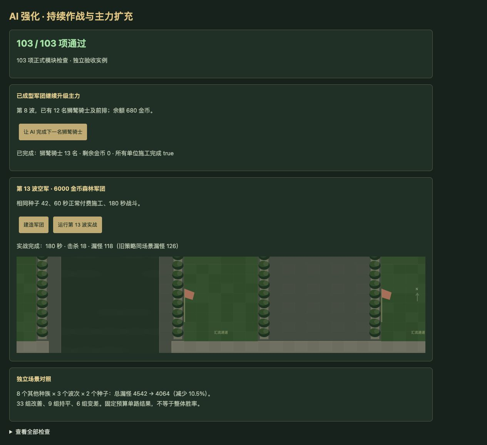

# v63 AI 持续作战与主力扩充归档

日期：2026-11-04。需求：继续升级 AI 强度。基线：`b61e1ce7af95713c712b3b8c42f5541545928e0f`。

## 最终行为

- 第4波起，选兵与升级除了比较有效秒伤，还把生命、护甲、攻防类型及已实现闪避形成的有效生命纳入持续输出估值。系数采用有效生命平方根，并限制在0.35—2.5之间；这是选兵启发式，不是战斗属性加成，也不声称精确预测存活时间。
- 同类兵种的多样性扣分设定上限，保留前排和辅助搭配，但不会随着军团扩大而无限贬低已成型主力。已有12名狮鹫骑士的验收场景会继续使用680金币完成下一名狮鹫，而非被迫购买低价射手。
- 前3波采购评分、经济与发兵策略沿用原行为。所有购买仍走真实费用、资格、人口与施工流程；存档无新增字段。未改玩家资源、单位属性、波次和技能覆盖分类。

## 固定预算验证

[完整机器数据](../../reference/ai-sustain-benchmark.json)保存全部结果，包括退步的场景。每组给予60秒正常付费施工，关闭经济及发兵，只比较同一路最多180秒战斗；国王生命统一提高到100万防止提前结束。结果用于比较同条件军团防守，不能当作自然通关率。

| 原有场景（各3种子） | 漏怪：旧→新 | 击杀：旧→新 |
| --- | --- | --- |
| 骑士，第8波，3000金币 | 158→123 | 166→202 |
| 野兽，第8波，3000金币 | 154→154 | 171→171 |
| 森林，第13波空军，6000金币 | 375→336 | 30→71 |
| 合计 | **687→613，减少10.8%** | **367→444** |

另外使用未参与改动选择的8个种族（机甲、黑暗、元素、幽魂、海洋、地精、不死、沙漠），第6/12/16波，种子7/2073，共48组。总漏怪 **4542→4064，减少10.5%**，击杀 **1510→1987**；33组改善、9组持平、6组回退。回退包括黑暗第6波种子2073、元素第6波两种子及第16波种子2073、幽魂第12波种子7、海洋第16波种子2073。没有依据这组结果再次调参。

## 固定对手完整对局

蓝队全部维持旧策略，只替换红队；玩家0在两组均接受相同的旧版建造辅助。对局自然结束，未赠送资源或改变属性。

| 种子 | 旧红队 | 新红队 |
| --- | --- | --- |
| 42 | 第6波负，705秒，国王0生命 | 第9波胜，986秒，国王15103生命 |
| 173 | 第6波负，671秒 | 第6波负，685秒 |
| 615 | 第4波胜，485秒，国王2436生命 | 第4波胜，489秒，国王3844生命 |

3个种子由1胜2负变为2胜1负，只是小样本结果；对局时长及后续随机调用会改变，不直接比较累计漏怪来推断整体强度。

复现方式（基线须独立检出上述提交，不能把更新后的主目录当基线）：

```sh
node scripts/benchmark-ai-matchups.mjs /path/to/baseline
node scripts/benchmark-ai-matchups.mjs /path/to/candidate
node scripts/benchmark-ai-sustain.mjs /path/to/baseline
node scripts/benchmark-ai-sustain.mjs /path/to/candidate
node scripts/benchmark-ai-opponents.mjs /path/to/baseline /path/to/baseline 35
node scripts/benchmark-ai-opponents.mjs /path/to/candidate /path/to/baseline 35
```

## 验收及归档

- 新增10项检查；AI专项103项、全量1923项（1832项Node测试及91项自定义检查）通过。
- 浏览器正式模块103项通过，无warning/error；实际点击验证付费扩军完成及第13波180秒实战（18击杀、118漏怪），与命令行同种子结果一致。独立8418端口验收，不读写用户8417的存档，不刷新用户对局。
- 35波×12秒运行检查：2784次生成，峰值123实体／16脚本任务，状态有限、保存续跑一致。这不是自然通关35波证据。
- 已构建71个浏览器模块及样式哈希，资源版本检查通过。临时验收页在提交和发布前删除；按已有授权推送GitHub并更新现有公开网站，发布回执保存在仓库外 `v63-publication.json`。
- 本文归档本次AI需求及验证上下文。原三个开发聊天保持归档，没有新增聊天；主聊天保留尚未完成的整体还原目标。


