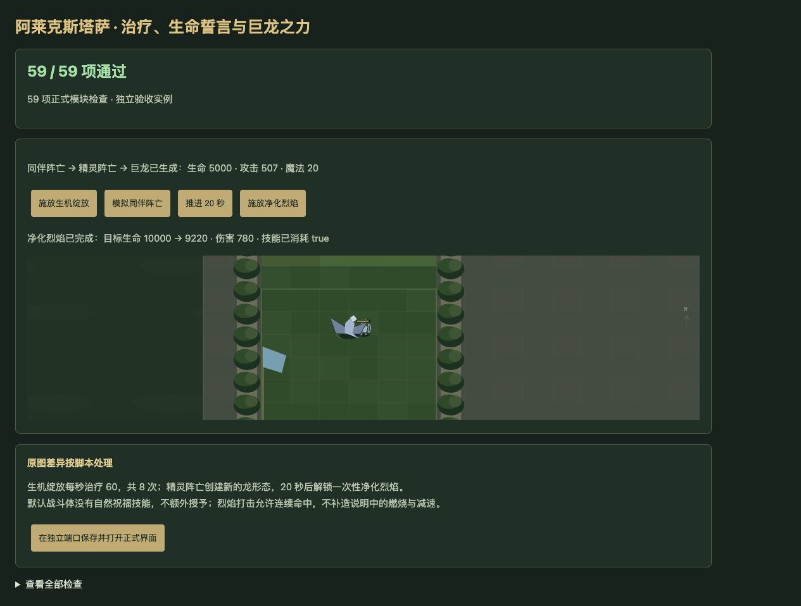
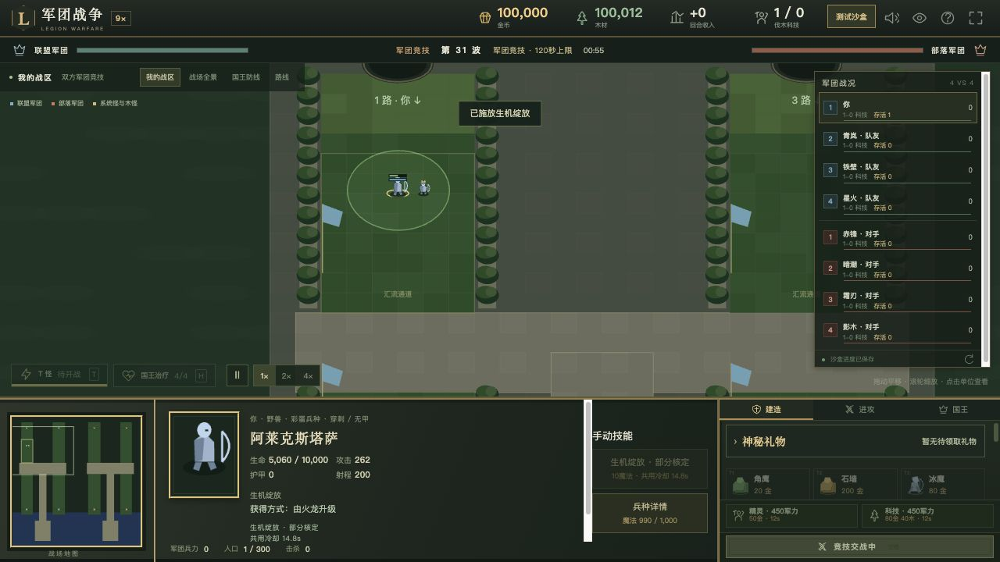

# v64 阿莱克斯塔萨精灵与巨龙形态归档

日期：2026-11-04。基线：`d2883f91fcf24a8c573bc014f2c3da7f29cdcb88`。内容版本：`v14-content-20261104-v64-1`。

## 来源及行为

[证据文件](../../reference/alexstrasza-evidence.json)保存650行原始JASS及能力、单位字段；专项检查核验每行和源码SHA256。以Latin1解码、仅按LF分行。主体位于33981—34450，施法入口39478—39483，主受伤入口41059—41073，独立武器事件42416—42440，建筑登记43731—43747。

| 机制 | 已接入行为 |
| --- | --- |
| 生命赐福 A16S | 从建筑登记600码友军生命监听，固定登记时最大生命65%的阈值。跨入阈值且15秒冷却结束时牺牲自身当前生命一半，0/1/2/3秒各治疗牺牲量的15%，范围跟随施法者。成功后移除该对象监听，离圈再进入才重建；冷却到期本身不重新触发。 |
| 生机绽放 A16T | 10魔法、15秒冷却、600码选点；固定中心每秒治疗60，共8次，首次立即。施法者死亡仍保留回调。 |
| 生命誓言 A16U | 0.1秒后分别找同原生所有者及同userData的h0MY、h0F1，各取首个，无距离门槛。双方最大生命变为当时两者之和并回满；受伤事件先均分当前生命，再扣本次伤害。精灵死亡恢复同伴原最大生命并回满，同伴死亡杀死精灵。两个原型独立链接，0.03秒计时器只清理失效链接。 |
| 自然祝福 A170 | 建筑登记全局受伤监听，600码友军受伤先请求15魔法、18秒冷却的transmute；成功且目标≤50%、施法者>15%生命时牺牲施法者最大生命15%并回满目标。普通及神圣战斗体都没有A170，未找到授予入口，因此默认请求失败。动态明确持有时才执行原条件，不补造默认授予。 |
| 巨龙之力 A172 | 单位死亡创建新h0R0，基础5000生命、495—519穿刺攻击、0.5秒间隔、20/30魔法；保留所有者、userData及位置，不复制旧生命链接、强化和魔法。继承该玩家标记的自然怒火护甲累计；20秒后授予一次A16W。龙体没有再次变龙登记。widget死亡只有0.5秒后注销监听，不能直接创建巨龙。 |
| 烈焰打击 A16V | 10魔法、13秒冷却、800码目标。暂停并固定方向，在0/1.2/2.4秒发射火球；每0.04秒走50码，对150码敌军造成160普通攻击/火焰非武器伤害，允许重复命中。原ChargeDistance先检查下一步，通常29步1450码后停止，1.2秒移除；第三次发射解除暂停。 |
| 净化烈焰 A16W | 20魔法、800码目标，施放即移除此技能；1秒后以施法者当前位置向固定方向900码为中心，对900码敌军造成一次780普通攻击/火焰非武器伤害，解除暂停。旧的三条白焰线函数只有定义没有调用，不添加该路径或友军治疗。 |
| 自然的怒火 A16Z | 每个独立武器事件抽主武器攻击范围，追加25%混乱/通用武器伤害。附伤后目标生命≤本次抽样值即自疗100，百分数≥45时加1护甲，按userData累计上限40；不要求击杀。局部P8继续传给后续青铜龙改伤分支。 |
| 两项龙族光环 | A16X显式99999码、护甲+1；A16Y显式600码、攻速+30%。A16Y缺少DataA，不根据说明额外添加10%移动。 |

手动技能接入正式选点/选敌命令及自动受伤入口，共享原生费用和冷却；自动顺序位于玛里苟斯之后、火枪手之前。精灵及神圣外观均使用同一组明确来源规则，龙体原始movetp为foot，不把龙外观误当成飞行目标。

保存恢复重新绑定活单位、保留尸体与辅助单位句柄，避免生命链接或延迟施法更新复制对象。永久护甲累计跟随本局，死亡回调、暂停、连续波和新局清空均经过验证。战场新增生命链接线、治疗圈、火球与净化预示，h0R0显示龙形态；面板显示链接数、怒火累计及净化解锁倒计时。这些为宿主绘制，原图模型与特效资产尚未补齐。

## 验收

- 新增60项专项检查；与安度因、瓦里安、青铜龙相关检查共174项通过。
- 全量1983项通过：1892项Node测试、91项自定义检查，失败0。
- 35波各12秒运行检查通过：2784次生成，峰值123实体、16脚本任务，状态有限、保存续跑一致；不等于自然通关35波。
- 浏览器59项通过，另1项源码及覆盖清单校验在Node端执行；warning/error为0。实际按钮验证治疗1000→1060、同伴阵亡→精灵阵亡→5000生命巨龙、20秒解锁、780伤害及一次性技能消耗。
- 正式页面从独立沙盒存档继续，选中精灵并用技能按钮选点：生命5000→5060，魔法1000→990，显示共用冷却。验收仅使用独立8418端口，未修改用户8417对局。
- 真实命令验证火龙、完成历史及h220资格满足后，支付600金币直接升级n066；战斗体h0QZ登记四条被动路线，未把兵种训练设为必需前置。
- 72个浏览器模块和样式内容版本一致。临时验收页在提交及打包前清理。

## 剩余边界与归档

原生生命阈值/入圈事件、ANcl前摇与引导仲裁、对象枚举顺序、原生伤害监听交错、动态攻击上下限、光环驻留、辅助碰撞、未实例化建筑及模型资源仍待核定。死亡句柄的直接生命写入不会擅自复活，明确保留原生语义边界。A170缺失授予入口以及未调用的旧净化函数均保留源码事实，不以提示文字补造效果。

覆盖补入建筑A170、运行时h0R0及动态A16W等6种能力：玩家680项（410已实现、166部分、36标记、68待核定）；全战斗765项（459已实现、175部分、49标记、82待核定）。部分适配不等于完成原生验收，整体还原目标继续。

本文归档本次需求、源码依据、验证与限制；按已有授权提交GitHub并更新现有网站，仓库外保存`v64-publication.json`回执。原三个开发聊天保持归档，没有新建聊天；主聊天保留全量还原目标。v63 AI强化及其完整对照数据继续保留，不再把本批技能接入当成AI胜率证据。
