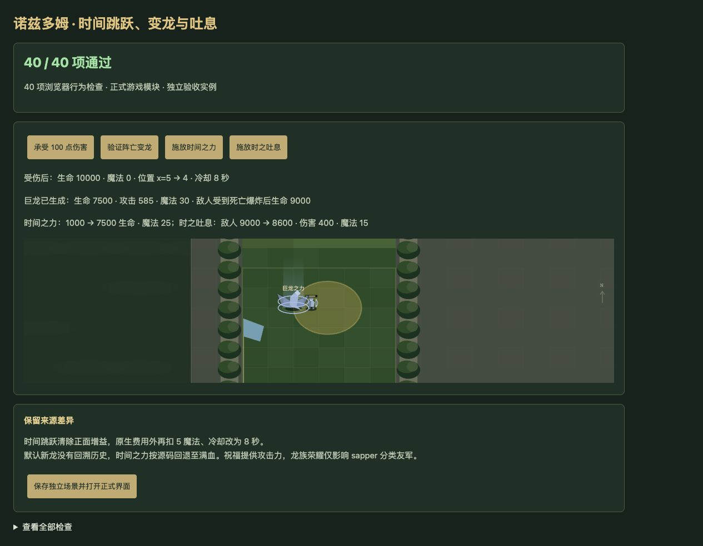
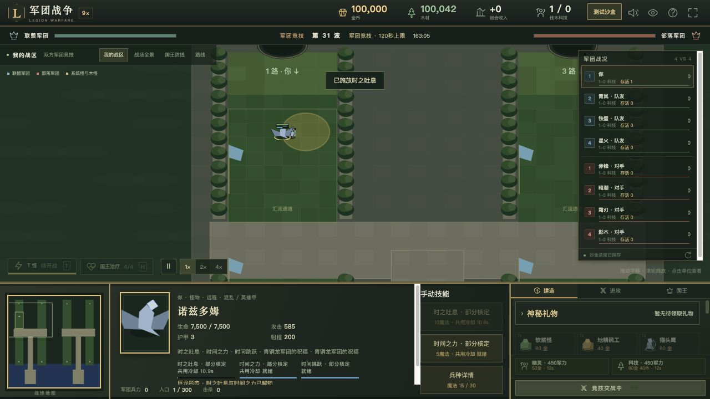

# v65 诺兹多姆时间技能与巨龙形态归档

日期：2026-11-04。基线：`83c39e543cb18468dca363f389bc3d046da493eb`。内容版本：`v14-content-20261104-v65-1`。

## 来源与最终行为

[证据文件](../../reference/nozdormu-evidence.json)保存226行原始JASS及能力、单位字段，专项检查逐行核验及验证源码SHA256；以Latin1解码、仅按LF分行。施法入口39486—39512，主受伤入口41099—41124及41160—41167，主死亡入口42022—42032，历史记录43580—43608，建筑登记43728—43729。

| 机制 | 已接入行为 |
| --- | --- |
| 时间跳跃 A154 | 正数敌对受伤时受伤者请求parasite。原生字段先需5魔法、6秒冷却；成功后脚本再扣5魔法并钳到0、冷却改为8秒、本次事件伤害写0。在本人建筑矩形内时，重复抽取0—600码距离及方向，直到落点仍在矩形内才直接移动；区域外仍抵消伤害并驱散已核定的正面增益。没有单独手动瞬移入口。 |
| 巨龙之力 A158 | 主死亡触发器中创建全新h0QT，保留所有者、userData、位置和朝向；7500生命、570—600混乱攻击、0.6秒间隔、30魔法。随后原死亡对象对400码内敌军造成1000普通攻击／普通武器伤害，仍受攻防类型和护甲影响。嵌套主死亡不能再次变龙；新龙没有A158。 |
| 时之吐息 A159 | 10魔法、11秒冷却、1000码选点。以施法者沿所选方向前移400码为中心，立即对400码内活着且无Avul的敌军造成400混乱／通用武器伤害。主受伤入口仅受伤者向攻击者自动施放，死亡的目标句柄不再接受自动单位命令。 |
| 时间之力 A15A | 5魔法、15秒冷却，读取已登记历史的第3格生命百分比；缺失或0改为100%，按当前最大生命设置，因此有历史时也可能降低生命。历史每秒右移六格、最新值写第1格，死亡后下一次采样清空并注销。主受伤入口仅攻击者自动请求。 |
| 祝福 A155/A156/A157 | A155为说明图标；A156提供600码20%攻击力，A157提供600码20%移动速度。龙体不携带A157，未根据说明补造攻速或施法速度。 |
| 龙族荣耀 A206/A201—A204 | A206为说明图标；实际光环为600码内sapper分类友军11%攻击、13%移速、每秒14恢复、12%攻速及1护甲。目标按原生分类判断；不同buff可叠加，同buff多个来源不重复加成。 |

源码只有建筑携带A15A且没有更早A14Y/A14Z分支时才登记历史。默认建筑n064没有A15A，死亡创建新龙也不调用该登记函数。因此默认龙形态施放时间之力走满血回退，不能根据说明凭空添加历史计时器。

同时修正A1W2与时间跳跃的事件次序：源码在跳跃写0后，用该主触发器原始伤害P8乘0.8覆盖事件值。混合能力场景100点伤害最终为80，避免重复减伤为64或错误保留为0；原有圣光护盾测试继续通过。

保存恢复绑定活单位或保留尸体，保持历史、冷却与对象身份；新局清空待执行记录。战场显示巨龙及短暂吐息范围，正式面板提供时间之力按钮、吐息选点、共享冷却和巨龙状态。这些为宿主绘制，原图模型资源仍缺失。

## 验收

- 新增41项专项检查；全量2024项通过（1933项Node测试、91项自定义检查），失败0。
- 浏览器40项通过，另1项源码和覆盖校验在Node端执行；warning/error为0。实际按钮验证跳跃100点伤害抵消及魔法耗尽、死亡变龙、1000爆炸、1000→7500生命回退、400吐息伤害。
- 正式页面从独立沙盒存档继续：选择龙形态，点击时间之力使生命1000→7500、魔法30→25；吐息选点后魔法25→15，冷却显示10.9秒。验收使用8418端口，保留用户8417对局和存档。
- 真实命令验证h0QP、h201完成历史及R08F资格满足后，支付550金币直接升级n064，未把兵种训练设为必需前置。
- 35波各12秒运行检查通过：2784次生成，峰值123实体、16脚本任务，状态有限、保存续跑一致；不是自然通关35波证明。
- 73个浏览器模块和样式版本一致；临时验收页在提交及打包前删除，独立测试服务器关闭。

## 剩余边界与归档

ANcl原生前摇与同帧命令仲裁、原生对象枚举、生命设置时序、飞行通行及模型特效仍为部分适配。建筑矩形映射到Web防区，不等于原地图坐标；异常随机流最多尝试256次并记录未取得落点。未知buff保留，不擅自当作正面或负面效果移除。

覆盖补入运行时龙体A159/A15A等2种能力：玩家682项（410已实现、170部分、38标记、64待核定）；全战斗767项（459已实现、179部分、51标记、78待核定）。部分适配不等于原生验收完成，整体还原目标继续。

本文归档本批需求、实现、证据和限制；按已有授权提交GitHub并更新现有网站，发布回执在仓库外保存为`v65-publication.json`。原三个开发聊天保持归档，未创建新聊天；主聊天保留整体还原目标。此前v63的AI强化和完整对照结果继续保留，本批技能补全不作为新的AI胜率证据。
