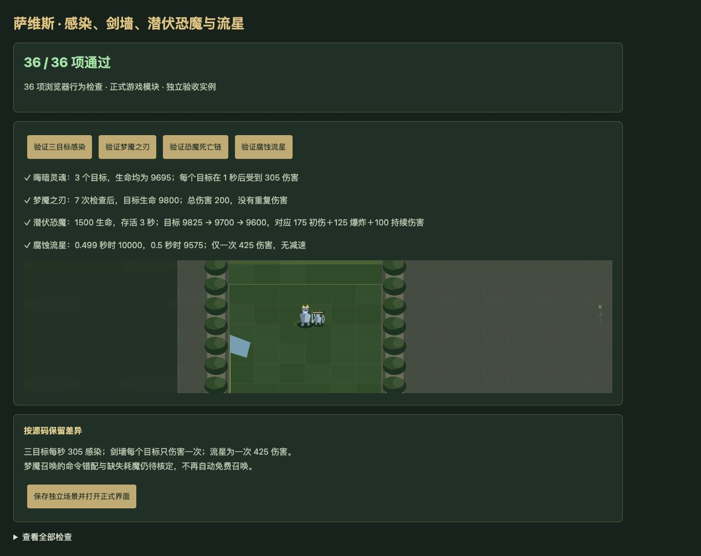
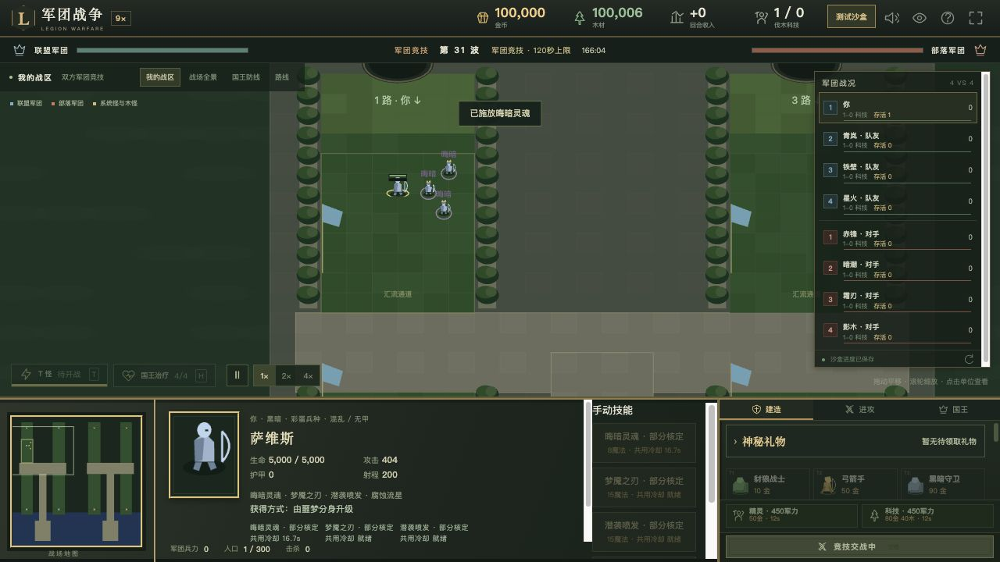

# v66 萨维斯技能与施法入口纠错归档

日期：2026-11-04。基线：`81cb5254aef543d59a2fb8bbb64cb761c40e90ce`。内容版本：`v14-content-20261104-v66-1`。

## 来源与最终行为

[证据文件](../../reference/savis-evidence.json)保存342行原始JASS，以及能力、建筑、战斗体和召唤物字段。专项检查逐行核验及验证源码SHA256，Latin1解码、仅按LF分行。主体35900—36119，施法入口39267—39275，自动命令40714—40732，梦魇召唤请求40769—40773，LoopDamage回调29895—29929。

| 能力 | 已接入行为 |
| --- | --- |
| 晦暗灵魂 A1UD | 8魔法、17秒冷却、500码选敌。感染选定目标及其600码内另外最多两个敌人，按枚举顺序取前两个，不额外抽随机。每个目标从1秒后每秒受到305混乱／通用武器伤害，直到该目标widget死亡；施法者死亡、目标离圈或技能移除均不取消。重复感染独立叠加，没有说明中的25溅射。 |
| 梦魇之刃 A1UE | 15魔法、20秒冷却、500码选敌。在目标施法时位置建立400码范围，0至6秒共7次检查；每个敌人在该次施法中只受到一次200混乱／通用武器伤害，离开再进入不重复。不同施法各自去重，施法者死亡不取消。 |
| 潜袭喷发 A1UF | 15魔法、15秒冷却、500码选敌。先在目标处创建u011潜伏恐魔，1500生命、149.5平均攻击、3护甲、1秒间隔，存活3秒；再对选定目标造成175混乱／通用武器伤害，最后登记恐魔widget死亡监听。恐魔死亡以当时位置300码范围造成125同类伤害，并对各目标从1秒后每秒追加10点，共10次。后续伤害来源为恐魔，施法者死亡不取消。登记前发生的死亡不补触发。 |
| 腐蚀流星 A1UG | 20魔法、15秒冷却、500码选敌。固定目标施法时位置，0.5秒后对500码敌军造成一次425混乱／通用武器伤害。六颗流星仅是视觉效果，不是六次伤害；没有源码未实现的减速。 |

四项技能共用原生费用和冷却，接入正式选敌命令与主受伤自动入口。自动顺序为A1UD、A1UE、A1UG、A1UF，每项受害者优先；受害者有技能但不能施放时，不回退给攻击者。50魔法的场景先支付8、15、20，余7，最后15魔法的潜袭喷发失败。死亡、重生中的widget回调、重复施法、暂停、连续波及存档对象绑定均已验证。

战场显示感染标记、剑墙范围、流星预示与恐魔范围；选中施法者会显示当前感染目标数。宿主图形用于表达已接入机制，原图模型与特效尚未导入。

## 同批纠错

- A1UH是建筑说明图标，实际战斗体h0WL携带A1UI。SavisSummon只有定义、没有调用，不根据说明添加两只召唤物、100攻击或3护甲。
- A1UI原生对象为AHwe，定义三只h03L、60秒生命和3600秒冷却，但主受伤入口下达的是spiritofvengeance，未匹配AHwe的waterelemental命令。已移除通用逻辑自动免费召唤的错误路径，保存失败请求信息。A1UI缺少Cost1，不能把缺失当0，也不能直接继承另一条可编辑AHwe对象的125费用。原生命令仲裁及手动耗魔仍待核定，因此不暴露未经核定的手动召唤。
- Trig_allabilityActions及InitTrig_allability没有古树分类拦截。修正古尔丹、安度因、阿莱克斯塔萨、诺兹多姆模块误加的古树屏蔽；动态携带这些技能的古树施法者现在可执行主体。保留嵌套施法时DisableTrigger对应的抑制。这一核验取代v59、v61、v64、v65归档中相反的旧验收描述，其他触发器自己的分类条件未作泛化更改。

## 验收

- 新增37项专项检查；五个相关家族222项检查通过。
- 全量2061项通过：1970项Node测试、91项自定义检查，失败0。
- 浏览器36项通过，另1项来源与覆盖核验在Node执行；warning/error为0。实际点击验证三目标每秒305、剑墙累计200、恐魔175＋125＋100及流星延迟一次425。
- 正式界面独立沙盒验证四项技能按钮和魔法不足禁用；以8魔法场景点击晦暗灵魂并选择敌人，显示“已施放”、17秒共用冷却、魔法8→0和“持续感染3个目标”。仅使用8418端口，未修改用户8417对局及存档。
- 正常付费命令验证h020→n08H：缺少R0GL历史或h220超级赞助时失败，满足历史并在沙盒启用资格后支付500金币升级，出战为5000生命、50魔法的h0WL。不将兵种训练设为必需前置，也不伪造普通对局平台资格。
- 35波各12秒运行检查通过：2784次生成，峰值123实体、16脚本任务，状态有限且保存续跑一致；不是自然通关35波证据。
- 74个浏览器模块和样式版本一致；临时验收页删除，独立测试服务器关闭。

## 剩余边界与归档

原生ANcl前摇、同帧命令仲裁、对象枚举与浮点计时、被移除句柄的回调、恐魔寻路和模型特效仍为部分适配。对象死亡后的持续伤害来源会保留原句柄；对象移除和死亡不等同，不额外补造死亡爆炸。

覆盖新增建筑A1UH，并将此前乐观标为已实现的A1UI改为部分适配。玩家683项能力：409已实现、175部分、39标记、60待核定；全战斗768项：458已实现、184部分、52标记、74待核定。整体还原尚未完成。

本文归档本批需求、证据、验证和限制；按已有授权提交GitHub并更新现有网站，仓库外保存`v66-publication.json`发布回执。原三个开发聊天保持归档，未新建聊天；主聊天继续承接整体目标。
