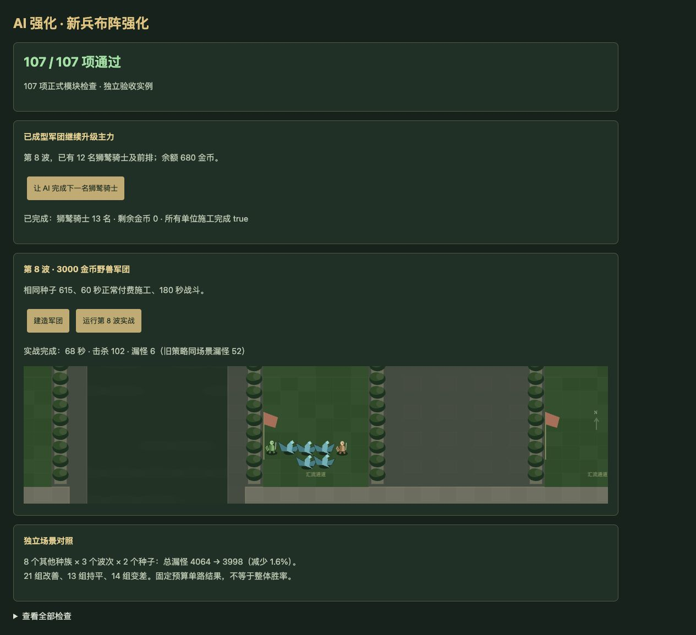

# v67 AI 新兵布阵强化归档

日期：2026-11-04。需求：升级 AI 强度。基线：`21cf50fce728b8e8731d00459e06595e779343ec`。

## 最终行为

第4波起，AI 为新建单位采用更靠后的优先布阵：近战优先第6行，然后向前补位；远程优先第7、8行。这样让怪群有更多汇集时间，也减少近战向后补位而混入远程队列的情况。这里的行号从1起算；满场时仍会使用其他空格，并不保证所有近战始终领先远程一排。

前三波沿用原布阵。普通购买、开局升级路径、英雄祭坛和已获得的随机兵礼包共用新位置选择；升级路径按候选最终兵种判断前后排。所有资源、人口、资格、施工、礼包消耗仍由正式命令校验。已有建筑保留原坐标，不使用或绕过移位次数，玩家0不受自动操作影响。没有增加金币、伤害、生命或其他隐藏加成。

## 同条件战斗对照

[完整机器数据](../../reference/ai-formation-benchmark.json)保留所有结果，包括退步场景。每组给予相同预算和60秒付费施工、最多180秒单路战斗，国王生命统一提高到100万防止提前结束。这是单路防守对照，不是自然通关率。

| 场景 | 漏怪：旧→新 | 击杀：旧→新 | 改善／持平／回退 |
| --- | --- | --- | --- |
| 原9组：骑士8波、野兽8波、森林空军13波 | 613→575 | 444→482 | 5／1／3 |
| 另48组：8种族×6/12/16波×2种子 | 4064→3998 | 1987→2053 | 21／13／14 |
| 共57组 | **4677→4573（减少2.2%）** | **2431→2535** | 26／14／17 |

48组使用机甲、黑暗、元素、幽魂、海洋、地精、不死、沙漠，种子7和2073。没有依据这组结果调整布阵参数。最终控制器的全部48组结果与独立原型逐项一致。

## 固定对手完整对局

蓝队维持旧策略，玩家0在两版均使用相同旧版建造辅助，只替换红队 AI。前三波布阵保持原样。

| 种子 | 旧红队 | 新红队 |
| --- | --- | --- |
| 42 | 第6波胜，681秒，国王5925生命 | 第6波胜，668秒，国王11325生命 |
| 173 | 第8波负，964秒 | 第6波负，677秒 |
| 615 | 第4波胜，499秒，国王2411生命 | 结果相同 |

新旧均2胜1负，173种子更早失败；小样本不支持普遍胜率提升的结论。对局时长和后续随机调用不同，累计漏怪也不能直接用来比较防守效率。

复现（基线应独立检出上述提交）：

```sh
node scripts/benchmark-ai-matchups.mjs /path/to/baseline
node scripts/benchmark-ai-matchups.mjs /path/to/candidate
node scripts/benchmark-ai-sustain.mjs /path/to/baseline
node scripts/benchmark-ai-sustain.mjs /path/to/candidate
node scripts/benchmark-ai-opponents.mjs /path/to/baseline /path/to/baseline 35
node scripts/benchmark-ai-opponents.mjs /path/to/candidate /path/to/baseline 35
```

## 验收与归档

- 新增4项检查：七个 AI 所属路的礼包落位、施工占格下最后空格、已有坐标与搬迁次数保留、前三波布阵保留。更新礼包首选行断言。
- AI专项107项、全量2065项（1974项Node及91项自定义检查）通过；浏览器107项通过，无warning/error。
- 浏览器实际点击完成680金币狮鹫升级，以及野兽第8波种子615的付费建造和战斗：68秒结束，102击杀、6漏怪，对照旧版52漏怪，与命令行一致。
- 35波×12秒运行检查：2784次生成，峰值123实体／16脚本任务，状态有限、保存续跑一致；不代表自然通关35波。
- 使用独立8418端口验收并清理临时页及服务器，用户8417游戏和存档保留。74个浏览器模块及样式资源版本已构建。
- 独立审阅已完成，未发现阻断问题。本次需求及上下文以本文归档；原三个开发聊天保持归档，主聊天保留尚未完成的整体还原目标。技能覆盖统计沿用v66。
- 按既有授权提交GitHub并发布现有公开网站；发布回执保存在仓库外 `v67-publication.json`。


