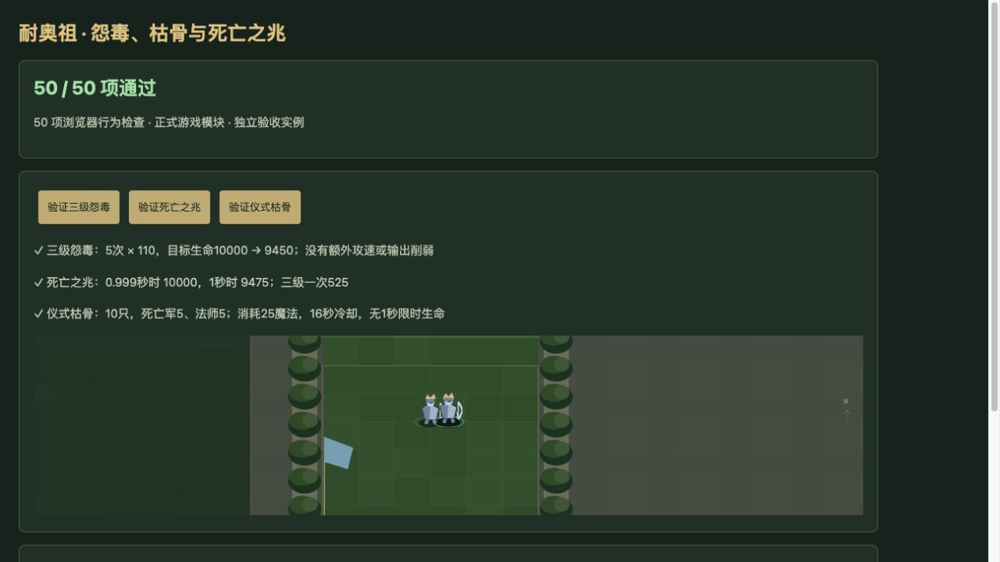
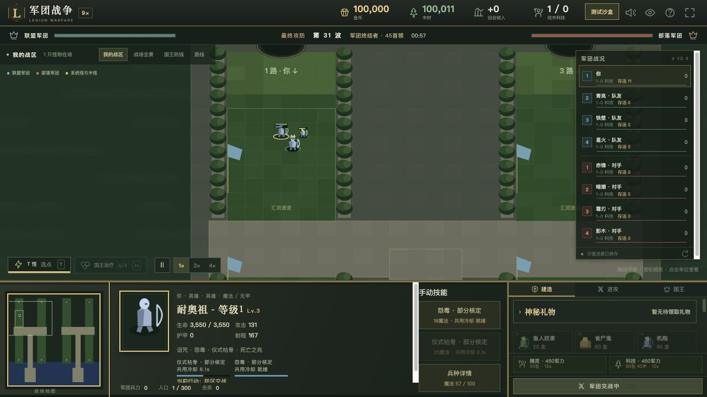

# v68 耐奥祖技能与等级归档

日期：2026-11-04。属于整体内容还原目标；AI 布阵需求已在 v67 独立提交。基线：`8abc91bd7d3e52462a4089f22de13589eb911d48`。

## 已接入行为

| 项目 | 原脚本行为与本次结果 |
| --- | --- |
| 怨毒 A1UM | 18 魔法、11 秒冷却；对所选单位当时位置建立 300 码范围，1 秒后开始每秒 55/82.5/110，共 5 次。每次重新枚举范围，施法者死亡不取消；没有提示文字里的输出/攻速削弱。自动入口受击者优先，无魔法时不回退到攻击者。 |
| 死亡之兆 A1UO | 主死亡触发器登记后延迟 1 秒，以尸体句柄回调时的位置为中心，对 600 码内敌军造成 105/157.5/**525**。三级明确为 `105*5`，不追踪最近敌人。 |
| 暗影死亡军 u04D | 依原型而非技能识别死亡；死亡时预选 300 码内敌人，每个目标从 1 秒后每秒受到 80，共 5 次。目标移出范围仍继续，目标死亡/复生事件取消。u04E 不触发此规则。 |
| 仪式枯骨 A1UN | 手动点选，25 魔法、16 秒冷却、800 码；总数 4/6/10，候选 u04D/u04E，允许某一种完全没抽到。无 1 秒限时生命；古树点命令停止，竞技场战斗体移除此能力。原生时序与分布仍有下述边界。 |
| 召唤物 | 继承原生所有者，按通用召唤事件复制召唤者 userData，登记 JW/JH。u04D 零魔法无法免费施放 A0BT；A0BT 两次实际 spell-effect 后移除，第二次原生召唤仍完成。u04E 治疗 50、耗魔 10，并遵守 nonancient 目标限制。 |
| 诅咒 A1UK/A1UL | 独立武器伤害事件首先创建 e008，赋予同等级 A1UL 并请求 shadowstrike，1 秒后 RemoveUnit；脚本创建 dummy 的 userData 保持 0。仅记录原生命令，未猜初伤、减速或持续伤害结算。 |

怨毒、死亡之兆和死亡军循环均保留混乱攻击/通用伤害/武器事件类型；不把它们改成普通魔法伤害。主死亡触发器重入和 Ju 排除与独立 widget 死亡监听分开；延迟回调在主死亡触发器重新启用之后运行，其击杀可以正常登记新的死亡事件。保存恢复重新绑定活目标和保留尸体引用。

## 等级与来源边界

`EggWhiteEx` 按单位 handle、能力 ID 各自累计完工次数。当前同 ID 的 Web 升级在真实完工时累加；新造任何阶段首次均为 1 级。部署复制建筑的实际等级，竞技场不重新授予 A1UN。旧档只按该建筑 ID 的 n08J/K/L 完成事件恢复，不能根据阶段名或其他建筑的记录推测次数；恢复存档不重放完工。

**原版阶段入口仍未核定。** 源包只有 n08J/K/L 与 h0WM/N/O 的映射，未提供升级边；原生 `war3map.w3u` 的 47 条外观修改也没有这三种对象。当前阶段连边按既有 Web 重建政策保留，不声称原版一定保持同 handle。实际 ReplaceUnit 创建新 handle，不复制这些计数。

**仍属部分实现：**

- A1UL 有持续伤害 5/7.5/10、Cast 字段 1 秒、持续 3/5/7 秒，但缺 Cost/Cool/初伤/减速等参数。解析器仅抄实际 SLK 单元，不能把另一条 AEsh 对象值当作父对象继承结果；终止跳数、同 buff 覆盖和弹道也未核定。因此当前只执行 dummy/命令请求/移除，不宣称诅咒已造成伤害。
- A1UN 在 Web 暂按立即生成、每只独立等概率选择及可通行点修正实现；原生出兵时序、随机权重/调用时刻、散布、事件顺序和自动施法入口仍待核定。没有加入原图未证实的自动施法命令。`Dur=1` 不作 1 秒生命周期。
- ANcl 原生允许单位或点，但怨毒脚本只读取单位目标；空单位坐标映射未知，目前提供单位选取。原图特效/模型缺失，原生仲裁、枚举、导航和移除句柄仍为宿主适配。

[逐行源码与字段证据](../../reference/nerzhul-evidence.json)校验完整 JASS SHA-256，行号按 Latin-1/LF 保留原始字节。AEsh 间隔字段及 ANdp 随机列表的外部佐证来自 [ScrewTheTrees 原作者实验记录](https://raw.githubusercontent.com/Cokemonkey11/wc3-ability-doc/main/sources/screwthetrees-wc3-editor-ability-insight-document/2023-11-14.md)，不能据此证明本图全部零售行为；具体实验版本和补充链接保留在证据文件。

## 验收与归档

- 51 项专项：36 项技能/事件/召唤/存档检查、15 项真实建造/升级/完工/竞技/迁移集成检查。
- 全量 **2116 项**通过：2025 项 Node 测试、91 项已有自定义检查；源码语法、diff 和资源内容版本校验通过。
- 浏览器 **50 项**通过（不运行 Node 的源码文件读验）；实际点击验证三级怨毒总计 550、死亡之兆延迟 525、三级枯骨 10 只。正式界面单位选取与点选都成功，魔法 100→82→57，冷却分别 11/16 秒，召唤后己方存活数 1→11。测试使用独立战斗夹具，不是自然局通关证明。
- 浏览器无 warning/error。35 波各 12 秒烟测：2784 次生成，峰值 123 实体/16 脚本任务，有限状态与保存续跑通过；不代表完整自然通关 35 波。
- 玩家 686 项能力：411 已实现、180 部分、39 标记、56 待核定；全战斗 771 项：460 已实现、189 部分、52 标记、70 待核定。新增辅助 A1UL 与 u04D/u04E 纳入玩家可达统计，五项耐奥祖能力均保留 partial。
- 独立审阅修正了召唤物 userData/JW/JH 继承；等级路径另由独立上下文核对并提供集成测试。两项委派已结束，本批上下文和边界以本文归档，原三个开发聊天保持归档。主聊天继续承担尚未完成的整体还原目标。
- 使用独立 8418 端口验收，临时页与服务器已清理，用户 8417 游戏和存档保留。75 个浏览器模块与样式版本已构建。按已有授权提交 GitHub 并发布现有公开网站，回执保存在仓库外 `v68-publication.json`。

