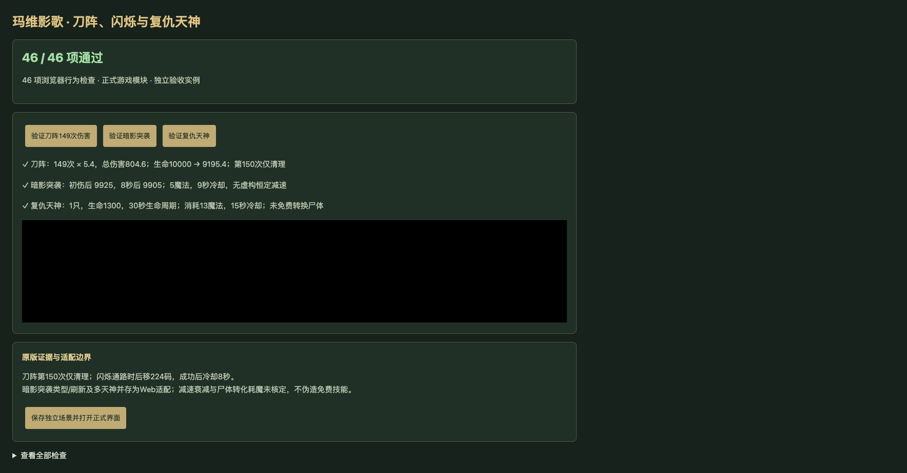

# v69 玛维影歌实现记录与待验事项

日期：2026-11-04。代码基线：`3d66d085e78e1a2e28c3d0269bd53d1b4c269adc`。本批实现与自动化检查已完成，**浏览器 QA 尚未执行，尚不能标记整批验收完成**。用户当前优先事项为继续增强 AI；以下记录保留玛维进度，不将其算作 AI 强化结果，也不宣称本批已提交或发布。

## 已接入行为

| 项目 | 来源与当前行为 |
| --- | --- |
| 刀阵 A1TZ | 16 魔法、9 秒冷却；从第 0.04 秒起，每 0.04 秒以施法者句柄当前位置枚举 350 码范围，对敌军造成 5.4 混乱攻击/通用武器伤害。源码 `execCount*.04<6` 对应前 149 次伤害，总计 804.6，第 150 次只清理。每次施法独立计时，移除能力或施加控制不提前终止，施法者 widget 死亡立即取消。来源：35808–35862、39303–39305。 |
| 闪烁 A1TX | 仅主伤害事件的受伤者触发，无耗魔、无本次伤害减免。按当前朝向向后：`RMax(32*BB,200)` 使前六次检查同一个 200 码位置，最后尝试 224 码；失败不占冷却，也不退回较近落点。成功后独立冷却 8 秒，不凭提示改成 270 码。来源：35863–35899、40591。 |
| 暗影突袭 A1TV | 手动选敌及主伤害自动命令接入，共享 5 魔法、9 秒冷却、300 码范围。Web 按 75 初伤、第 3/6 秒各 10、8 秒结束执行；`Cast1=3` 为伤害间隔，不增加三秒施法延迟。持续效果跟随目标，施法者死亡仍继续；目标死亡、复生或移除 B084 则取消。原生结算近似见下文。 |
| 复仇之魂 A1TW | 手动无目标施法，13 魔法、15 秒冷却，生成一只 e01I 复仇天神，1300 生命、30 秒存活；复制召唤者原生所有者和 userData，登记 JW/JH。天神未添加标准单位提示中的魔免。古树的 `spiritofvengeance` 命令按 44804–44820 停止，不扩大为所有玛维技能禁用。 |
| 自动命令 | 保留 40764–40783 的顺序和每项独立的受伤者优先 `if/elseif`；受伤者存在技能但缺魔法时，不回退到攻击者。先执行闪烁，再尝试暗影突袭等命令。A1TW 源脚本实际发 `waterelemental`，与 AEsv 的 `spiritofvengeance` 不匹配，当前记录失败，不扣魔法或自动生成天神。 |
| 获取入口 | 保留 h093 守望者及已拥有的 h193 圣殿守望者直接花 400 金币、施工 2 秒升级 n08G，部署为 h0WK。R0GG 由完成 h0FL 或 n01Q 任一满级月之女祭司获得；需求为战斗结束标记 u004 与 R0GG，不增加兵种训练前置。来源：1977–1982、2473–2476、3105–3107、28775–28777、17241–17242。h193 的会员外观获取档位仍待核定，测试没有虚构资格绕过。 |

主伤害入口先排除原始伤害不大于 0、自伤、空来源和盟友，再排除攻击者 A2Y7；正数小伤害和法术伤害也能触发。`InitTrig_UnitDamageActions` 的类型筛选函数没有登记为条件，不能据此缩小入口。主触发器重入与独立 widget 死亡处理分开；存档恢复重新绑定刀阵施法者、暗影突袭目标及保留尸体引用。

实现位于 [maiev-rules.js](../../dist/maiev-rules.js)，通过 skills/engine 接入施法、伤害、死亡、计时及存档。[逐行源码与字段证据](../../reference/maiev-evidence.json)保留 218 行 JASS 证据及完整文件 SHA-256，按 Latin-1/LF 对齐原始字节；原生能力的外部佐证和适用范围也保留在该文件中。

## 保留的 partial / unresolved 边界

- **A1TV 仍为 partial。** 初伤与持续伤害各自攻击类型、弹道、魔免/虚无交互及同 buff 覆盖尚未完整核定。目前统一采用 `spells/shadow_strike`、即时初伤和同 B084 刷新，属于宿主适配。DataB/C 各 20%，但 DataD 衰减参数缺失，仅记录原生减移速/攻速参数，不结算虚构的八秒恒定减速。
- **A1TW 仍为 partial。** h0WK 的 `auto=A1TW` 不足以证明可用的原生自动施法入口。错误 `waterelemental` 请求不被悄悄改正；重复手动召唤暂允许多天神并存，原生替换策略待核定。原施法者死亡不立即移除天神，30 秒生命周期继续。
- **天神的 A1TY 仍为 unresolved。** Avng 字段记录每次一个 e01J、最多六个、30 秒生命、随直接施法父体死亡消失，但 Cost 缺失，不能当作免费或套用另一对象的费用。当前不执行尸体转化、尸体消耗和子体生命周期，e01J 未计入玩家已可达运行时形态，也不从默认提示补造 Avul 无敌。
- **A1TX/A1TZ 仍为 partial。** 闪烁使用 Web 行走网格；原生浮点、施法前摇、同帧命令仲裁、范围枚举、导航以及模型/特效仍有宿主边界。刀阵的源码定时与伤害已接入，不据此宣称全部零售引擎表现一致。

本次覆盖清单快照：玩家 **688** 项能力，411 已实现、184 部分、40 标记、53 待核定；全战斗 **773** 项，460 已实现、193 部分、53 标记、67 待核定。e01I 纳入玩家可达形态，e01J 保留源对象；A1TV/TW/TX/TZ 均为 partial，A1TY 为 unresolved。整体还原目标继续。

## 已完成的自动化检查

- [脚本集成测试](../../tests/v14-maiev-script.test.mjs) **24/24**：源码公式、149/150 回调边界、350 范围、跟随中心、独立叠加、widget 死亡、200→224 路径、失败不占冷却、真实 Game 伤害顺序、条件直升及存档续跑。
- [原生能力适配测试](../../tests/v14-maiev-native.test.mjs) **24/24**：暗影突袭费用/目标/时间表/B084、命令错配、手动召唤与古树限制、召唤身份/生命周期、拒绝免费尸体转化及保存恢复。本批共 **48 项专项**通过。
- `npm test` 日志 `/private/tmp/legion-v69-full.log` 已到命令链最后一项 `v14-maiev-native.test.mjs` 的完整结束汇总：103 个 Node 测试文件合计 **2073 项通过、0 失败**，另有 91 项既有自定义检查通过，合计 **2164 项**。这是本批测试快照，不覆盖此后独立开展的 AI 改动。
- `npm run test:smoke` 日志 `/private/tmp/legion-v69-smoke.log` 已输出结果：35 波各模拟 12 秒，2784 次生成，峰值 123 实体/16 脚本任务，`finiteState=true`、`saveContinuation=true`。短时烟测不代表完整自然通关 35 波。

## 浏览器验收与归档

- 独立8418页面的46项浏览器检查通过；实际点击刀阵、暗影突袭、复仇天神三个按钮，分别得到804.6伤害、75初伤加20持续伤害、1个1300HP/30秒天神。warning/error为空。
- 正式界面补验受到浏览器连接超时影响，未完成正式UI选敌与存档操作验收；不将独立页结果冒充正式UI点击。用户8417页面和存档保留。
- 本批已核定脚本及原生适配以本文归档，已知partial/unresolved继续留在总体待办；后续用户要求的AI主动施法单独记录在v70。
- 按既有授权提交GitHub，和v70一起发布至现有公开网站。发布回执保存在仓库外。

