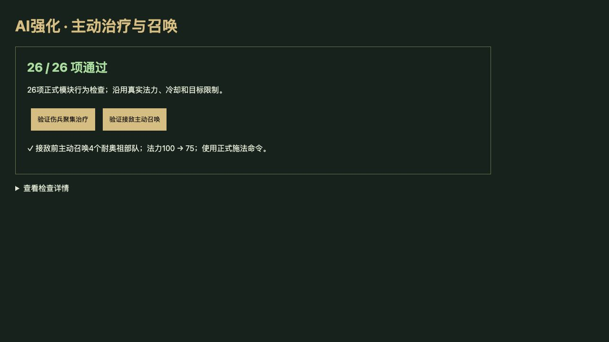
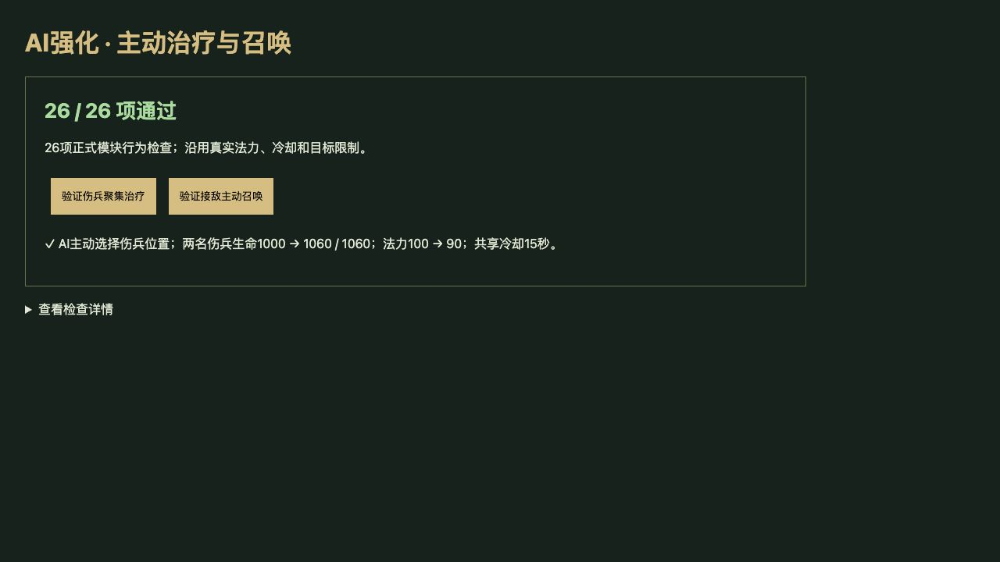

# v70 AI 主动治疗与召唤归档

日期：2026-11-04。用户需求：升级 AI 强度。对照基线：`f15d99a`（与候选相同的玛维等技能引擎，未接入主动施法控制器）。

## 最终行为

AI 在正常波次与竞技场战斗中，开始主动使用五项已接入的英雄技能：

- 阿莱克斯塔萨的生机绽放：以范围内伤兵可恢复生命合计选择施法位置，伤势过轻时保留魔法。
- 玛法里奥的宁静：根据施法者周围伤兵判断价值，排除不可治疗目标；已有宁静覆盖时避免浪费同类光环。
- 耐奥祖的仪式枯骨：敌人进入附近后在本人位置召唤；沿用等级数量、耗蓝和竞技场移除规则。
- 玛维的复仇天神：接敌前召唤，避免敌人尚远时消耗30秒限时生命。
- 玛维的刀阵：实际350码内有敌群或高生命目标时启动。

每个施法者每轮最多成功施法一次，所有操作使用正式 `cast` 命令，遵守真实费用、共享冷却、控制状态、目标、所有权和古树限制。玩家0不被接管；关闭沙盒AI、暂停、准备阶段和结束状态不操作。保留已有阵容购买与经济策略，未增加资源或单位属性。原图受伤自动施法继续独立执行，AI只增加玩家式战术操作；技能自身partial边界不因此消失。

安度因主动绝望之雨原型在6组校准场景中令漏怪388→506，抢占骇人之魂魔法，已撤下这一AI行为；原有自动施法顺序保留。未按其他英雄名称泛化或猜测技能。

## 相同阵容实战对照

[机器数据](../../reference/ai-combat-benchmark.json)保存全部结果与被撤下的原型。每组在同一引擎中使用相同固定7单位阵容、种子与波次：1个源对象英雄、2个h00T、4个h00U。仅切换主动AI命令，原图自动触发在两边都开启。单路最多180秒，国王生命统一100万防止提前结束；统计的是这段时间内的漏怪和击杀，不是完整自然通关率，也不是按预算买兵比较。

| 场景 | 漏怪：旧→新 | 击杀：旧→新 | 改善／持平／回退 |
| --- | --- | --- | --- |
| 30组：5英雄×8/13/16波×种子42/173 | 2794→2671 | 1011→1134 | 12／14／4 |
| 另30组：5英雄×6/12/20波×种子7/2073 | 1170→1092 | 1365→1443 | 4／24／2 |
| 总60组 | **3964→3763（减少5.1%）** | **2376→2577** | **16／38／6** |

第二组在最终策略确定后运行，未依据其结果继续调参。安度因在最终两组中是保留原逻辑的对照，结果完全不变。六组回退保留；提升主要发生在已有相关英雄的军团，不能由此声称所有阵容或自然对局胜率上升。

固定旧蓝队的三局自然对局以种子42、173、615运行，玩家0也使用相同旧版购买辅助。最终三组结果逐字段一致，红队2胜1负，分别在第6／6／4波结束；已存机器数据。这项检查看早期整体行为是否回退，不作为英雄策略收益的证明。

复现：

```sh
node scripts/benchmark-ai-combat.mjs /path/to/candidate
node scripts/benchmark-ai-combat.mjs /path/to/candidate --holdout
node scripts/benchmark-ai-opponents.mjs /path/to/baseline /path/to/baseline 35
node scripts/benchmark-ai-opponents.mjs /path/to/candidate /path/to/baseline 35
```

## 验收与归档

- 新增26项检查，AI专项共133项通过；全量2190项通过（2099项Node及91项自定义）。
- 独立审阅修复了宁静被多个无效目标阻塞和竞技场 `arena0/arena1` 军团遗漏；最终审阅无阻断问题。
- 浏览器26项全部通过；实际点击验证两个伤兵1000→1060、耗蓝100→90，以及耐奥祖4召唤物、耗蓝100→75。warning/error为空。
- 35波×12秒烟测：2784次生成，峰值123实体／16脚本任务，有限状态与保存续跑通过。这不是自然通关35波的证明。
- 构建77个浏览器模块及样式版本；独立8418验收页与服务已清理，用户8417游戏未操作。
- 按已有授权提交GitHub并用Sites发布现有公开网站；发布回执存仓库外 `v70-publication.json`。
- 此单项需求及审阅上下文以本文归档；原三个开发聊天保持归档，主聊天保留未完成的整体还原目标。




