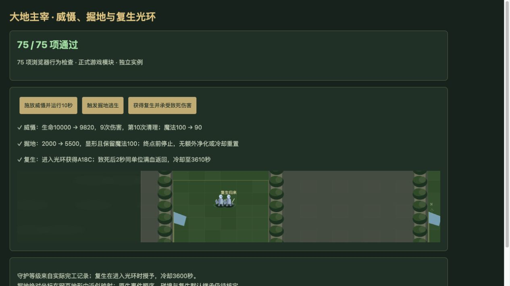

# v71 大地主宰实现与证据归档

日期：2026-11-04。基线：`b63c869a5dccc27f213299420b54a09d904c3fc8`；技能实现版本：`v14-content-20261104-v71-1`。本批专项 **77/77**、独立浏览器 **75/75** 及三个实际操作通过，源码核对和独立审阅已完成；与 v72 AI 改动合并后的最终全量回归 **2276 项**全部通过。本记录归档本批已接入行为，整族仍有下述 partial 边界，不表示原图全部还原。

## 已接入行为

| 能力 | 最终行为与源码位置 |
| --- | --- |
| A17H 守护 | 100000 码友军/自身攻击光环，按实际能力等级提供 5%/10%/15%，不增加最大生命。完工保留每个 handle 的独立整数与布尔：n067 置真并递增；布尔为真且新类型不是 n068 时只清布尔；其余清布尔并递增。源 28528–28540；出战只复制已有能力等级，43752–43754。 |
| A17I 威慑光环 | Aasl 字段为 900 码敌军移速 -30%、攻速 -10%；没有攻击力 -10% 或离圈后持续至回合结束的额外脚本。 |
| A17J 主宰光环 | AOae 字段为 600 码友军与自身攻速、移速各 +20%；没有额外敌军减速分支。 |
| A17K 复生光环 | 建筑携带时为出战体登记：先枚举 800 码友军，之后监听进入范围；相同原生所有者和 userData、非召唤且没有排除能力时，实数随机值 ≤20 才授予 A18C。失败可离开后再次进入重抽；成功者因已有 A18C 被排除。源 34484–34527、43766–43767。 |
| A17L 掘地求生 | 登记时固定最大生命 25% 的阈值，生命严格跌破后只触发一次；隐藏、无敌、禁用通行并朝本阵营王前支援点移动。3 秒距离参数、0 秒首跳和 0.04 秒循环，先判终点再移动；名义算术下移动 74 次，2.96 秒停止于距离的 74/75。收尾显形、取消无敌、恢复通行并设为当前最大生命的 55%，不回蓝、不清状态、不刷新冷却。源 30160–30220、34528–34575。 |
| A17N 威慑主动 | 无目标 `cloudoffog`，10 魔法、10 秒冷却；每秒以施法者当时位置枚举 500 码敌军，前九次各 20 魔法攻击/通用武器伤害，第十次只清理，单目标无修正合计 180。widget 死亡结束。源 34451–34483、39494–39495；正数敌对伤害自动命令为受击者优先，失败不回退来源，41021–41024。 |
| A18C 动态复生 | ACrn 对象显式 `DataA1=2`、`Cast1=2`、`Cool1=3600`；致命时保留同一战斗句柄，等待两秒后恢复，冷却从致命时开始。等待阶段不结算普通死亡/赏金，widget 监听只触发一次。仅动态授予战斗体，不写回建筑、不注册木乃伊的 2.01 秒移除监听。源全部显式引用仅 1445、34496、34515；原生适配边界见下文。 |

复生排除表为 `A0ZQ/A0YH/A158/A172/Aphx/A17J/A18C/A0ZU/A1SE`，由 1425–1449 核定；不包括 A14E。初扫经 `SelectRangeAlly` 排除死亡和 Avul（29807–29827），后续入圈回调没有这两项附加检查。施法者普通 `EVENT_UNIT_DEATH` 终止光环监听，widget 死亡单独不终止。已经授予的 A18C 不随提供者死亡撤销。

竞技场在调用普通被动登记前移除 A17L（43883–43891），保留 A17H 等级与复生光环。掘地隐藏期间普通攻击、移动和手动施法均暂停；直接杀死的尸体不在下一帧补启动掘地。致命伤害触发的死亡收尾不伪造复活。存档继续绑定原战斗体、计时任务、授予状态及复生冷却，不重新抽奖或重复完工。

## 等级与入口

JASS 18471–18478 对应 `n067/n068/n069 → h0R4/h0R5/h0R6`；英雄页有 n067 注册（29247）。保留现有英雄选择及付费直接升级，不添加训练前置；Web 的两个升级费用为 100、205 金币。

新造任何阶段的第一个 A17H 完工均为 1 级。Web 同建筑 ID 的 n067→n068→n069 顺序完工为 1→2→3；跳过 n068 的 n067→n069 则保留 1→1，再一次 n069 完工才到 2。整数计数继续累加，实际能力限制在三个对象等级内。源码没有此处的永久能力授予，不能照抄相邻耐奥祖分支。

旧存档恢复优先采用已保存的实际等级和计数/布尔；缺失时仅依据该 buildingId 的完工 journal 与当前已完成阶段。恢复不调用完工、不重放奖励、不按名称或英雄等级补历史。旧 journal 去重同阶段，已丢失的重复完工次数无法重建。

**三阶段连边是 Web 重建。** 原对象包缺少三阶段的原生 Upgrade/Requires，连续注册不能证明原图升级保持 handle，原生变形或 ReplaceUnit 的实际调用仍未核定。Web 按同建筑 ID 保存计数，不把它描述为原版句柄连续性的证据。

## partial 边界

- A17L 原坐标是 Player(8) 同盟 `(-3549,-2218)` 与 Player(9) 同盟 `(3549,-2218)`，目前映射 `supportWorld(0/1)`；没有精确复原地形、落点碰撞和通行修正。原生浮点计时也可能影响最后一步。
- 生命阈值事件、致死结算与 widget 回调的同帧顺序未有本图原生运行记录；死句柄上 `SetUnitLifePercentBJ` 的结果未知。当前保留死亡结果，只有真正可用的复生能力进入复生流程；直接生命写入另以按帧观测衔接。
- A18C 的 Cost 缺失，宿主耗魔 0 复用已核对的 1.24.4/1.27.1 ACrn 默认表，**不是缺失值等于零**。本图实际运行补丁与继承尚未确认。满生命/魔法恢复依据通用复生行为作宿主适配；原生 buff 保留/清除、等待时移除能力、同体多个复生能力的优先级仍待实测。当前多能力按已保存技能顺序确定性选择。
- A17K 的入圈事件按帧检测；原生随机流、组枚举、未实例化建筑/马甲、unit/widget 死亡先后、A17N 的 ANcl 命令前摇与仲裁，以及混合技能中的其他未接入分支仍未闭合。原模型、音效和特效不包含在本批完成范围内。

完整 [机器证据](../../reference/earth-lord-evidence.json)固定 JASS SHA-256、**461 行 LF 对齐原文**、七个能力和六个单位对象字段，并明确已有 ACrn 外部证据的复用来源与适用范围。源码行号按 Latin-1 解码后仅按 LF 切分，避免其他字节误当换行。

## 覆盖与验证

动态 A18C 从 h0R6 的复生光环进入运行时覆盖。A17H/I/J 保持 implemented；A17K/L/N 和 A18C 为 partial。由同一脚本生成 [JSON](../../reference/content-coverage.json) 与简短 [Markdown 快照](../../reference/content-coverage.md)：

| 范围 | 能力总数 | implemented | partial | marker | unresolved |
| --- | ---: | ---: | ---: | ---: | ---: |
| 玩家 | 689 | 411 | 188 | 40 | 50 |
| 全战斗 | 774 | 460 | 197 | 53 | 64 |

- [脚本与真实 Game 集成](../../tests/v14-earth-lord.test.mjs) **36 项**、[完工/恢复/部署等级](../../tests/v14-earth-lord-levels.test.mjs) **22 项**、[A18C 生命周期](../../tests/v14-earth-reincarnation.test.mjs) **19 项**，本批最终 **77/77** 通过。覆盖费用、九次伤害、范围跟随、排除列表与重抽、实际等级光环、付费升级、竞技场、致死分流、同帧隐藏动作、存档续跑等。复验日志：`/private/tmp/legion-v71-evidence-targeted.log`。
- 独立审阅后的修正包括：直接死亡不延迟触发尸体掘地、掘地当帧停止普通攻击、威慑在伤害监听前排除原生无敌单位，以及隐藏期间禁用显示的手动技能入口。最终只读审阅无阻断问题。
- 整合方复验独立浏览器 **75/75**（专项中两个文件系统源码检查不在浏览器执行），warning/error 为空。三个实际按钮分别验证威慑合计 180、掘地 2000→5500、A18C 授予后致死并在两秒满血、时间 10 时冷却截止 3610。该结果是独立验收页操作，不等同于用户正式游戏界面的完整操作验收。
- 合并 v72 后全量 **2276 项**通过（2185 项 Node 测试及 91 项自定义检查）；35 波×12秒烟测的2784次生成、峰值123实体／16脚本任务、有限状态与保存续跑通过。该烟测不是自然通关35波的证明。
- 正式 UI 未做新的完整操作验收；已完成上述独立浏览器检查和真实 Game 命令操作。79个浏览器模块内容版本已构建；本批与 v72 一起提交并使用既有公开 Sites 项目发布，最终服务端回执存仓库外 `v72-publication.json`。本项实现与审阅上下文归档于本文，整体还原目标继续。

复现：

```sh
node --test tests/v14-earth-lord.test.mjs tests/v14-earth-lord-levels.test.mjs tests/v14-earth-reincarnation.test.mjs
node scripts/content-coverage.mjs --write
```


