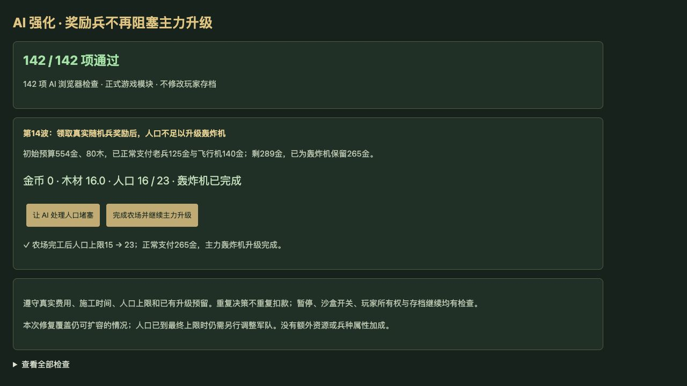

# v72 AI 主力升级恢复归档

日期：2026-11-04。用户需求：升级 AI 强度。基线提交 `b63c869`；实战前后都使用同一份 v71 引擎，仅切换 AI 控制器。完整逐文件 SHA256、原始对局结果与撤回方案保存在[机器证据](../../reference/ai-strength-benchmark.json)。

## 最终行为

AI 领取随机兵奖励后，奖励兵允许超过普通人口限制，可能挤占已预留的主力升级人口。旧逻辑持续等待升级成功，却在执行农场逻辑前返回，导致有资源也无法恢复升级。

现在，第4波起等待中的升级计划确实超过当前人口上限时，AI 会先尝试建农场。它保留整条升级链的金币和木材，再支付真实农场费用；只有农场实际完工后才获得人口，并继续正常付费升级。已有农场任务不重复排队或扣款，资源不足时继续等待；人口刚好够用或仍有空位时保持原时序。暂停、沙盒AI开关、玩家0所有权、施工与存档恢复规则不变。

本次不增加资源或单位属性。若奖励使人口超过最终上限300，农场不能解除该阻塞；本次不自动卖兵、取消计划或突破上限。

## 真实场景与对照结果

第14波，初始554金、80木、10工人、15人口。通过真实命令花125金建老兵，AI花140金建飞行机并预留265金升级轰炸机；领取正常第13波产生的A13N随机兵后，占用14人口，升级需要16人口。

新版本支付24金80木建农场，保留265升级金币；农场两秒完工，人口上限15→23；随后正常支付265金并完成轰炸机。种子1、5、7是在观察战果前按真实A13N可领取条件选择的前三个种子，独立审核已枚举确认。

| 同预算、同引擎三组 | 旧版 | 新版 |
| --- | ---: | ---: |
| 解除人口堵塞并完成主力升级 | 0/3 | 3/3 |
| 每组军力变化 | 卡在飞行机 | +265 |
| 总输出伤害 | 1696 | 2979 |
| 总漏怪 | 234 | 234 |
| 总击杀 | 0 | 0 |

每组准备30秒、战斗最多180秒；两边统一100万国王生命以避免提前结束，仅为独立压力测试设置，不进入正式游戏。本场景证明升级恢复，不证明普遍漏怪减少或胜率提升。

种子42、173、615的三场自然对局固定旧版蓝队（team0），仅红队（team1）切换AI；玩家0接受相同旧版建造辅助。最终三场逐字段完全一致，红队均为1胜2负。该结果属于小样本回归。

自身光环评分、空军前排偏好两个原型没有稳定收益，已撤回。最初扩大所有等待计划的提前农场行为改变了正常对局，也已收窄为实际人口不足才触发；原始数据保留，不用被撤方案的收益描述最终版本。

复现：

```sh
node scripts/benchmark-ai-strength.mjs /path/to/checkout
node scripts/benchmark-ai-opponents.mjs /path/to/candidate /path/to/baseline 35
```

## 验收与交付

- 新增9项专项，覆盖真实奖励领取、费用预留、重复调度、人口刚好足够/剩余1格、资源不足、已有农场、保存恢复、暂停及所有权。
- 最终全量2276项通过（2185项Node、91项自定义检查）。独立审阅81项与16组旧新状态矩阵通过，只有第4波起人口实际不足的等待计划发生变化。
- 浏览器全部142项AI检查通过，warning/error为空。实际点击验证付费农场开工、保留265金、施工后扩容、继续付款及轰炸机完工；不读写用户8417存档。
- 构建79个浏览器模块及样式内容版本；与v71技能恢复一起使用既有公开Sites项目发布，发布服务端回执存仓库外 `v72-publication.json`。
- 本单项开发与审阅上下文归档于本文；原三个开发聊天保持归档，主聊天继续保留尚未完成的整体还原目标。


