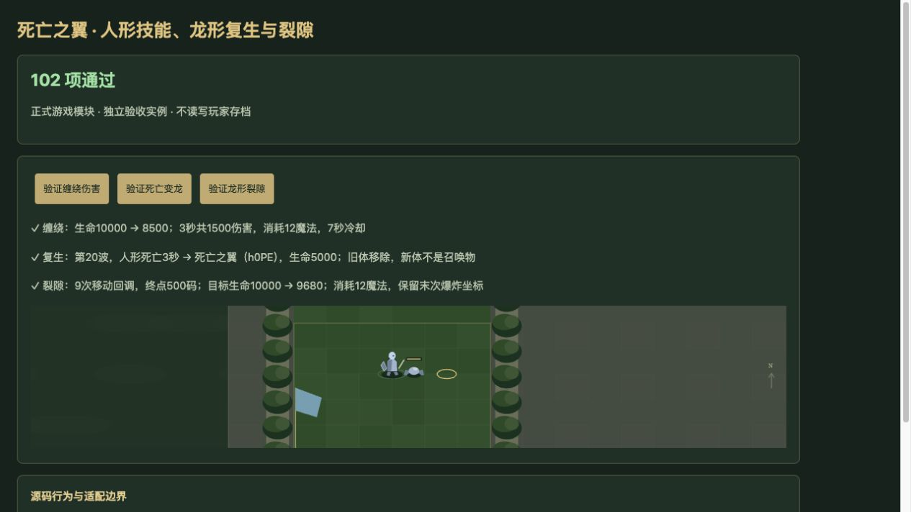

# v73 死亡之翼实现与证据归档

日期：2026-11-04。基线：`ef2139aedcc9dfe8014bbdb9e56038df9582e460`；技能实现版本：`v14-content-20261104-v73-1`。本批接入人形与龙形脚本主体、获取条件和真实战斗生命周期。下述原生命令、坐标和缺失对象字段仍为 partial，整体还原目标继续。

## 已接入行为

| 能力 | 最终行为及 LF 源码位置 |
| --- | --- |
| A0YF 上古之神之力 | 手动单位目标，12魔法、7秒冷却、800码；在目标当时位置250码内向前7个敌方枚举结果请求缠绕。无效目标也消耗请求名额，不保证主目标优先；没有补造脚本自动施法。39581–39607。 |
| A0YG 缠绕辅助 | 同一 e008 逐次添加能力、设2级和 DataA=目标当时最大生命5%、命令后移除。宿主对合法地面有机敌人施加3秒禁移禁攻与按帧积分的魔法伤害；BEer刷新不叠加，驱散只清本技能控制。原始对象普通/英雄持续时间均3秒。 |
| A0YE 沸腾血脉 | 正数敌对主伤害前，截断缺血比例×10并限制0至10级，不加1、不请求11级；实际回复读取当前正等级的显式DataB。0级请求保留原有效等级并记录未核定，不把技能删除。40997–41002。 |
| A0YH 死亡降临 | 普通死亡时当前波数≤20才排队；3秒后检查 userData 对应活跃席位，再创建新龙形。h0PC/h0UY/h0XE分别成为h0PE/h0V0/h0XG，保留位置、所有者、userData和朝向，移除旧体。500码敌人请求锤晕，前11个枚举结果请求99999混乱/通用伤害。42049–42053、41846–41904。 |
| 龙形治疗/喷火 | 每秒生命≤50%恢复400，父计时器发现生命≤.45终止。首次8秒启动喷火，在其后1/2/3秒各脉冲一次200法术攻击/普通伤害，保留武器事件分类；每次为13个相距100码、半径400码圆的并集且单目标去重。喷火结束重置父计数，已启动的脉冲不因普通死亡提前取消。41756–41845。 |
| A0YI 喷火辅助 | 已知3秒攻速−75%对合法目标生效；缺失移速字段不补。Bslo按原生buff组刷新，命令接受与实际施加分别记录。 |
| A0YJ 撕裂大地 | 手动12魔法、7秒冷却、800码；独立bP触发器不受bO禁用影响。1.5秒后每0.03秒推进50码，从100至500共9次；150码内每个目标只推开50码并受20法术攻击/通用伤害，最后350码300同类型伤害。目标推开会改写本次中心，终爆沿用最后中心。40075–40169。 |
| A0YJ 被动 | 正数敌对主伤害事件25%将事件值写零；受伤前生命≤70/40/10%依次各一次400码100法术攻击/普通武器伤害，每次只触发一个阈值。普通死亡击杀回100生命，共用killnum不等于25时每次加0.06攻速；实际武器间隔使用该加成。40458–40479、41192–41206、42009–42015。 |
| 龙族荣耀 | A0YR/S/T/U与A201/202/203/204分别共享buff组，按sapper类别匹配，不按名称猜龙族。显式近战和远程标志均为1，已修复A0YR/A201漏掉近战的问题；其他伤害、移速、回复、攻速、护甲值按原对象。 |

三秒复生等待保留普通死亡结算与赏金，并阻止波次/竞技场过早结束；它与ACrn原生复生不同，不抢先触发普通死亡。读档重连旧体、龙形、缠绕马甲及计时器引用，不重复扣费、复生或叠加伤害。A0YD龙魂沿用已有独立武器事件实现，未改成按UI英雄名称或boss标签秒杀。

主伤害顺序接为诺兹多姆→A1W2护盾写值→A0YJ龙形抵消→蝎子分支；原始P8输入保留，护盾不重复减伤。主死亡顺序补上梦魇后龙形击杀增益、诺兹多姆/不稳定炼金后死亡之翼复生，仍遵守同一个主死亡触发器的禁止重入。

## 获取条件与修正

圣龙h201及其专属外观h204可直接升级h0PD，费用750金币、耗时2秒、人口18。仍需R06U、超级赞助h220与u004，不增加训练前置。R06U原始表达式为 `h0BP OR (n05M AND h0D2 AND h01B) OR h11B OR h0R8`（28644–28648）。

本批修复R06U使用外观展开记录的漏洞：单独n05M不再因别名h0BP而提前解锁，只有实际完成记录满足表达式才授予。已有存档已授予的R06U保留；缺失历史不足以证明当时资格无效，不逆向撤销。h204仍需其账号资格；h0UZ/h0XF仍需R0DS/R0HR对应外观权益，超级赞助不自动授予付费皮肤。死亡之翼一席上限沿升级与外观链共享。A0YL仅建筑技能书及说明图标，不伪造为手动变身或注入战斗体。

## 原生适配边界

- ANfd的DataB=.01为图形持续时间，DataC伤害缺失，不补造原生附伤。A116治疗守卫与A0YV龙之怒缺少关键字段，仍 unresolved。
- A0YG的费用/冷却/施法缺失字段采用已核对AEer参考75魔法/8秒/0秒；[1.24.4原生表](https://github.com/sumneko/w3x2lni/blob/master/data/zhCN-1.24.4/prebuilt/Custom/ability.ini#L5099-L5145)及[1.27.1原生表](https://github.com/sumneko/w3x2lni/blob/master/data/enUS-1.27.1/prebuilt/Custom/ability.ini#L5101-L5147)。这是宿主默认依据，不能证明本图继承、e008施法点、连续添加/移除命令均实际完成。请求、宿主接受、实际施加与nativeOutcome未验证分别保存；伤害按宿主帧积分。
- A0YE第1级DataB、移动和百分比模式缺失，不能把运行时回退0描述为已证实的原生零值。
- 全局马甲k的A0OZ路径保留既有等级、末次爆炸保留5级、阈值分支设1后移除；复生使用独立新马甲。其他家族对同一k的添加/移除、锤晕缺失伤害/费用、slow默认目标和命令仲裁仍未完全衔接。
- IsLivingPlayer原图要求PLAYING+MAP_CONTROL_USER，Web映射活跃人类与AI席位。原生出生科技、原图攻击移动目的地、地形/碰撞/推开坐标、同帧计时与枚举次序、RemoveUnit后的句柄行为未有本图运行记录。
- 原模型、音效和特效未包含在本批完成范围内。独立验收页操作不等同于正式UI全流程验收。

[机器证据](../../reference/deathwing-evidence.json)固定JASS SHA-256、仅按LF计数的原文、单位/能力对象字段、获取入口与上述边界。语义字段及攻击类型使用项目既有原生映射：JASS `ATTACK_TYPE_NORMAL` 对应host `spells`，不能误用host `normal`（后者是JASS近战攻击类型）。

## 覆盖与验收

玩家692项能力：410 implemented、194 partial、40 marker、48 unresolved；全战斗777项：459/203/53/62。加入三个龙形与A0YG/A0YI运行时辅助；A0YE由此前过度标记的implemented改为partial。参见[当前覆盖快照](../../reference/content-coverage.md)。

- 四个专项文件：人形25、龙形42、真实Game集成18、获取条件18，共 **103/103**；独立审阅复跑其中85项。审阅发现的法术攻击类型映射、A1W2内部guard、死亡分支先后、R06U别名问题均已修正。
- 全量 `npm test` **2379项通过**（2288项Node测试及91项既有自定义检查），日志 `/private/tmp/legion-v73-full.log`。35波×12秒烟测2784次生成、峰值123实体/16脚本任务、有限数值与保存续跑通过；这不是自然通关35波的证明。
- 浏览器 **102/102**（仅略去1项文件系统源码检查），warning/error为空。三个实际按钮验证：缠绕10000→8500；第20波死亡3秒生成5000生命h0PE并移除旧体；裂隙9步/500码及20+300伤害。独立页面不读写玩家存档；未宣称正式UI全流程验收。
- 81个浏览器模块内容版本已构建。本批提交GitHub并发布到既有公开Sites项目；服务端发布回执归档在仓库外 `v73-publication.json`。

复现：

```sh
node --test tests/v14-deathwing-human.test.mjs tests/v14-deathwing-dragon.test.mjs tests/v14-deathwing-integration.test.mjs tests/v14-deathwing-acquisition.test.mjs
npm test
npm run test:smoke
```



本批人形实现、龙形实现、入口审查与独立复核上下文归档于本文；主还原上下文继续，不归档总目标。
