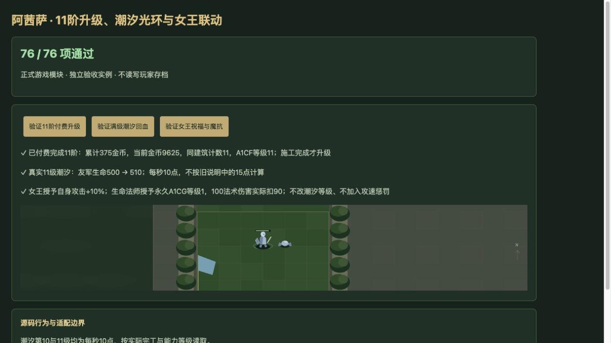

# v74 阿茜萨光环等级与女王联动归档

日期：2026-11-04。基线：`7122b9dc29c647a56d0c595100e9aa2a9c321308`；技能实现版本：`v14-content-20261104-v74-1`。本批完成十一阶段的能力等级、光环和女王联动接线，并修正生命法师永久抗性的旧存档迁移。已通过下述验收；已独立提交`874fe53`，纳入v75统一交付，最终网站状态以v75发布回执为准。整体内容还原继续。

## 最终行为

| 项目 | 已接入行为与 LF 源码位置 |
| --- | --- |
| A1CF 完工等级 | 每次携带技能的建筑实际完工，独立计数加1并设置能力等级；施工开始、读档不加次数。新造任一高阶段第一次仍是1级，不能从英雄名称推断。计数保留实际次数，能力按对象支持范围限制至11级；该源分支未永久授予能力。28541–28544。 |
| 普通与竞技出战 | 复制建筑当前A1CF等级到已有的战斗技能，不给缺失该技能的彩蛋战斗体补技能。竞技先执行专属移除，再执行普通PassiveSkill；A1CF不在竞技移除名单。43862–43864、43883–43895。 |
| A1CF 潮汐之力 | 600码友军与自身回复光环B07T，当前等级DataB为1／2／3／4／5／6／7／8／9／10／10。宿主第10、11级均每秒恢复10生命，不采用满级文案15。多来源同buff组取最强，不累计各等级。 |
| A1CH／A1CI 海浪赞歌 | 两个独立500码光环：B07U攻击+13%，近战、远程均适用；B07V护甲+2。没有补造20%全伤害减免。 |
| A1CJ 阿茜萨女王联动 | 由建筑携带A1CJ时登记，出战后0秒全图扫描一次精确原型h0OV。每个友方女王给阿茜萨本体添加永久A1CK，初次默认1级、自身攻击+10%，已有等级不重置；每个敌方女王分别请求本体已有A1CG等级减1。不减A1CF等级，不增加A1OE攻速惩罚。33232–33263、43806–43808。 |
| A1CK 女王祝福 | 自身攻击光环，四级DataA依次+10%、+15%、−11%、+4%，同时启用近战与远程。阿茜萨只添加能力；瓦斯琪A1OC独有的2／3／4级状态机仍由VashjSwap负责，两个联动不混用。32922–32967。 |
| Qs误别名与A1CG | 原图Qs实际为A1CU，Qt为A1CG，Qu为B07T，不能改写成A1CF。仅建筑携带A1CU的部署调用RegisterAxisaHalo：先给自己永久Qt，再注册0秒及每1秒检查。普通阿茜萨仅携带A1CF不会自行获得魔抗。1151–1153、43800–43805。 |
| 永久抗性授予 | 在施法者当前位置600码内，选择存活且无Avul的友军，要求非自身且已有B07T；只向尚无Qt者授予，不提升已有Qt。当前光环覆盖或有效显式buff可满足宿主检查，不允许另一个战区的光环制造buff。widget死亡终止登记，已有永久授予不撤回；原生复生后也不自动重注册。33186–33231、29807–29827。 |

A1CG按实际能力当前等级DataB处理法术减伤，保留原始浮点字段；不作用于普通魔法类型武器或通用脚本伤害。女王递减到0或负等级时，记录原生结果未核定并保留原有效能力，不能擅自删除。建筑有A1CU但战斗体缺失时，不补造A1CU；Qt的零级请求与宿主有效等级分别记录。

女王扫描没有距离、战区、存活、隐藏或幻象筛选；已经移除的单位不纳入宿主枚举。一次扫描后不因后来出现女王而重扫。普通死亡不取消已经排队的零秒回调；存档恢复重连源句柄，不重复登记或执行已完成回调。

## 获取、费用与存档

十一阶段从h0U3到h0U2按现有英雄升级入口正常付费，前十阶段各25金币，最后阶段125金币，合计 **375金币**；只有每次施工完成才递增A1CF计数。第11阶段拥有攻击、护甲及女王联动能力，但其A1CF实际等级仍由本建筑完工历史决定。

满级阿茜萨可直接升级女皇·瓦斯琪女士n07I，费用 **500金币、2秒**，仍检查超级赞助h220、R0D2完成资格、战斗结束及资源/人口条件，不增加兵种训练前置。可选训练入口在拥有相应奖励时费用为 **200金币**并消耗奖励；直接升级仍付500金币且不消费训练奖励。彩蛋战斗体不继承不属于其原型的A1CF。

旧建筑存档只按该buildingId的真实完工记录恢复缺失计数；显式保存的计数、实际等级独立优先，不从阶段名称补齐早期历史，不重放完工。旧去重日志缺失的同阶段重复完工无法重建。

旧抗性实现只明确授予过0.1：只有无真实Qt的旧0.1字段（容差1e-8）才迁移为永久A1CG第1级。其他旧正数保留原字段及`nagaResistanceLegacyUnresolved`记录，不推定技能或等级。独立审阅发现初版会把0.3／0.7改成0.1并误授Qt，已修复并加入真实读档测试。A19A与A1Q5的重叠判断读取真实Qt及其正等级，未知旧字段不会抑制其他已实现抗性；已移除的现代Qt也不会被旧缓存重新创建。

## 明确保留的 partial 边界

- Qs=A1CU是原始绑定，不能按技能文案修成阿茜萨自身魔抗光环。Qt非正等级写入、缺失Qs时的零级写入结果均未有原图运行证明。
- A1CF缺移动DataA及百分比模式DataC，高等级范围、目标和Buff字段未完整提取；A1CI缺百分比模式，A1CH／A1CK缺部分flat/default字段。宿主采用已知数值与通用光环模式，并在能力说明中保留partial。外部原生表只作默认解释参考，不能证明本图继承。
- B07T的原生传播、驻留、驱散和同帧刷新仍近似；光环叠加采用现有buff组规则。AIsr与其他原生抗性组合沿既有宿主优先策略，不猜多重叠加。
- 十一阶段Web连边来自连续Mk/Ml注册重建，原始Upgrade／Requires字段缺失；Web保持buildingId不能证明原版同handle升级还是ReplaceUnit。原始超出11级的设置行为和缺失历史不能反推。
- 原生零秒回调顺序、世界枚举、widget／普通死亡边界、RemoveUnit句柄、地图坐标及模型音效尚不等同于原图运行。独立浏览器验收页不代表正式游戏UI全流程验收。

[机器证据](../../reference/axisa-evidence.json)保存402条精确LF源码锚点、固定JASS SHA-256、4份CSV哈希、25个单位、9个能力、4个Buff与13条w3a覆盖来源，以及上述已知差异。

## 覆盖与验收

当前玩家能力692项：**406 implemented／199 partial／40 marker／47 unresolved**；全部战斗能力777项：**455／208／53／61**。A1CF／A1CH／A1CI／A1CK从过度标记的implemented调整为partial，A1CJ接入后仍partial。两个范围是包含关系，不能相加，也不是原图完成率。见[当前覆盖快照](../../reference/content-coverage.md)。

- 本批专项 **77/77**：女王29、等级25、真实Game桥接23。独立关联回归 **178/178**，包含本批77项及娜迦、瓦斯琪、玛里苟斯相关检查，不重复相加。日志为`/private/tmp/legion-v74-evidence-targeted.log`和`/private/tmp/legion-v74-independent-final.log`。
- 全量`npm test` **2456项通过**：日志115个Node汇总合计2365项、失败0，再加91项既有自定义检查。日志`/private/tmp/legion-v74-full.log`；该结果是v74快照，不提前覆盖下一批AI变更。
- 35波×12秒烟测通过：2784次生成，峰值123实体／16脚本任务，有限数值与保存续跑均通过。日志`/private/tmp/legion-v74-smoke.log`；不宣称自然完整通关35波。
- 独立浏览器 **76/76**，仅略去1项文件系统源码检查；三个实际按钮通过：11阶段付费累计375金币、同建筑计数11；满级潮汐使友军500→510；友方女王给予自身攻击+10%，生命法师永久授Qt1后100法术伤害实际扣90。截图已核对，验收实例不读写玩家存档。
- 两个新模块语法检查及`git diff --check`通过，独立审阅完成。本批已独立提交`874fe53`，与v75统一交付；不以验收完成代替发布回执。

复现：

```sh
node --test tests/v14-axisa.test.mjs tests/v14-axisa-levels.test.mjs tests/v14-axisa-integration.test.mjs
npm test
npm run test:smoke
```



本批等级实现、女王联动、共享桥接与独立审计上下文归档于本文。后续AI强化在v75独立继续，主内容还原目标保持进行中。
