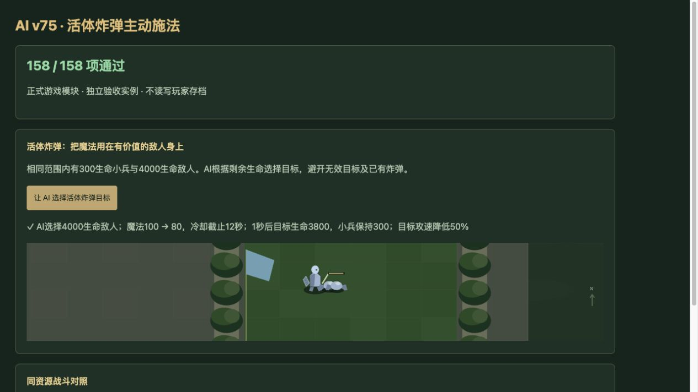

# v75 AI 活体炸弹战术强化归档

日期：2026-11-04。基线：`874fe5397ea385ff01378138f10de71ec8f4ea75`。用户需求：升级AI强度。本批最终只增加活体炸弹A0IP的主动施法决策；建军、经济、单位属性及技能本身的伤害规则保持基线。阿茜萨v74还原已独立提交，本批与其统一交付。

## 最终行为

AI持有A0IP时，会在真实600码施法范围内选择仍有足够生命的敌人，优先考虑最大生命带来的持续伤害收益。目标生命至少为100与其最大生命15%中的较大值，预计有效持续伤害至少80，避免把魔法花在即将死亡的小兵上。

目标须属于当前战场的敌方，且满足技能目标掩码；死亡、移除、隐藏、蝗虫、魔免、无敌及旋风目标不会排在合法目标之前。已有未完成活体炸弹任务或仍有效B04Y的目标被跳过；即使buff已驱散，仍有脚本计时器时也不重复施法。这样不会主动制造原脚本共享计数的重叠异常。

实际施法走同一个`Game.command('cast')`：支付20魔法，遵守2秒冷却、暂停、控制状态、竞技场和所有权限制。一个施法者每次AI决策最多成功释放一次技能；多名施法者会看到前一名已登记的炸弹，转而选择其他目标。玩家0不会被接管，旧存档恢复和已有手动施法冷却继续有效。

这是浏览器对手策略，并非声称原图存在A0IP自动命令。技能本身沿用已有的原生适配边界，未扩大内容覆盖率。

## 实战对照

[完整战斗证据](../../reference/ai-v75-combat-benchmark.json)内置旧策略源码及SHA256；基准加载当前Game和技能模块，只切换施法决策函数，每组开战快照哈希一致。初始运行使用7122b9d的AI文件，其Git blob与v74基线完全相同。

固定骷髅术士阵容，波次8／13／16，种子42／173，共6组，每组最多180秒：

| 指标 | 旧策略 | 新策略 |
| --- | ---: | ---: |
| 总漏怪 | 735 | 719 |
| 总击杀 | 26 | 42 |
| 总输出伤害 | 23546 | 26169 |
| 国王总承伤 | 2051998 | 1990542 |

漏怪3组改善、3组持平。第16波两组国王承伤分别增加288与373，未隐去这两个退步。两边统一高国王生命用于隔离压力试验，不在正式游戏中授予；这些结果证明此固定阵容下的收益，不代表自然对局胜率或所有兵种普遍提升。

## 未保留的试验

死亡之翼主动缠绕6组漏怪472→473、击杀289→288，未显示足够收益，已撤回。

[建军试验证据](../../reference/ai-v75-benchmark.json)明确标记`runtimeRetained:false`，保存132条试验记录、原型恢复方法及代码哈希。飞刀持续输出估值使9组主场景漏怪746→754；唯一前排保护虽在主场景与36组独立场景改善，却使既有9组回归漏怪575→623，其中野兽一组6→44，妨碍强力火龙升级。两种方案及组合全部撤回，`ai-controller.js`逐字节恢复基线，不把局部正收益计入交付成果。

## 验收与交付

- 新增17项专项，其中一项使用同开战快照运行真实波8战斗对照；所有AI检查159/159通过，独立审阅通过。
- 最终`npm test` **2473项通过**（2382项Node与91项既有自定义检查），失败0；日志`/private/tmp/legion-v75-full.log`。
- 35波×12秒烟测通过：2784次生成、峰值123实体／16任务、有限状态与存档续跑通过；不是完整自然通关证明。
- 浏览器 **158/158**，略去依赖Node/Git的实战对照；warning/error为空。实际点击验证选择4000生命敌人，魔法100→80，冷却截止12秒，一秒后目标4000→3800、旁边小兵仍300，目标攻速降低50%。独立实例不读写玩家8417存档，不宣称正式游戏UI全流程验收。
- 83个浏览器模块内容版本构建完成，临时验收页面从交付包移除。内容覆盖仍为v74的692项玩家能力及777项全战斗能力。
- 本批与v74使用既有GitHub仓库、既有公开Sites项目交付；最终发布状态以仓库外`v75-publication.json`服务端回执为准。

复现：

```sh
node --test tests/ai-v75-combat.test.mjs
node scripts/benchmark-ai-v75-combat.mjs
npm test
npm run test:smoke
```



本单项的战术实现、建军试验与独立审阅上下文归档于本文。主聊天继续承担尚未完成的整体内容还原目标。
