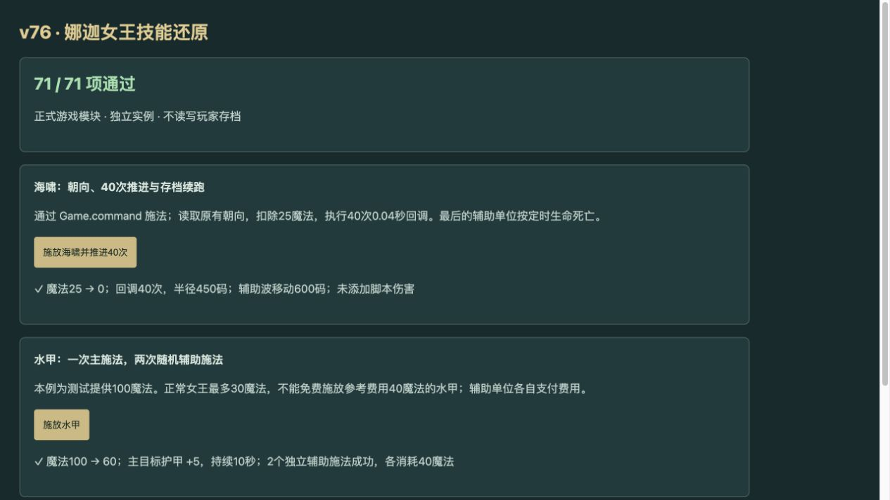

# v76 海啸、水甲与治疗触发归档

日期：2026-11-06。基线：`e337e0f641dd89892979985c987901f4520b9cda`；保留此基线已发布的内部作弊模式。本批接续整体内容还原，逐行证据见 [ocean-caster-evidence.json](../../reference/ocean-caster-evidence.json)。

## 已接入的行为

- 娜迦女王 h108 的海啸 A313：实际敌人目标、25魔法、5秒冷却；按已有朝向选90/270度。e010每0.04秒前移15码、半径从250每次增5，共40次；可步行的目标点将活敌推7码。末次仍执行，再请求0.01秒定时生命；不补造未提取的原生伤害。
- 水甲 A07Y：施加10秒5护甲；只有h108成功施法才从自身400码内生命至少1、非原目标的友军中两次不重复随机选择。每个u006独立发命令、支付参考40魔法，1秒定时生命。原始mana0与manaN均999999，不能误读成初始0魔法；首次1..1随机抽样同样消耗随机数。
- 治疗 A0HB：原生500治疗、10魔法，采用双版本Ahea的1秒参考冷却。独立SPELL_EFFECT监听仅读取该战斗句柄显式保存的Ca，自身加2Ca，再给2000码内A07S且userdata相同的单位加Ca。源码唯一写入者h0xk无调用入口，部署不按训练、近卫数量或建筑状态虚构加成。
- A07Y与A314缺失Cost字段不再编译为免费：分别采用双版本AUfa40、AHwe125参考；普通女王最多30魔法不能免费施放。A313、A07Y、A314及A0HB接入手动命令，已存在的原生自动选择保留为Web策略。英雄直接付费升级及训练折扣保持原流程。

## 生命周期与审阅修正

辅助单位使用真实模板，不普攻、不寻路、不进入碰撞索引，也不影响胜负、清路与普通击杀计数。仍保留原生死亡回调。独立审阅定位并修复了继承guard导航后被出生门传送、连续波误删活辅助句柄、到期被计作普通击杀三处问题，并补真实Game回归。

存档恢复重新连接任务的施法者和辅助单位句柄；旧技能字段重编译时保留资源、冷却、施法次数和动态能力，不重放施法或治疗。连续波保留未结束的波浪，普通清场仍按现有阶段结束流程销毁。

## 明确未闭合的差异

原始w3a独立解析没有这六项对象，缺字段不能证明免费，也不能证明基础对象继承。本批40/125魔法与1秒冷却属于明确标注的原生参考适配，不计完全还原。水甲近战减速数值、原生施法点与命令完成顺序、ANfd原生伤害、原图通行格和枚举次序仍未核定。

Web战场隔离与原生蝗虫枚举采用现有宿主边界；海啸推移使用Web可行走点判定。普通自动水甲/召唤策略不等于找到原图自动开关。海洋相关规则全部保留partial。

## 验收

- 海洋专项84项，含19项真实Game接线；另有死亡触发、老兵与内部作弊模式回归。
- 浏览器71/71通过（未运行依赖Node文件系统的源码核对与获取入口测试）。实际点击显示海啸25→0魔法、40次推进、终半径450；水甲100→60魔法、主目标5甲10秒、两名独立辅助成功各耗40魔法。控制台无warning/error。
- 35波×12秒烟测：2784次生成、峰值123实体／16任务，有限状态和存档续跑通过；不是完整自然通关证明。
- 最终`npm test` **2562项通过**（2471项Node＋91项既有自定义检查），失败0；日志`/private/tmp/legion-v76-verified.log`。85个浏览器模块内容版本构建。验收临时页面不进入部署包。
- 当前玩家可达693项：404 implemented、203 partial、40 marker、46 unresolved；全战斗778项：453／212／53／60。统计标签不是原图完成率。

复现：`node --test tests/v14-tsunami.test.mjs tests/v14-ocean-healing.test.mjs tests/v14-ocean-acquisition.test.mjs tests/v14-ocean-integration.test.mjs`，`npm test`，`npm run test:smoke`。

本批模块开发、来源核查和独立审阅上下文在本文归档。主聊天保留整体目标，后续继续处理[总待办](../RESTORATION_TODO.md)的未闭合规则与资源缺口。
