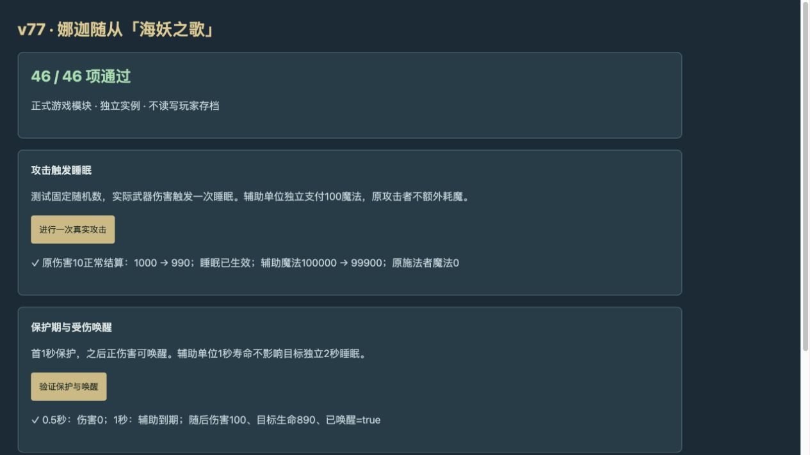

# v77 海妖之歌与睡眠归档

日期：2026-11-06。基线：`f18a2495e3419c45a4dd94d5c572fe1a39da1394`。本批补齐A1DO与辅助A1DN，保持所有已发布内容。来源见 [逐行证据](../../reference/siren-sleep-evidence.json)，规则见 [独立模块](../../dist/siren-sleep-rules.js)。

## 来源与入口

原始JASS的New_UnitAttack武器伤害监听在42279–42280按A1DO调用NagaAttack；32969–32980按实数0–100≤15创建Pn、添加A1DN、发sleep命令并设置1秒定时生命。Pn在1126为e008。这个被动不消耗原攻击者魔法、不另加手动施法门或内置冷却；嵌套仍遵守同来源武器监听guard。

可达基础兵为鱼人建造者u03N的n07F娜迦随从，战斗体h0UM，125金币、1人口、2秒。升级至175金射手或275金海妖战士后均不再携带A1DO；训练只提供可选折扣70／110，不额外设赞助或训练获取门。

辅助e008使用真实模板，初始/最大魔法100000。A1DN对象明确800码、普通/英雄均2秒、DataA1=1、BUsl/BUsp/Bust。完整w3a审计没有A1DN/A1DO覆盖记录。缺失Cost/Cool/Cast采用两个版本的AUsl一级100魔法、6秒冷却、0施法时间参考，并明确标注本图继承未验证。

## 实际行为与接线

每次概率命中都创建独立辅助体并发命令；合法目标由辅助体支付费用，失败命令仍保留辅助体及1秒寿命。原武器伤害正常结算，不因本次随后产生的睡眠而被吞掉。

睡眠使用独立状态与BUsl，不写通用stunUntil。目标不能移动、攻击或手动/通用自动施法，待完成普攻取消，原生monsoon吟唱中断；其他脚本自主计时器保留。首1秒保护，之后宿主正伤害唤醒。全额吸收/零伤害不唤醒，旧睡眠先处理唤醒，再进入本次伤害监听，避免新睡眠立即被自己的触发伤害解除。保护、睡眠与辅助寿命分别计时。

独立审阅发现并修复：艾萨拉特有手动描述提前返回绕过控制门；清路时遗漏睡眠守军的返航意图；AI先于任务更新造成保护缓存多留一轮。现在清路登记返航但睡着时不移动或传送；关键武器/AI目标判定读取当前时间，step和command前刷新兼容状态。同帧移除BUsl即解除其保护判定，不清除其他无敌、眩晕或暂停。

快照恢复重连真实目标与辅助体，不重放概率、费用或伤害。辅助体死亡不提前结束目标控制；连续波保留同一目标状态，辅助体沿v76规则不计普通击杀或赏金。

## 未闭合边界

Blizzard官方页面与原生buff数据证实不能移动/攻击/施法、可受攻击唤醒、可打断吟唱。DataA的元数据为Stun Duration；首段保护的适配参考了2016年原作者改字段实验，但其版本未记录，未在本图零售客户端验证。非普攻正伤害唤醒、重施、驱散、致死同帧及原生前摇/命令完成顺序仍为宿主适配，全部保留partial。不把辅助技能的参考费用当作已核定图内字段，也不把睡眠简化为普通眩晕。

## 验收与归档

- 专项58项：模块25、获取12、真实Game接线21；独立审阅21项重跑及差异检查通过。
- 最终`npm test` **2620项通过**：2529 Node＋91既有自定义检查，失败0。日志`/private/tmp/legion-v77-verified.log`。
- 浏览器46/46，实际点击验证初次伤害1000→990，独立辅助魔法100000→99900；0.5秒受伤被保护，1秒辅助到期，随后100伤害使目标990→890且醒来。控制台无warning/error；依赖Node的来源/获取测试未在浏览器运行。
- 35波各12秒烟测：2784次生成、峰值123实体／16任务，有限状态与存档续跑通过；不是35波自然通关证明。
- 86个模块内容版本构建，临时验收页不进入发布包。
- 玩家694项：404 implemented／205 partial／40 marker／45 unresolved；全战斗779项：453／214／53／59。标签不是整图完成率。

复现：`node --test tests/v14-siren-sleep.test.mjs tests/v14-siren-acquisition.test.mjs tests/v14-siren-integration.test.mjs`、`npm test`、`npm run test:smoke`。

本批模块、获取证据与独立审阅上下文在本文归档，最终发布以仓库外v77-publication.json回执为准。主聊天继续整体内容还原，未闭合项目转入[总待办](../RESTORATION_TODO.md)。
